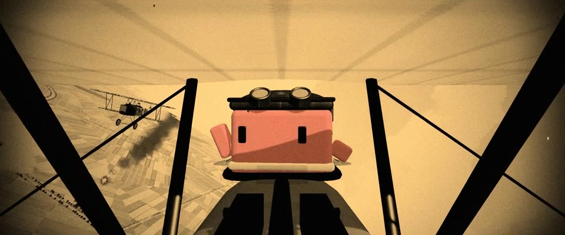

# 默片 3D 空战 · 正色片黑白 + 琥珀染色 · Silent-era 3D Dogfight, Tinted Ortho B&W

> 原文：lemo-opuscar `styleboard/opuscar98_styles.json` 第 1 条（OPUSCAR 98 纪念片里《翼》Wings（1927/28）那一段的风格；LemoLab，MIT，commit `f171360`），2026-10-31 收入本仓库作参考（不在风格库里，片子不能选它当风格），未改动。
> 这是约 5 秒片段的风格，没有完整的十一节说明，所以不进风格库。用法：当视觉语言的参考——某一段画面想要这种质感时，借它的提示词写进决策单，声音、镜头、坑由模型自己补。

**渲染**：3D（3D·B&W）　**手法组合**：three.js 三维 · 正色片黑白 · 默片染色 · 放映磨损和圆形光圈（three.js 3D · Orthochromatic black and white · Silent-film tinting · Projector wear and iris）

## 风格提示词（中文原文）

平滑着色的 3D 按默片正色片拷贝调色：高反差，红色发黑。天空近白，地面留清楚的中灰层次，深黑占画面 25%–35%，只在剪影里。染色：白位向琥珀 #FFCC80 混一半，天空是淡奶油琥珀，不要整片橙；黑位不变。只有故事围绕的那个主角留色，整个人都留，饱和度约七成（如 #D97757）；灯火和其他光源一律是灰的。叠 24 fps 片门抖动（±1 像素）、闪烁（±5%）、细颗粒（±4%）、一到三条细划痕、稀疏灰尘，片门圆角加柔和暗角，第一镜 1 秒圆形光圈打开。招牌镜头：机位绑在跟主角一起动的东西上，露出一截支架，轻微震动；再接跟拍和主观镜头。每 2–3 秒一切，穿过云、烟或强光白场转场。对标 William Wellman《翼》（1927）。避免：运动模糊、灰阶里有颜色。

## Style prompt (English original)

Smooth-shaded 3D graded as a silent-era orthochromatic print: high contrast, reds go black. Sky near-white, ground in readable mid-greys, deep blacks (25-35% of frame) only in silhouettes. Tint: blend whites half-way toward amber #FFCC80, so the sky is pale cream-amber, never solid orange; blacks stay black. Only the hero the story centres on keeps colour, whole figure at ~70% saturation (e.g. #D97757); every lamp, fire or other light source stays grey. 24 fps gate weave (±1 px), flicker (±5%), fine grain (±4%), 1-3 thin scratches, sparse dust, rounded corners, vignette; open on a 1 s iris. Signature shot: a camera rigged to something moving with the subject, rig in frame; then chase and POV. Cut every 2-3 s; white out through cloud, smoke or glare. Reference: William Wellman, *Wings* (1927). Avoid: motion blur, colour in the greys.

## 这个风格是什么（上游说明）

用 three.js 搭的一战空战，按 1927 年正色片拷贝调色：天空发白、黑位很深、整体琥珀染色、片门抖动和划痕。《翼》最出名的是把摄影机绑在飞机上拍的空战，所以这里大部分机位都装在飞机上。

A three.js dogfight graded like a 1927 orthochromatic print: white skies, deep blacks, an amber tint, gate weave and scratches. Wings is remembered for aerial combat shot from cameras strapped to the planes, so most cameras here ride on the planes.

## 上游示范用法（只是一个例子，不要照搬故事和镜头）

Clawd 扮美军飞行员：皮飞行帽、护目镜、白围巾，坐在 SPAD 座舱里。开场序幕接到第一镜，第 1 拍光圈打开；之后五刀硬切，大约两拍一切。第 5 拍前后它回头、机枪开火；最后穿云白场，接上第 2 部开头的奶油白。

| 机位 | 镜头 | Shot |
|---|---|---|
| open | 机头正前方对着座舱：Clawd 戴皮飞行帽、护目镜推在额头，夹在两根支柱中间；圆形光圈打开，镜头缓缓推近。 | Head-on over the cowling: Clawd in a leather cap with goggles pushed up sits between the struts; the iris opens and the camera pushes in slowly. |
| dogfight | 大全景：机群在云间盘旋，下面是格子田和白垩战壕，一架福克拖着黑烟；镜头缓缓推近。 | Wide aerial: the planes circle among the clouds above patchwork fields and chalk trenches, one Fokker trailing black smoke; a slow push in. |
| cockpit | 机头机位带发动机震动：Clawd 回头看咬尾的福克，抬起一只手，双挺维克斯机枪开火闪光。 | Cowling camera with engine shake: Clawd looks back at the Fokker on its tail and raises an arm as the twin Vickers flash. |
| enemy | 从福克上翼看出去，敌机机枪开火，追着前方 Clawd 的 SPAD；机位固定在敌机上。 | From the Fokker's upper wing, its guns firing, chasing Clawd's SPAD ahead; the camera rides fixed to the enemy plane. |
| dive | 过 Clawd 肩头的俯冲镜头：前面是上翼和张线，弹坑和折线战壕迎面扑来。 | Over Clawd's shoulder as the SPAD dives: the upper wing and wires in front, shell craters and zig-zag trenches rushing up. |
| clouds | 云团里的 SPAD 像幽灵一样朝镜头飞来，雾越来越浓，画面白到奶油色。 | The SPAD, ghostly in the cloud bank, flies at the camera; the fog thickens until the frame whites out to cream. |

参考：William A. Wellman, 1927；Harry Perry (aerial photography)；Tinted silent-era release prints；RFC aerial photographs of the Somme, 1916–18

