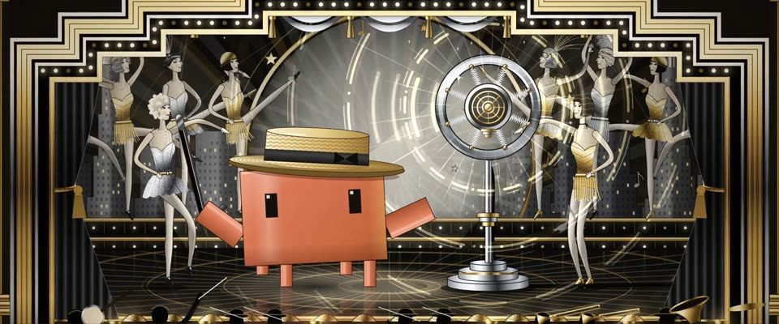

# 黑金银装饰艺术歌舞海报 · Black-Gold Art Deco Revue Poster

> 原文：lemo-opuscar `styleboard/opuscar98_styles.json` 第 2 条（OPUSCAR 98 纪念片里《百老汇旋律》The Broadway Melody（1928/29）那一段的风格；LemoLab，MIT，commit `413a6bd`），2026-10-27 收入本仓库作参考（不在风格库里，片子不能选它当风格），未改动。
> 这是约 5 秒片段的风格，没有完整的十一节说明，所以不进风格库。用法：当视觉语言的参考——某一段画面想要这种质感时，借它的提示词写进决策单，声音、镜头、坑由模型自己补。

**渲染**：2D（2D）　**手法组合**：装饰艺术海报 · 喷枪金属渐变 · A. M. Cassandre · Erté 服装（Art Deco poster · Airbrush metallic gradients · A. M. Cassandre · Erté costume）

## 风格提示词（中文原文）

装饰艺术歌舞海报。黑漆底；金和银都用分带金属渐变做（每个面 3–5 条硬分界），喷枪光晕、放射线、阶梯形、流线型，场景外圈套一道层层退进的金线台口框，嵌一排灯泡。色板按用途：底 #0A0908，金 #D6B560，高光 #F3E2A2，银 #BFC4C9；皮肤用淡银奶油色；只有故事围绕的那个主角用一个饱和强调色（如 #D97757）。人物是 Erté 式修长造型，有五官表情，题材允许时加流苏、亮片或羽毛。细颗粒、闪光点、星星。正面对称，中间一束追光。动起来：灯泡流动，一排重复元素（舞者、浪头）向中心卷成波浪，主要声源或光源放射环纹；镜头慢推，踩音乐的拍子切，无乐每 2–3 秒一切。对标 A. M. Cassandre 的海报、Erté 的服装设计。避免：平涂黄色冒充金属、人物没脸、多余的颜色。

## Style prompt (English original)

Art Deco revue poster. Black lacquer ground; gold and silver from banded metallic gradients (3-5 hard bands); airbrush glows, sunbursts, ziggurat steps, streamlined curves; a stepped proscenium frame of gold lines and bulbs. Palette: ground #0A0908, gold #D6B560, highlight #F3E2A2, silver #BFC4C9; skin pale silver-cream; one saturated accent (e.g. #D97757) only on the hero the story centres on. Elongated Erté-style figures with real faces; fringe, sequins or feathers where the subject allows. Fine grain, glints, stars. Frontal symmetry, a central spotlight. Motion: chasing bulbs, a row of repeated elements (dancers, waves, columns) rippling toward the centre, rings radiating from the main sound or light source; slow pushes, cut on the music's beat (without music, every 2-3 s). References: A. M. Cassandre's posters, Erté's costumes. Avoid: flat yellow for metal, faceless figures, extra hues.

## 这个风格是什么（上游说明）

会动的黑金银装饰艺术歌舞海报：喷枪渐变、阶梯形台口、镀铬电容麦克风。1929 年的百老汇正是装饰艺术盛期，这部又是有声片降临的一部，所以让声波从麦克风里一圈圈放出来。

An Art Deco revue poster in black, gold and silver: airbrushed gradients, a stepped proscenium, a chrome condenser mic. It is 1929 Broadway at the height of Deco, and the film where sound arrives, so rings of sound pour out of the mic.

## 上游示范用法（只是一个例子，不要照搬故事和镜头）

Clawd 是戴硬草帽、拿黑手杖的踢踏舞者，从头踢踏到尾。开头从第 1 部的白场里淡入；第 4 拍麦克风活过来，声波涌出（有声片来了）。四刀硬切：街口 → 舞台 → 麦克风 → 歌舞队 → Clawd。

| 机位 | 镜头 | Shot |
|---|---|---|
| marquee | 从白场里淡入：Astor 剧院的雨棚招牌（THE BROADWAY MELODY / ALL TALKING · ALL SINGING · ALL DANCING），灯泡流动；Clawd 戴硬草帽、拿手杖站在左边；镜头缓缓拉远。 | Out of the white: the Astor Theatre marquee, 'THE BROADWAY MELODY / ALL TALKING · ALL SINGING · ALL DANCING', bulbs chasing; Clawd with boater and cane at left; a slow pull back. |
| still | 舞台全景：装饰艺术台口、台阶上的歌舞女郎，Clawd 在巨大的电容麦克风旁踢踏，麦克风开始一圈圈放出声波；镜头缓缓拉远。 | The whole stage: Deco proscenium, chorus girls on the risers, Clawd tapping beside the giant condenser mic as it starts pouring out sound rings; a slow pull back. |
| mic | 镀铬弹簧环麦克风特写，声波放射、音符飞出；镜头推近。 | Close on the chrome spring-ring mic, rings radiating and notes flying; a push in. |
| line | 沿着踢腿队列横移：羽毛头饰、亮片短裙，腿一排排踢成波浪。 | Truck along the kick line: feathered headdresses, sequins, legs kicking in a wave. |
| close | Clawd 近景，踢踏中草帽一歪一歪，身后是麦克风环；轻推。 | Clawd in close-up, tapping, the boater tilting, the mic ring behind; a slight push in. |

参考：Harry Beaumont, 1929；1929 MGM one-sheet；A. M. Cassandre；Erté

