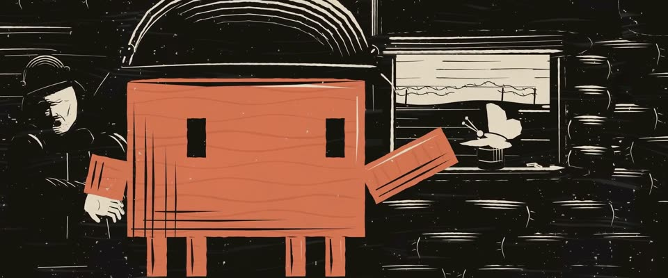

# 珂勒惠支式反战木刻 · Kollwitz Anti-war Woodcut

> 原文：lemo-opuscar `styleboard/opuscar98_styles.json` 第 3 条（OPUSCAR 98 纪念片里《西线无战事》All Quiet on the Western Front（1929/30）那一段的风格；LemoLab，MIT，commit `413a6bd`），2026-10-27 收入本仓库作参考（不在风格库里，片子不能选它当风格），未改动。
> 这是约 5 秒片段的风格，没有完整的十一节说明，所以不进风格库。用法：当视觉语言的参考——某一段画面想要这种质感时，借它的提示词写进决策单，声音、镜头、坑由模型自己补。

**渲染**：2D（2D·B&W）　**手法组合**：木刻版画 · 凯绥·珂勒惠支 · 德国表现主义 · 双版套印（Woodcut · Käthe Kollwitz · German Expressionism · Two-block colour print）

## 风格提示词（中文原文）

仿凯绥·珂勒惠支《战争》组画（1921–22）的表现主义木刻。画面六到七成是实黑；形体之间用白色轮廓刀分开，刀宽为画幅宽的 1/300–1/150；人脸刻成白形，只留几笔黑五官；手要大。人物占满画面，被画框裁切。每刀都有尖的进刀收刀和碎木边，离光越近的刀越宽，刀痕成组排、节奏略不均。墨色 #17130F 印在 #E8DFCA 纸上；纹理只有木纹条和缺墨斑点（±5%）。只有故事围绕的那个主角套一块色版（如 #D97757），平铺在身体或衣服上，刀痕照样压在上面，黑仍占六成以上。光只从一个开口进来（窗、云缝）；灯只刻一小圈短刀痕。人物脚下的地面留不刻的黑。动作安静（呼吸、一个小手势）；慢摇、慢推。避免：灰雾灰调、排刀规整成条纹、血腥。

## Style prompt (English original)

Expressionist woodcut after Käthe Kollwitz, *Krieg* (1921-22). 60-70% solid black; white contour cuts 1/300-1/150 of frame width separate forms; faces are white shapes with a few black features; hands large. Figures fill the frame, cropped by its edges. Each cut tapers in and out with chipped edges, is wider the nearer it sits to the light, in slightly uneven bundles. Ink #17130F on paper #E8DFCA; texture is only wood-grain streaks and under-inked speckle (±5%). One colour block (e.g. #D97757) only on the hero the story centres on, flat on its body or clothes, cuts over it; black stays 60%+. Light enters through one opening (window, cloud gap); lamps get a short ring of cuts. The ground under figures stays uncut black. Quiet motion (breathing, a small gesture); slow pans and push-ins. Avoid: grey fog or midtones, even striped hatching, gore.

## 这个风格是什么（上游说明）

珂勒惠支式木刻：大块的黑、刀刻的白轮廓、粗糙木纹，Clawd 用单独一块橙色版套印。珂勒惠支 1921–22 年的反战版画，和这部片出自同一场战争、同一种悲痛。

A woodcut after Käthe Kollwitz: big masses of black, white knife-cut contours, rough grain, with Clawd printed from its own orange block. Kollwitz's German anti-war prints of 1921–22 come from the same war and the same grief as the film.

## 上游示范用法（只是一个例子，不要照搬故事和镜头）

Clawd 扮保罗，戴德军钢盔。整段放慢（1.2 倍）、压得很静：第 3 拍前后开始伸手，用三拍慢慢伸到底；幻影士兵只在最后一镜出现。四刀硬切：战壕里的脸 → 保罗的手臂 → 蝴蝶 → 十字架墓地。

| 机位 | 镜头 | Shot |
|---|---|---|
| faces | 沿战壕横摇，扫过刻出来的脸：一个双手捂脸，一个惊恐地看着，一个睡着了。 | Pan along the trench past carved faces: one soldier with his face in his hands, one staring in fear, one asleep. |
| poster | 钢盔下一张直视镜头的脸（致敬 1930 年原海报）；慢推。 | Tight on a soldier's face under the steel helmet, staring straight out (a nod to the 1930 poster); a slow push in. |
| clawd | 中景：Clawd 戴德军钢盔站在射击台上，慢慢把手臂伸向射击孔，孔沿铁罐上停着一只白蝴蝶；镜头推近。 | Medium: Clawd in a Stahlhelm on the firing step slowly reaches toward the loophole, where a white butterfly sits on a tin; a push in. |
| butterfly | 射击孔边白蝴蝶特写，Clawd 的橙色手臂从左边伸进来；推近。 | Close on the white butterfly at the loophole, Clawd's orange arm entering from the left; a push in. |
| field | 大全景：照明弹下的无人地带和白十字架墓地，幻影士兵的队列淡入、往远处走去；缓缓拉远。 | Wide over no-man's land to a cemetery of white crosses under a flare; a ghost column fades in, walking away; a slow pull back. |

参考：Lewis Milestone, 1930；Käthe Kollwitz, Krieg (1921–22)；1930 Universal poster

