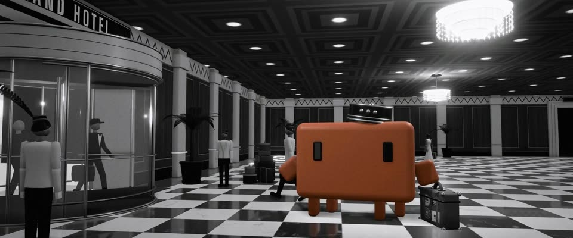

# 米高梅银色黑白 3D 大堂 · MGM Silver B&W 3D Lobby

> 原文：lemo-opuscar `styleboard/opuscar98_styles.json` 第 5 条（OPUSCAR 98 纪念片里《大饭店》Grand Hotel（1931/32）那一段的风格；LemoLab，MIT，commit `413a6bd`），2026-10-27 收入本仓库作参考（不在风格库里，片子不能选它当风格），未改动。
> 这是约 5 秒片段的风格，没有完整的十一节说明，所以不进风格库。用法：当视觉语言的参考——某一段画面想要这种质感时，借它的提示词写进决策单，声音、镜头、坑由模型自己补。

**渲染**：3D（3D·B&W）　**手法组合**：three.js 三维 · 米高梅银色黑白 · 装饰艺术室内 · 俯拍同心构图（three.js 3D · MGM silver-screen black and white · Art Deco interiors · Overhead symmetry）

## 风格提示词（中文原文）

真 3D 场景，默认装饰艺术风大堂（大理石、镀铬、吊灯、亮面棋盘格地面）；室外保留真实场景，表面做出光泽（湿路面、静水），构图对称。环境光遮蔽加柔和辉光，调成 30 年代片厂银色黑白：约四成画面深黑，白位亮度约九成，不发灰。光从一个高处光源成束落下。只有故事围绕的那个主角留色（如 #D97757），至少占画面高度六分之一；暖灯渲染成白光，辉光只在灯旁。颗粒（±3%），灯旁光晕。招牌镜头：平视大全景，望进对称纵深，地面和天花同时入画，地面有倒影；再接 4–6 秒的侧向跟拍；俯拍同心圆、人像棋子只用一次。年代人物有头、帽、四肢，按路线走。对标美术指导 Cedric Gibbons、摄影师 William Daniels。避免：原地踏步、抽象图案铺满画面、偏色。

## Style prompt (English original)

A real 3D set, by default an Art Deco interior (marble, chrome, chandelier, glossy checkerboard floor); outdoors keep the real setting with glossy surfaces (wet pavement, still water) and symmetrical framing. Ambient occlusion, soft bloom; 1930s studio silver: about 40% deep black, glossy whites near 90%, no washed-out greys. Light falls in shafts from one high source. All neutral grey except the hero the story centres on (e.g. #D97757), at least 1/6 of frame height; warm lamps render white, bloom only around them. Grain (±3%), halation. Signature shot: eye-height wide into a deep symmetrical set, floor and ceiling in frame, floor reflections; then 4-6 s tracks; one overhead on rings, figures as chess pieces. Period figures (heads, hats, limbs) walk routes. References: art director Cedric Gibbons, cinematographer William Daniels. Avoid: walking in place, frame-filling abstract patterns, colour casts.

## 这个风格是什么（上游说明）

用 three.js 建的圆形大堂，按米高梅的银色黑白调色，Clawd 的橙是唯一的颜色。这部片最出名的是从顶上笔直往下拍、回廊一圈圈收进去的镜头，整个布景就按这一镜来建。

A three.js model of the circular lobby, graded in MGM's silver black and white with Clawd's orange as the only colour. The film's best-known image is the shot straight down the well, galleries closing in rings, so the set is built around it.

## 上游示范用法（只是一个例子，不要照搬故事和镜头）

Clawd 扮门童，戴圆筒小帽，拎一只贴满旅馆标签的皮箱。它是真的在走：每秒 1.4 米、2.4 步，步子和位移对得上。整段 1:1 播放，1.08 秒处从俯拍一刀切到侧面跟拍。

| 机位 | 镜头 | Shot |
|---|---|---|
| overhead | 从天窗下笔直往下看：六层回廊一圈圈收向钥匙塔，橙色门童是棋盘格大理石上唯一的一个点，正走过地面；镜头慢慢推近。 | Straight down the six-gallery light well, the rings closing toward the key tower; the orange bellboy is a single dot crossing the checkerboard marble; a slow push in as the lens narrows. |
| follow | 贴着 Clawd 身高的侧面跟拍：它拎着皮箱往前走，大堂从身后滑过，前方旋转门在转；镜头边跟边往前、往里靠。 | Side tracking shot at Clawd's height: it walks with its suitcase, the lobby sliding past, the revolving door turning ahead; the camera eases forward and in. |

参考：Edmund Goulding, 1932；Cedric Gibbons (art direction)；William Daniels (cinematography)

