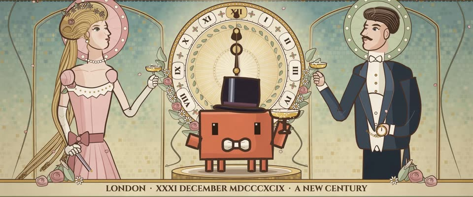

# 慕夏新艺术装饰画 · Mucha Art Nouveau Panel

> 原文：lemo-opuscar `styleboard/opuscar98_styles.json` 第 6 条（OPUSCAR 98 纪念片里《乱世春秋》Cavalcade（1932/33）那一段的风格；LemoLab，MIT，commit `413a6bd`），2026-10-27 收入本仓库作参考（不在风格库里，片子不能选它当风格），未改动。
> 这是约 5 秒片段的风格，没有完整的十一节说明，所以不进风格库。用法：当视觉语言的参考——某一段画面想要这种质感时，借它的提示词写进决策单，声音、镜头、坑由模型自己补。

**渲染**：2D（2D）　**手法组合**：阿尔丰斯·慕夏 · 彩色石印 · 新艺术装饰纹样（Alphonse Mucha · Colour lithograph · Art Nouveau ornament）

## 风格提示词（中文原文）

慕夏式彩色石印。褐色 #4B3326 轮廓线，宽约画幅宽 1/250，背光侧（光默认从左上来）加粗到两倍，两端收尖；粉彩平涂，每块在背光侧叠一层深一档的硬边色。色板：奶油 #F5ECD6 作纸和天空，鼠尾草绿 #A9B490 作植物衣褶，淡金 #CFA55A 作光环装饰，玫瑰 #DBA49C 作皮肤和花；故事围绕的那个主角用一个更浓的强调色（如 #D97757）。横幅：人物和细环纹大光环居中三分之一，两侧拱格，后面铺灰青（鼠尾草绿掺灰）方块马赛克；鞭线藤蔓和花草；底部一条衬线大写铭文，用用户语言，字高约画面 1/25。留白不超过画面八分之一。杏仁眼、厚眼睑；头发或衣料三色成束。石版颗粒、纸斑、暗角。慢摆；下摇到光环再拉远。避免：干净细线、饱和色、空荡背景。

## Style prompt (English original)

Alphonse Mucha colour lithograph. Brown contours #4B3326, about 1/250 of frame width, doubling on the shadow side (light from upper left), tapered ends; pastel flats, each with a hard-edged darker shadow tone. Palette: cream #F5ECD6 paper/sky, sage #A9B490 foliage/drapery, pale gold #CFA55A halo/ornament, rose #DBA49C skin/flowers; the hero the story centres on in one stronger accent (e.g. #D97757). Wide frame: figure and a big ring-filled halo in the middle third, arched panels either side, behind them a muted-teal (sage plus grey) square-tile mosaic; whiplash vines, local flowers; a bottom band of serif capitals in the user's language, 1/25 of frame height. No plain area over 1/8 of frame. Almond eyes, heavy lids; hair or cloth in three-tone strands. Litho grain, paper mottle, vignette. Slow sway; tilt down to the halo, pull back. Avoid: thin clean lines, saturated colour, empty backgrounds.

## 这个风格是什么（上游说明）

慕夏式新艺术装饰画：膨胀的褐色轮廓线、粉彩平涂、马赛克底，中心人物身后一个光环。电影开场就是 1899 年跨年夜一家人举杯迎接新世纪，所以光环做成敲十二点的钟面。

A Mucha-style Art Nouveau panel: swelling brown outlines, pastel flats, a mosaic ground and a halo behind the central figure. Cavalcade opens on New Year's Eve 1899 with a family toasting the new century, so the halo is a clock striking twelve.

## 上游示范用法（只是一个例子，不要照搬故事和镜头）

Clawd 是举杯的马里奥特家一员：丝质高礼帽、白领结、手持香槟碟。第 3 拍钟敲十二点、光环一闪，紧接着切到举杯，Clawd 一跳把杯子举起来。1:1 播放，两刀硬切，最后一个拉远停在整张海报上。

| 机位 | 镜头 | Shot |
|---|---|---|
| clock | 从 CAVALCADE 标题和奔马横饰带往下摇到钟面光环并推近；指针合到 XII，敲钟那一下光环一闪。 | Tilt down from the CAVALCADE title and the galloping-horse frieze onto the clock halo, pushing in; the hands close on XII and the halo flares on the stroke. |
| toast | 举杯中景：戴高礼帽、白领结的 Clawd 一跳，举起香槟碟，两侧的简和罗伯特也举杯；轻拉。 | Medium on the toast: Clawd in a top hat and white bow tie springs up and raises its coupe while Jane and Robert raise theirs from either side; a slight pull back. |
| still | 拉远到整幅慕夏装饰画：三只杯子举着，玫瑰花瓣飘落，底部是 LONDON · XXXI DECEMBER MDCCCXCIX · A NEW CENTURY 铭文带。 | Pull back to the whole Mucha panel: glasses raised, rose petals falling, the band 'LONDON · XXXI DECEMBER MDCCCXCIX · A NEW CENTURY' at the foot. |

参考：Frank Lloyd, 1933；Alphonse Mucha, The Seasons (1896)；Alphonse Mucha, Zodiac (1896)；Fox 1933 poster (the galloping horses)

