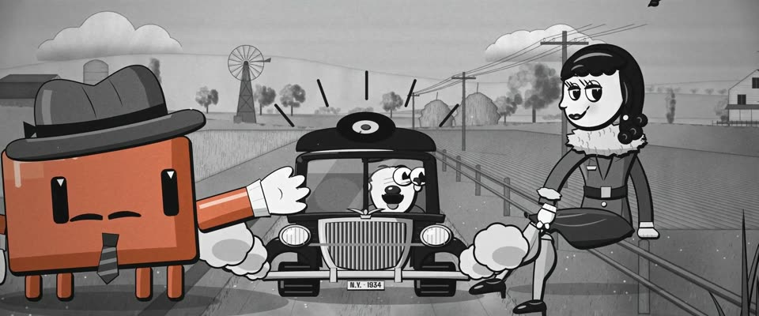

# 30 年代黑白橡皮管卡通 · 1930s B&W Rubber-hose Cartoon

> 原文：lemo-opuscar `styleboard/opuscar98_styles.json` 第 7 条（OPUSCAR 98 纪念片里《一夜风流》It Happened One Night（1934）那一段的风格；LemoLab，MIT，commit `f171360`），2026-10-31 收入本仓库作参考（不在风格库里，片子不能选它当风格），未改动。
> 这是约 5 秒片段的风格，没有完整的十一节说明，所以不进风格库。用法：当视觉语言的参考——某一段画面想要这种质感时，借它的提示词写进决策单，声音、镜头、坑由模型自己补。

**渲染**：2D（2D·B&W）　**手法组合**：弗莱舍橡皮管 · 赛璐璐上色 · 糊涂交响曲水彩背景 · 放映胶片磨损（Fleischer rubber hose · Cel painting · Silly Symphonies watercolour backgrounds · Projected film wear）

## 风格提示词（中文原文）

30 年代初的黑白橡皮管卡通。角色：软管四肢、白手套、饼切眼、圆脑袋，三到四头身；墨线 #141414 粗细变化（画幅宽 1/400–1/150），背光一侧变粗（默认光从左上）；角色平涂只用纯黑、纯白，加至多一种浅灰作硬阴影，黑面一道高光。背景只用中间灰（明度 30%–80%），不用纯黑白：铅笔线不擦，灰色水彩罩染，边缘积水有颗粒沉淀。只有故事围绕的那个主角带颜色（如 #D97757）：整个身体，主角是人时只给关键道具。加 ±1 像素片门抖动、24 fps 颗粒（±4%）、闪烁、划痕、灰尘。动作都有预备、冲过头再回落：落地压扁、快动拉长、吃惊时弹眼，碰撞时镜头轻震。对标弗莱舍工作室的 Betty Boop 短片、迪士尼《糊涂交响曲》的背景。避免：光滑矢量线、角色发灰和背景糊在一起。

## Style prompt (English original)

Early-1930s black-and-white rubber-hose cartoon. Characters: noodle limbs, white gloves, pie-cut eyes, round heads; thick-thin ink #141414 (1/400-1/150 of frame width) swelling away from the light (default upper left); fills pure black and white plus at most one light grey for the hard shadow, gloss on blacks. Backgrounds stay mid-grey (30-80%), never pure black/white: graphite lines left in, grey watercolour washes with pooled edges and granulation, paper grain. Only the hero the story centres on has colour (e.g. #D97757): its whole body, or its one key prop if the hero is human. ±1 px gate weave, grain (±4%), flicker, scratches, dust. Actions anticipate, overshoot, settle: squash on landing, stretch on fast moves, eyes pop when surprised, a camera jolt on hits. References: Fleischer's Betty Boop shorts; Disney's Silly Symphonies backgrounds. Avoid: smooth vector lines, grey characters merging with the background.

## 这个风格是什么（上游说明）

1934 年的黑白橡皮管卡通：粗细变化的墨线、饼切眼、白手套，赛璐璐平涂叠在灰阶水彩背景上，带胶片颗粒。和电影同一年，公路喜剧的笑点也适合卡通的节奏。

A 1934 black-and-white rubber-hose cartoon: thick-thin ink, pie-cut eyes, white gloves, cel shading over grey watercolour backgrounds, with film grain. It is the film's own year, and a road comedy gag suits cartoon timing.

## 上游示范用法（只是一个例子，不要照搬故事和镜头）

Clawd 扮彼得：灰色软呢帽、松开的条纹领带、一撇小胡子，手臂末端戴白手套。第 3–4 拍艾莉撩裙子，第 5 拍车急刹停下（只有这一下放回 1 倍速），Clawd 的目瞪口呆正好卡在这一下。两刀硬切：拇指 → 双人 → 收尾。

| 机位 | 镜头 | Shot |
|---|---|---|
| thumb | Clawd 竖起的白手套大拇指和得意的脸，身后是空路，一辆车从坡顶开过来；慢推。 | Close on Clawd's gloved thumb and smug face, the empty road behind, a car coming over the rise; a slow push in. |
| two | 双人镜头：Clawd 在路边竖拇指，艾莉坐在栅栏上把裙摆撩到小腿；轻拉。 | Two-shot: Clawd thumbing on the verge, Ellie on the fence rail hitching her skirt up to the calf; a slight pull back. |
| road | 收尾全景：车在两人中间急刹，司机眼珠弹出来；Clawd 瞪大眼、张开双手，帽子跳起；急停那一下镜头一震。 | The payoff, wide: the car skids to a stop between them, the driver's eyes popping out; Clawd's eyes go wide, gloves open, hat jumping; the camera jolts on the stop. |

参考：Frank Capra, 1934；Fleischer Studios, Betty Boop (1932–34)；Disney, Silly Symphonies backgrounds；1934 Columbia one-sheet

