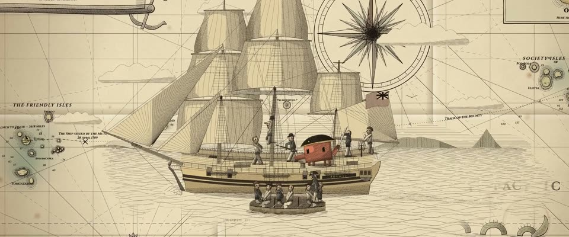

# 海军部海图铜版画 · Admiralty Sea Chart Copperplate

> 原文：lemo-opuscar `styleboard/opuscar98_styles.json` 第 8 条（OPUSCAR 98 纪念片里《叛舰喋血记》Mutiny on the Bounty（1935）那一段的风格；LemoLab，MIT，commit `f171360`），2026-10-31 收入本仓库作参考（不在风格库里，片子不能选它当风格），未改动。
> 这是约 5 秒片段的风格，没有完整的十一节说明，所以不进风格库。用法：当视觉语言的参考——某一段画面想要这种质感时，借它的提示词写进决策单，声音、镜头、坑由模型自己补。

**渲染**：2D（2D）　**手法组合**：18 世纪海军部海图 · 铜版线刻 · 手工淡彩 · Robert Dodd 的版画（18th-century Admiralty chart · Copperplate engraving · Thin hand colouring · Robert Dodd's aquatint）

## 风格提示词（中文原文）

18 世纪末的铜版地图，默认是英国海军部海图（内陆题材换成测绘图）。明暗全靠刻刀细排线和交叉排线，线宽约画幅宽的 1/1200；线宽设下限，细小处变暗而不是消失。墨色 #1C1610 印在 #EFE3C4 直纹纸上，带淡霉斑和折痕。只上很薄的手工淡彩：沿水边的海蓝 #9EBCBC，陆地 #B8C08C；故事围绕的那个主角（如 #D97757）是唯一的浓色。32 向罗盘玫瑰拉出恒向线网、刻度边框、晕滃山形、装饰图名框、一个装饰物（如海怪）、衬线字。情节放进一幅不加边框的排线插画，排线向纸面渐隐；推到底时插画占画面高度 60%–75%。运镜：一个 5–6 秒的镜头从整张图滑进插画，四周留着地图；一条虚线路线自己画出来。避免：切出纸面、浓重水彩、僵硬的人物。

## Style prompt (English original)

A late-18th-century copperplate map, default an Admiralty sea chart (inland: a survey map). Fine burin hatching and cross-hatching (lines ~1/1200 of frame width) give all tone; a minimum line width makes small detail darken, not vanish. Ink #1C1610 on laid paper #EFE3C4, light foxing, folds. Thin hand colour: water #9EBCBC along edges, land #B8C08C; the hero the story centres on (e.g. #D97757) is the one strong colour. Rhumb lines from 32-point roses, a graduated border, hachured hills, cartouche, one ornament (e.g. a sea monster), serif lettering. Put the action in an unboxed engraved vignette fading into the chart, filling 60-75% of frame height at the end of the move. Camera: one 5-6 s glide from the whole sheet into the vignette, chart still around it; a dotted route inks itself in. Avoid: cropping the paper, heavy washes, stiff figures.

## 这个风格是什么（上游说明）

18 世纪英国海军部海图的铜版画：恒向线、罗盘玫瑰、水深数字、手工淡彩，邦蒂号是图上的一幅船舶插画。这部片讲的是一次航行，所以整段都留在海图上。

An 18th-century Admiralty sea chart engraved in copperplate, with rhumb lines, compass roses, soundings and thin hand colour; the Bounty is a ship vignette on the sheet. The film is a voyage, so the whole film stays on the chart.

## 上游示范用法（只是一个例子，不要照搬故事和镜头）

Clawd 扮弗莱彻·克里斯蒂安：横戴双角帽、手持弯刀。整段不离开海图，一个镜头滑进去，不切。第 4 拍举刀，紧接着刀锋一闪指向小艇；最后几拍小艇往船尾漂开。

| 机位 | 镜头 | Shot |
|---|---|---|
| chart | 一镜到底：从整张海图开始，邦蒂号沿虚线航迹前进，镜头滑进图上的船舶插画，四周仍是恒向线和罗盘玫瑰；甲板上 Clawd 举起弯刀、指着布莱让他下船，小艇落到船尾，驶向帝汶的航迹在图上一路画出来。 | One continuous move: from the whole chart, with the Bounty sailing her dotted track, the camera glides in to the ship vignette, rhumb lines and roses still around it; on deck Clawd swings the cutlass up and points Bligh away as the launch falls astern and its track to Timor inks itself across the sheet. |

参考：Frank Lloyd, 1935；Robert Dodd, The Mutineers turning Lieut. Bligh… adrift (1790)；British Admiralty and Cook-voyage charts, 1770s–80s；Thomas Rowlandson

