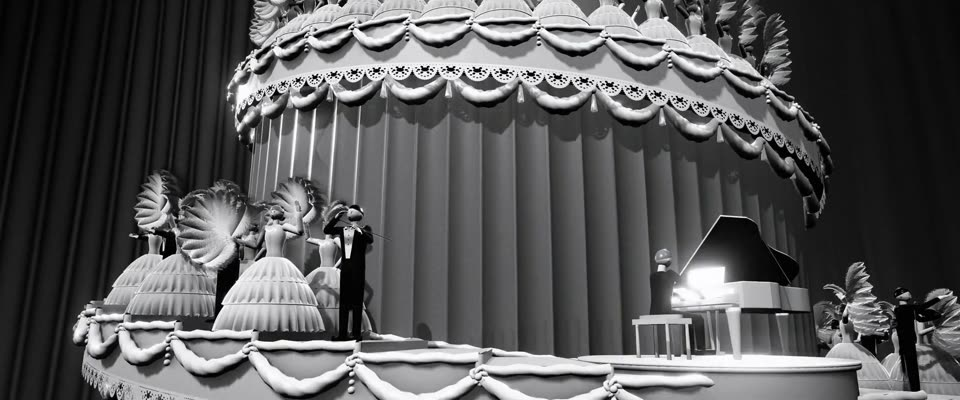

# 银色黑白 3D 螺旋婚礼蛋糕舞台 · Silver B&W 3D Wedding-cake Stage

> 原文：lemo-opuscar `styleboard/opuscar98_styles.json` 第 9 条（OPUSCAR 98 纪念片里《歌舞大王齐格飞》The Great Ziegfeld（1936）那一段的风格；LemoLab，MIT，commit `f171360`），2026-10-31 收入本仓库作参考（不在风格库里，片子不能选它当风格），未改动。
> 这是约 5 秒片段的风格，没有完整的十一节说明，所以不进风格库。用法：当视觉语言的参考——某一段画面想要这种质感时，借它的提示词写进决策单，声音、镜头、坑由模型自己补。

**渲染**：3D（3D·B&W）　**手法组合**：three.js 三维 · 米高梅银色黑白 · 1936 年歌舞大场面 · 鸵鸟羽毛与雪纺（three.js 3D · MGM silver black and white · 1936 revue spectacle · Ostrich feathers and chiffon）

## 风格提示词（中文原文）

真 3D 舞台大场面，调成 30 年代片厂银色黑白：把题材的世界搭成圆形分层转台上的歌舞布景，慢慢转（每秒约 3 度），挂满垂幔花环；题材里的人变成一排排穿戏服、有脸有手的合唱队。灰阶：戏服浅缎灰，布景中灰，褶皱大幕更深，剧场深黑；白色不到纯白。正面柔和主光，轮廓光更亮，把缎子和羽毛的边勾到近白。淡光柱，颗粒（±3%）。只有故事围绕的那个主角留色（如 #D97757），灯都渲染成白光。招牌镜头：贴低的中景沿层台看过去，人物占画面高度四分之一到三分之一，主角在前排。再接帷幕升起（3 秒）、10 秒吊臂上升，落到平视主角的中景。对标 Robert Z. Leonard《歌舞大王齐格飞》（1936）。避免：平均打光、没脸的锥形人、转得太快。

## Style prompt (English original)

Real 3D stage spectacle in 1930s studio silver: the subject's world built as a revue set on a round tiered platform turning about 3° per second, draped and garlanded; its people become rows of costumed chorus figures with faces and arms. Costumes light satin grey, set mid-grey, pleated curtain backdrop darker, theatre deep black; whites below pure white. Soft front key; brighter rim lights edging satin and feathers near-white. Faint shafts, grain (±3%). All neutral grey except the hero the story centres on (e.g. #D97757); lamps render white. Signature shot: low medium along the tiers, figures 1/4-1/3 of frame height, the hero on the front tier. Then a 3 s curtain rise, a 10 s crane up to a level medium of the hero. Reference: Robert Z. Leonard, *The Great Ziegfeld* (1936). Avoid: flat lighting, faceless cones, fast spinning.

## 这个风格是什么（上游说明）

用 three.js 建的旋转螺旋“婚礼蛋糕”舞台，米高梅银色黑白：缎面、雪纺和鸵鸟羽毛衬在深黑里，只有 Clawd 是颜色。《A Pretty Girl Is Like a Melody》那座 175 级的螺旋舞台是这部片的名场面。

A three.js model of the revolving spiral 'wedding cake' stage in MGM's silver black and white: satin, chiffon and ostrich feathers against deep black, Clawd the only colour. The 175-step spiral of 'A Pretty Girl Is Like a Melody' is the film's famous set piece.

## 上游示范用法（只是一个例子，不要照搬故事和镜头）

Clawd 是蛋糕顶上的明星：水钻头带上一丛鸵鸟羽毛像喷泉一样翻落。场景按 1.2 倍跑；明星留到最后一刀才露脸，第 5 拍它转身、一跳、双臂甩成 V 字。两刀硬切连起帷幕、吊臂和顶层。

| 机位 | 镜头 | Shot |
|---|---|---|
| curtain | 正面低机位：雪纺帷幕从旋转的蛋糕舞台上飞起，一层层举扇的女郎露出来，顶上是小小的 Clawd；镜头往上仰。 | Low front shot: the chiffon curtain flies up off the revolving cake, revealing tiers of fan-girls with Clawd tiny at the top; the camera tilts up. |
| rise | 沿螺旋吊臂上升，扫过羽毛扇、白色三角钢琴和小提琴手，停在顶层之下。 | Crane up the spiral past the feather fans, a white grand piano and the violinists, stopping short of the top. |
| top | 几乎平视的中景：顶上的 Clawd 戴鸵鸟羽毛头饰，转身面对镜头，双臂甩成 V 字；慢推。 | Near-level medium on Clawd at the summit in an ostrich-feather headdress: it turns to the camera and flings its arms up into a V; a slow push in. |

参考：Robert Z. Leonard, 1936；Cedric Gibbons and John Harkrider (sets and costumes)；Oliver T. Marsh, Ray June, George Folsey (cinematography)

