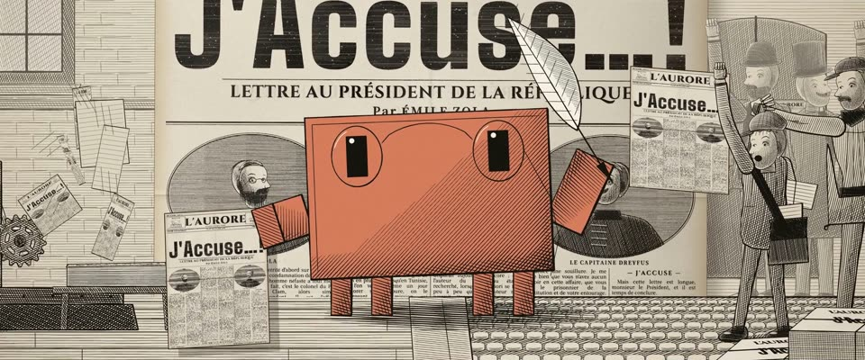

# 报纸活字印刷 + 线刻插图 · Newsprint Letterpress and Line Engraving

> 原文：lemo-opuscar `styleboard/opuscar98_styles.json` 第 10 条（OPUSCAR 98 纪念片里《左拉传》The Life of Emile Zola（1937）那一段的风格；LemoLab，MIT，commit `413a6bd`），2026-10-27 收入本仓库作参考（不在风格库里，片子不能选它当风格），未改动。
> 这是约 5 秒片段的风格，没有完整的十一节说明，所以不进风格库。用法：当视觉语言的参考——某一段画面想要这种质感时，借它的提示词写进决策单，声音、镜头、坑由模型自己补。

**渲染**：2D（2D·B&W）　**手法组合**：木活字大标题 · 新闻纸活字印刷 · 1890 年代线刻（Wood-type headline · Letterpress on newsprint · 1890s line engraving）

## 风格提示词（中文原文）

1890 年代的报纸印刷。文字先排成清晰墨版再“印”：约 1 像素模糊加噪声阈值切边，做出油墨外扩、字边毛糙、局部缺墨、淡淡的背面镜像透字。版面语法：报头、横贯全宽的木活字大标题（约画面高度 1/6）、3–6 栏小字正文（用用户的语言，字高约画面 1/80）夹着一幅大线刻插图。木活字一字一块，带木纹。所有画面都是线刻：线宽约画幅宽 1/1000、间距约 1/400，顺着形体走，交叉排线只用在暗部，背光一侧轮廓加粗，远处用淡墨。暖黑 #17130F 印在新闻纸 #E8E0CC 上；故事围绕的那个主角单独一块强调色版（如 #D97757），套印偏 1–2 像素。动起来：活字块砸下、回弹、留下印迹；一个反复的机械动作，报纸翻页。避免：干净的数码字体、平滑灰调、其他颜色。

## Style prompt (English original)

1890s newspaper print. Set text as a sharp mask, then print: ~1 px blur and a noisy threshold for ink spread, ragged edges, under-inked patches, faint mirrored show-through. Page grammar: masthead, a wood-type headline across the width (~1/6 of frame height), 3-6 columns of small type in the user's language (~1/80 of frame height) flanking one large engraved picture. Wood-type letters are grained blocks. Everything pictured is a line engraving: hatching lines about 1/1000 of frame width, spaced 1/400, following the form, cross-hatching only in darks, heavier shadow-side contours, paler distance. Warm black #17130F on newsprint #E8E0CC; the hero the story centres on gets one accent plate (e.g. #D97757), offset 1-2 px. Motion: type blocks slam down, bounce and leave their print; one repeating mechanical motion, pages turning. Avoid: clean digital type, smooth grey shading, other colours.

## 这个风格是什么（上游说明）

报纸活字印刷加 1890 年代线刻插图：木活字大标题、密排铅字正文，泛黄新闻纸上的油墨外扩和缺墨，人物用排线画。这部片最有名的画面就是 1898 年 1 月 13 日《震旦报》的《我控诉》头版。

Letterpress newsprint with 1890s line engraving: a wood-type headline, dense columns of lead type, ink spread and under-inking on yellowed paper, figures in hatching. The film's best-known image is L'Aurore's 'J'Accuse…!' front page of 13 January 1898.

## 上游示范用法（只是一个例子，不要照搬故事和镜头）

Clawd 扮左拉：夹鼻眼镜、鹅毛笔、手里拿着当天的报纸。第 2 拍最后一个字母落下，整版一震；第 3 拍它从报纸上抬头，鹅毛笔高高举起。场景按 1.05 倍跑，两刀硬切：大标题 → 左拉 → 印刷机。

| 机位 | 镜头 | Shot |
|---|---|---|
| headline | 《震旦报》头版特写（JEUDI 13 JANVIER 1898）：“J'Accuse…!”的木活字一个个砸下来，最后一个落下时整版一震；镜头推近。 | Close on the L'Aurore front page dated 13 January 1898: the wood-type letters of 'J'Accuse…!' drop in one by one and the page jolts as the last one lands; a push in. |
| clawd | 中景：扮左拉的 Clawd 站在头版前，从手里的报纸上抬起头，一跳，把鹅毛笔高高举起，右边报童在叫卖；轻拉。 | Medium on Clawd as Zola in front of the page: it looks up from its newspaper, springs up and thrusts the quill high, a newsboy shouting at right; a slight pull back. |
| press | 轮转印刷机在转，印刷工举起湿报纸，报纸一张张飞出来；镜头拉远并向右移。 | The rotary press running, a printer holding up a wet sheet, papers flying out; the camera pulls back and trucks right. |

参考：William Dieterle, 1937；L'Aurore front page, 13 January 1898；Le Petit Journal and L'Illustration line engravings；Marinoni rotary press

