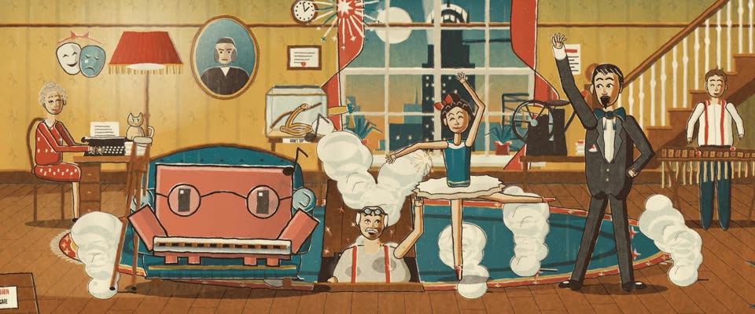

# WPA 丝网海报 · WPA Silkscreen Poster

> 原文：lemo-opuscar `styleboard/opuscar98_styles.json` 第 11 条（OPUSCAR 98 纪念片里《浮生若梦》You Can't Take It with You（1938）那一段的风格；LemoLab，MIT，commit `413a6bd`），2026-10-27 收入本仓库作参考（不在风格库里，片子不能选它当风格），未改动。
> 这是约 5 秒片段的风格，没有完整的十一节说明，所以不进风格库。用法：当视觉语言的参考——某一段画面想要这种质感时，借它的提示词写进决策单，声音、镜头、坑由模型自己补。

**渲染**：2D（2D）　**手法组合**：30 年代 WPA 丝网印 · 分色渐变 · 六色不透明平涂油墨（1930s WPA silkscreen · Split-fountain inks · Six flat opaque inks）

## 风格提示词（中文原文）

1936–39 年 WPA 联邦艺术计划的丝网海报。六色不透明油墨从浅到深套印，后印的版要在不该盖住的浅色形（云、太阳、高光）处镂空：奶油 #F0E2C0 给光和云，赭 #E0A842、朱红 #C84A2A 给天空和暖色面，青 #22686E 给水和阴影，主角专用色（如 #D97757，只用在故事围绕的那个主角身上），最后印深棕描边 #322018。阴影是深一色叠印，不用灰。大面积用分色渐变：两色 2–3 级粗台阶，中间一级是两色叠印。每版套偏 1–3 像素，模版边缘游移，刮板拖痕、漏印，平涂上都有暖色棉浆纸纹（±5%）。人物占画面高度二分之一到三分之二：大块面、月牙形暗面、棕色描边、脸有表情。留一条粗体大写标题，用用户的语言。慢推，一版一版弹出来。避免：网点、平滑渐变、干净的矢量平涂。

## Style prompt (English original)

A 1936-39 WPA (Federal Art Project) silkscreen poster. Six opaque inks printed light to dark, each later screen cut away around lighter shapes (clouds, sun): cream #F0E2C0 for light, ochre #E0A842 and vermilion #C84A2A for sky and warm planes, teal #22686E for water and shade, the hero's own ink (e.g. #D97757, only on the hero the story centres on), brown keyline #322018 last. Shadows: a darker ink overprinted, never grey. Big areas get split-fountain blends: two inks in 2-3 coarse steps, the middle one their overprint. Screens 1-3 px off register; wandering stencil edges, squeegee streaks, warm rag-paper grain (±5%) on every flat. Figures fill 1/2-2/3 of frame height: big planes, crescent shadows, expressive faces. A bold capital title band, user's language. Slow pushes; screens pop in one by one. Avoid: halftone dots, smooth gradients, clean vector flats.

## 这个风格是什么（上游说明）

30 年代 WPA 丝网海报：六色不透明平涂油墨、分色渐变、轻微套印错位，印在棉浆纸上。1936–39 年联邦艺术计划的海报就是这部片同年代的美国平面语言，也和第 10 部的报纸拉开距离。

A 1930s WPA silkscreen poster: six flat opaque inks, split-fountain gradients, slight misregistration on rag paper. The Federal Art Project posters of 1936–39 were American graphic design of the film's own years, and they keep it apart from No. 10's newsprint.

## 上游示范用法（只是一个例子，不要照搬故事和镜头）

Clawd 扮凡德霍夫爷爷：圆形金属框眼镜、口琴，拐杖靠在椅子边。一屋子人各干各的，地下室的烟花在最后一镜里越炸越大。两刀硬切：客厅 → 口琴 → 烟花。

| 机位 | 镜头 | Shot |
|---|---|---|
| still | 整个凡德霍夫家客厅，像一张海报：Clawd 扮爷爷，戴圆眼镜坐在青色扶手椅里吹口琴，埃西在窗前踮脚跳舞，科伦科夫高喊拍子，德皮纳从地下室活板门里探出头；轻拉。 | The whole Vanderhof living room as a poster: Clawd as Grandpa in round glasses plays harmonica in the teal wing chair, Essie dances on pointe in the window, Kolenkhov shouts the count, De Pinna pops out of the cellar hatch; a slight pull back. |
| harmonica | Clawd 近景：圆眼镜、口琴，音符往上飘，德皮纳在画面边上；推近。 | Close on Clawd with glasses and harmonica, notes drifting up, De Pinna at the edge of frame; a push in. |
| fireworks | 回到客厅，地下室的烟花炸开：火箭、星爆和烟柱填满屋子；镜头拉远。 | Back on the room as the cellar fireworks go off: rockets, starbursts and smoke columns fill it; the camera pulls back. |

参考：Frank Capra, 1938；WPA Federal Art Project silkscreen posters, 1936–39；1938 Columbia one-sheet

