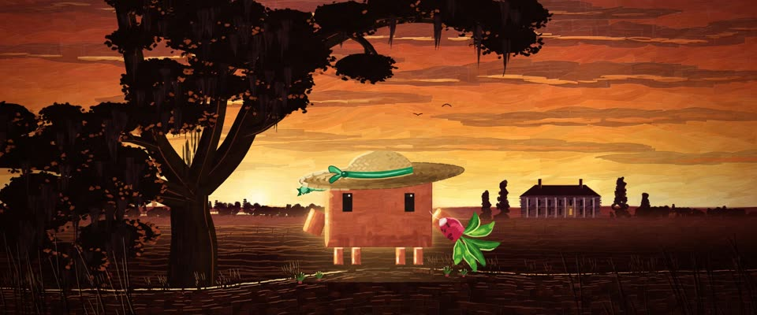

# Technicolor 厚涂油画 · Technicolor Impasto Oil

> 原文：lemo-opuscar `styleboard/opuscar98_styles.json` 第 12 条（OPUSCAR 98 纪念片里《乱世佳人》Gone with the Wind（1939）那一段的风格；LemoLab，MIT，commit `413a6bd`），2026-10-27 收入本仓库作参考（不在风格库里，片子不能选它当风格），未改动。
> 这是约 5 秒片段的风格，没有完整的十一节说明，所以不进风格库。用法：当视觉语言的参考——某一段画面想要这种质感时，借它的提示词写进决策单，声音、镜头、坑由模型自己补。

**渲染**：2D（2D）　**手法组合**：厚涂油画 · 刮刀 · 1939 年 Technicolor 配色 · 史诗海报画（Impasto oil · Palette knife · 1939 Technicolor palette · Epic poster painting）

## 风格提示词（中文原文）

1939 年 Technicolor 配色的厚涂油画。刮刀色块：天空用长条横向色带（长为画幅宽的 1/15–1/6，厚约 1/60），地面和人物用顺形体的短笔触，之间留出平静、薄涂的区域；颜料棱受左上方的光，越亮越厚，薄处露布纹。默认是落日天空，从酒红 #3A0912 经大红 #A8241A、橙 #F27A22 烧到金 #FFD878；地面红褐 #6E2214；剪影是带暖意的近黑；故事围绕的那个主角保持看得清的暖中间调（如 #D97757），不做成剪影。强逆光，金色轮廓光；近景加一道暖色侧光照亮半边脸和手。构图像史诗海报：大块深色剪影（树、房子、岩石、人物）压在低地平线上。灯火用油画火焰。运镜：全景慢推，低机位推近主角，最后吊臂升起看大景。避免：大小一样的碎块铺满画面、脏棕色、平滑渐变。

## Style prompt (English original)

Impasto oil in a 1939 Technicolor palette. Palette-knife slabs: long horizontal sky bands (1/15-1/6 of frame width long, about 1/60 tall), shorter strokes following form on land and figures, calm thin areas between; ridges lit from upper left, paint thickest in highlights, canvas weave where thin. Default sunset sky: wine #3A0912, red #A8241A, orange #F27A22, gold #FFD878; ground red-brown #6E2214; warm near-black silhouettes. The hero the story centres on stays a readable warm mid-tone (e.g. #D97757), never a silhouette. Strong backlight, gold rims; in close shots a warm side light on half the face and hands. Epic-poster composition: big dark silhouettes (trees, buildings, rocks, figures) on a low horizon. Lamps as painted flames. Camera: slow push on the wide, low push-in on the hero, crane up to a vista. Avoid: tiled same-size strokes, muddy browns, smooth gradients.

## 这个风格是什么（上游说明）

厚涂油画：刮刀色块、颜料堆起的棱，Technicolor 的热度——从金色烧到血红的天空、红土、黑色剪影。全片的色彩从《乱世佳人》开始降临，第一张满色画面就是夕阳下的塔拉。

Impasto oil with palette-knife slabs, ridged paint and Technicolor heat: skies burning from gold to blood red, red earth, black silhouettes. Gone with the Wind is where colour arrives in the film, so Tara at sunset is the first fully saturated frame.

## 上游示范用法（只是一个例子，不要照搬故事和镜头）

Clawd 扮斯嘉丽：系绿缎带的宽檐草帽，手里一根萝卜。前 7 拍天空从金色烧到血红，第 6 拍举起萝卜。四刀硬切走过塔拉、发誓、亚特兰大和车站，最后 5 拍是一条升降长镜头。

| 机位 | 镜头 | Shot |
|---|---|---|
| tara | 塔拉剪影全景：大橡树、白房子和雪松黑压压地立在从金色烧向血红的天空下，Clawd 站在红土丘上拿着萝卜；慢推。 | Tara in silhouette: the great oak, the white house and cedars black against a sky burning from gold toward blood red; Clawd stands on a red-earth rise holding a radish; a slow push in. |
| oath | 压低地平线推近，背后是燃烧的天空：戴绿缎带宽檐草帽的 Clawd 把萝卜高高举起，逆光一圈金边。 | Low push-in against the burning sky: Clawd in a wide straw hat with a green ribbon raises the radish high, backlit with a gold rim. |
| close | Clawd 脸和草帽的近景，缎带尾巴在风里翻飞。 | Close on Clawd's face and hat, the ribbon tails whipping in the wind. |
| fire | 亚特兰大大火：马车冲过燃烧的仓库和木构架，Clawd 坐在瑞德旁边的驾座上，后面是普莉西和梅兰妮；镜头跟着横移，前景火舌掠过。 | Atlanta burning: the wagon charges past the flaming warehouse and timber frame, Clawd beside Rhett on the seat, Prissy and Melanie behind; the camera trucks with it as flames sweep the foreground. |
| depot | 火车站一条升降长镜头：从站在伤兵中间的 Clawd 一路升高后退，一排排伤兵铺满红土直到地平线，场中一面破旗，Clawd 只剩一个橙色小点。 | One crane move at the depot: from Clawd among the wounded, up and back until rows of soldiers cover the red ground to the horizon, a torn flag in the yard and Clawd a single orange dot. |

参考：Victor Fleming, 1939；Ernest Haller and Ray Rennahan (Technicolor cinematography)；William Cameron Menzies (production design)；1939 poster

