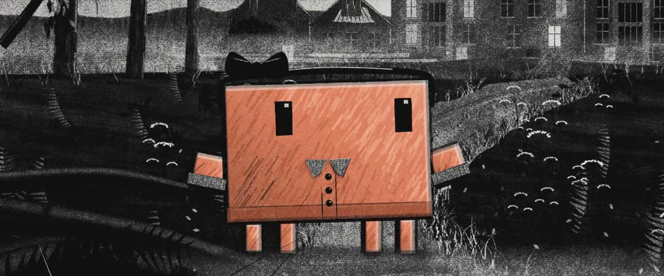

# 哥特炭笔画 · Gothic Charcoal Drawing

> 原文：lemo-opuscar `styleboard/opuscar98_styles.json` 第 13 条（OPUSCAR 98 纪念片里《蝴蝶梦》Rebecca（1940）那一段的风格；LemoLab，MIT，commit `f171360`），2026-10-31 收入本仓库作参考（不在风格库里，片子不能选它当风格），未改动。
> 这是约 5 秒片段的风格，没有完整的十一节说明，所以不进风格库。用法：当视觉语言的参考——某一段画面想要这种质感时，借它的提示词写进决策单，声音、镜头、坑由模型自己补。

**渲染**：2D（2D·B&W）　**手法组合**：藤炭笔 · 橡皮擦白与手指抹开 · William Kentridge · 哥特悬疑（Vine charcoal · Eraser lifts and smudging · William Kentridge · Gothic suspense）

## 风格提示词（中文原文）

有纹的纸上画炭笔。纸纹细（颗粒约画幅宽 1/600）：轻压只挂纹峰，重压填满纹谷。颗粒只在中间调；黑如天鹅绒，擦白是干净纸面。明暗：约六成画面暗到中灰，一成半深黑，在最近的前景和最大块面上，亮处少。炭色 #121111，纸色 #EEECE7。笔法：藤炭干笔断线，炭条侧锋顺形体宽扫（宽为画幅宽 1/60–1/30），排线，手指抹，橡皮擦出边光和光晕；雾是在铺好的灰调上横向擦出来的（如 William Kentridge 的动画素描）。只有故事围绕的那个主角用粉彩（如 #D97757），铺得较实、透点纸纹，炭笔勾边；火焰保持炭黑和纸白。月光从上方来，两三层雾带不同速横漂。运镜：主观镜头慢推，前景向两边分开。避免：数码噪点、光滑的数码光晕、发灰的黑、空亮的天空。

## Style prompt (English original)

Charcoal on toothed paper. Fine tooth (grain ~1/600 of frame width): light pressure catches only the peaks, heavy pressure fills the valleys. Grain only in midtones; velvet blacks, clean-paper lifts. Values: ~60% dark-to-mid grey, 15% deep black in the nearest foreground and largest masses, lights small. Charcoal #121111 on paper #EEECE7. Marks: broken vine lines, side-of-the-stick sweeps (1/60-1/30 of frame width) following form, hatching, finger smudges, eraser lifts for edges and glows; mist is horizontal streaks erased out of a toned area (as in William Kentridge's animated drawings). Only the hero the story centres on is in pastel (e.g. #D97757), laid fairly solid, tooth peeking through, outlined in charcoal; flames stay charcoal-and-paper. Moonlight from above; 2-3 fog bands drift at different speeds. Camera: slow subjective push, foreground parting. Avoid: digital noise, smooth digital glows, grey blacks, empty bright skies.

## 这个风格是什么（上游说明）

粗纹纸上的炭笔画：天鹅绒般的黑、抹开的灰，月光和雾用橡皮擦出来。希区柯克的《蝴蝶梦》是一场黑白哥特梦，庄园先在雾里、后在火里，炭笔两样都画得出来。

Charcoal on toothed paper: velvet blacks, smudged greys, moonlight and mist lifted out with an eraser. Hitchcock's Rebecca is a black-and-white Gothic dream of a house in mist and then in flames, and charcoal can draw both.

## 上游示范用法（只是一个例子，不要照搬故事和镜头）

Clawd 扮第二任德温特夫人：天鹅绒发箍、开衫，仰望庄园。开场的梦境推进里没有它；接着三刀硬切：Clawd → 起火的庄园 → 丹弗斯太太。每一镜都在往里推，2.5 秒一路推向大火。

| 机位 | 镜头 | Shot |
|---|---|---|
| drive | 沿着荒草蔓生的月下车道主观推进，树林分开，雾里露出曼德利，几扇本不该亮的窗亮着灯。 | Subjective push up the overgrown moonlit drive; the trees part on Manderley in the mist, its phantom windows glowing. |
| close | Clawd 近景，扮第二任德温特夫人：天鹅绒发箍、开衫翻领，身后是曼德利；慢推。 | Close on Clawd as the second Mrs de Winter, in a velvet headband and cardigan collar, Manderley behind; a slow push in. |
| house | 月光下的曼德利，镜头推近，火从一扇扇窗里烧起来。 | Manderley in moonlight, the camera pushing in as fire breaks out across its windows. |
| danvers | 丹弗斯太太一动不动站在燃烧的窗口，双手交叠，冷脸被平光照着；镜头往她脸上推。 | Mrs Danvers standing motionless in the burning window, hands folded, her cold face lit flat; a push in toward her face. |

参考：Alfred Hitchcock, 1940；George Barnes (cinematography)；William Kentridge (charcoal animation)；Odilon Redon, the noirs

