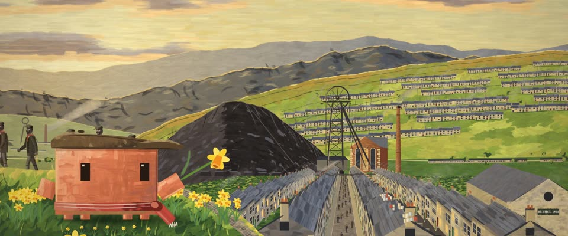

# 威尔士山谷水粉 · Welsh Valley Gouache

> 原文：lemo-opuscar `styleboard/opuscar98_styles.json` 第 14 条（OPUSCAR 98 纪念片里《青山翠谷》How Green Was My Valley（1941）那一段的风格；LemoLab，MIT，commit `f171360`），2026-10-31 收入本仓库作参考（不在风格库里，片子不能选它当风格），未改动。
> 这是约 5 秒片段的风格，没有完整的十一节说明，所以不进风格库。用法：当视觉语言的参考——某一段画面想要这种质感时，借它的提示词写进决策单，声音、镜头、坑由模型自己补。

**渲染**：2D（2D）　**手法组合**：不透明水粉 · Kyffin Williams 刮刀风景 · 1941 原海报配色（Opaque gouache · Kyffin Williams palette-knife landscape · 1941 poster colours）

## 风格提示词（中文原文）

仿威尔士画家 Kyffin Williams 的不透明水粉。方向性笔触宽为画幅宽 1/80–1/40，长是宽的 2–5 倍，边缘毛糙，完全覆盖；房子、墙、山脊用断续深色短线勾边；暗山上刮几笔亮绿或灰蓝。色板：天空和光淡金 #F1C565（别成芥末黄），田野绿 #86A03F，暗部煤黑 #1D1B1E，远山和水面灰蓝 #48505E，小点缀黄 #F6CF2F，其他颜色由这几色调出；故事围绕的那个主角用 #D97757，至少占画面高八分之一。田野和天空偏亮（约六成），山和房子偏暗。暖色调色不超过一成，暗角，颗粒。默认傍晚低角度侧光，田野受光，山脊有轮廓光。从高处真透视取景，一条路把视线引下去；小房子（或墙、石块）顺山坡一级级排开。动起来：烟或云循环飘动，横向跟拍。避免：水彩透明感、矢量平涂、发暗发脏。

## Style prompt (English original)

Opaque gouache after Welsh painter Kyffin Williams. Directional strokes 1/80-1/40 of frame width, 2-5 times as long, ragged, fully covering; broken dark dashes outline buildings, walls and ridges; dark hills flecked with lighter green or slate knife marks. Palette: sky and light pale gold #F1C565 (not mustard), fields green #86A03F, darks coal #1D1B1E, far hills and water slate #48505E, small accents yellow #F6CF2F, other colours mixed from these; the hero the story centres on #D97757, at least 1/8 of frame height. Fields and sky light (~60%), hills and buildings dark. Warm grade under 10%, vignette, grain. Default low late-afternoon side light: fields lit, ridges rim-lit. From high ground in true perspective, a path leading the eye down; small repeated buildings (or walls, rocks) stepping along slopes. Motion: looping smoke or cloud, a lateral track. Avoid: watercolour transparency, vector fills, mud.

## 这个风格是什么（上游说明）

用 1941 年原海报金黄加绿配色的不透明水粉：扎实的色块、煤黑的渣山、Kyffin Williams 式厚重的深色山体和断续描边。用水粉而不用木刻，和第 3 部区分开；画的是矿工唱着歌走下山谷回家。

Opaque gouache in the 1941 poster's gold and green: solid colour masses, coal-black tips, Kyffin Williams' heavy dark hills and broken contours. Gouache keeps it apart from No. 3's woodcut; the scene is the colliers walking home down the valley, singing.

## 上游示范用法（只是一个例子，不要照搬故事和镜头）

Clawd 扮少年休：粗花呢平顶帽、打结的红围巾、一枝黄水仙。先坐在山顶看山谷，再跟着唱歌的矿工齐步走下街。两刀硬切：山谷 → 井架大轮 → 街道。

| 机位 | 镜头 | Shot |
|---|---|---|
| still | 山顶黄水仙丛里俯瞰：戴平顶帽、系红围巾的 Clawd 坐在左前景，手拿一枝黄水仙，排屋街一路通到谷底的井架和煤渣山；慢拉。 | From the hilltop among the daffodils: Clawd in a flat cap and red scarf sits in the left foreground holding a daffodil, the street of terraces leading down to the pithead and the coal tip; a slow pull back. |
| pit | 井架和转动的大轮特写，后面绿坡上爬满排屋；固定机位。 | Close on the pithead frame and its winding wheel turning, terraces climbing the green slope behind; a locked-off camera. |
| street | 沿排屋街的横向跟拍：下工的矿工分三排往下走，脸上是煤灰，边走边唱；Clawd 走在前排，房子从身后滑过。 | Lateral tracking shot down the terrace street: the colliers walk home in three rows, faces black with coal, singing; Clawd walks in the front row as the houses slide past. |

参考：John Ford, 1941；Arthur C. Miller (cinematography)；Kyffin Williams；1941 poster

