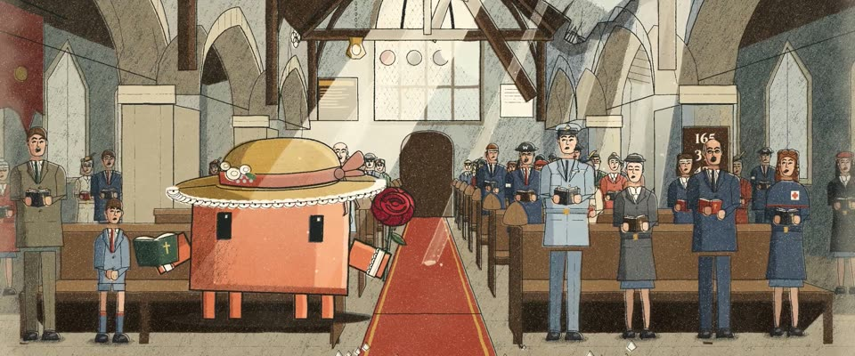

# 英国战时石印海报 · Home Front Stone Lithograph

> 原文：lemo-opuscar `styleboard/opuscar98_styles.json` 第 15 条（OPUSCAR 98 纪念片里《忠勇之家》Mrs. Miniver（1942）那一段的风格；LemoLab，MIT，commit `413a6bd`），2026-10-27 收入本仓库作参考（不在风格库里，片子不能选它当风格），未改动。
> 这是约 5 秒片段的风格，没有完整的十一节说明，所以不进风格库。用法：当视觉语言的参考——某一段画面想要这种质感时，借它的提示词写进决策单，声音、镜头、坑由模型自己补。

**渲染**：2D（2D）　**手法组合**：石印 + 蜡笔阴影版 · Frank Newbould、Abram Games 二战海报 · 英国信息部海报配色（Stone lithograph with crayon shadow plate · Frank Newbould and Abram Games WWII posters · Ministry of Information palette）

## 风格提示词（中文原文）

做成 1942 年英国战时的石印海报。造型简化有力，三版套印，略错位 1–3 像素：色版承载所有平涂；冷灰蓝蜡笔版压暗每一处阴影，带短而斜的石纹颗粒（不用网点）；墨绿黑轮廓版给每个形描一圈约画幅宽 1/500 的线，人物和云也要描。配色按用途：奶油 #EBDFC2 是纸色和亮部，灰蓝 #8497A6 是天空和阴影，砖红 #A23F2D 和深绿 #34503F 只作点缀，合计不超过画面四分之一；棕色和肤色由奶油加砖红调出；轮廓色 #1E2422。场景可以排满。天空用喷枪渐变，只有纸纹每秒 12 帧跳动。浅色光带顺着光源方向斜落，照到之处阴影版消失。人物正面站立，像海报里的人。镜头慢移带视差、上摇。对标 Frank Newbould、Abram Games。避免：网点阴影、干净的矢量边、大片饱和色。

## Style prompt (English original)

A 1942 British wartime stone-lithograph poster. Simple, strong shapes from three plates, 1-3 px off register: a colour plate with all flat fills; a grey-blue crayon plate darkening every shadow with short slanted stone grain; a green-black key line about 1/500 of frame width around every shape, figures and clouds included. Palette by role: cream #EBDFC2 paper and highlights, grey-blue #8497A6 sky and shadow, brick red #A23F2D and deep green #34503F as accents, at most a quarter of the frame; browns and skin mixed from cream and brick; key #1E2422. Scenes may be full. Airbrushed skies; only the paper grain boils at 12 fps. Pale light bands, angled from the source, cancel the shadow plate. Figures stand frontally. Camera: slow drifts, a tilt up. References: Frank Newbould, Abram Games. Avoid: dot screens, clean vector edges, big saturated fields.

## 这个风格是什么（上游说明）

二战英国本土战线的石印海报：砖红、深绿、奶油、灰蓝的有限套色，阴影是石版蜡笔颗粒。配影片结尾：被炸穿屋顶的乡村教堂里全村唱诗，喷火式战机从破洞上方飞过。

A WWII British Home Front lithograph poster: flat brick red, deep green, cream and grey-blue, with a grainy crayon shadow plate. It fits the film's last scene, a village singing in its bombed church while Spitfires pass overhead.

## 上游示范用法（只是一个例子，不要照搬故事和镜头）

Clawd 扮米尼弗夫人：花边草帽、赞美诗集和红色的「米尼弗夫人」玫瑰。全景里它在唱诗；切到近景时听见引擎声，停下抬头；第三个镜头是它的视线，穿过屋顶破洞看喷火式编队飞过。三个硬切，靠一个抬头的动作连起来。

| 机位 | 镜头 | Shot |
|---|---|---|
| still | 全景，顺着被炸的教堂中殿看过去：村民站在长椅间唱诗，阳光成柱照下；Clawd 戴花边草帽坐在第一排，拿着赞美诗集和红玫瑰在唱。镜头微微后拉。 | Wide down the bombed nave: the village sings from the pews under shafts of sun; Clawd sits in the front pew in a lace-trimmed straw hat with hymn book and red rose, singing. The camera eases back slightly. |
| close | Clawd 和玫瑰的近景：引擎声传来，它停下不唱，抬头看向屋顶。镜头轻推。 | Close on Clawd with the rose: the engines come over, it stops singing and looks up toward the roof. Slight push-in. |
| roof | 从教堂里垂直仰拍屋顶的破洞：断裂的椽子框住天空，喷火式战机排成 V 字飞过。镜头慢推并略微旋转。 | Looking straight up through the torn roof: snapped rafters frame the sky as a V of Spitfires crosses it. Slow push with a slight roll. |

参考：William Wyler, 1942；Joseph Ruttenberg (cinematography)；Frank Newbould, Your Britain — Fight for it Now (1942)；Abram Games；Mrs. Miniver one-sheet (1942)

