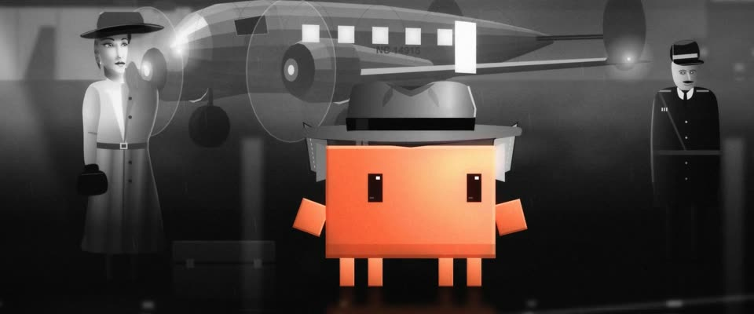

# 好莱坞片厂柔光黑白 · Studio Glamour Black-and-White

> 原文：lemo-opuscar `styleboard/opuscar98_styles.json` 第 16 条（OPUSCAR 98 纪念片里《卡萨布兰卡》Casablanca（1943）那一段的风格；LemoLab，MIT，commit `413a6bd`），2026-10-27 收入本仓库作参考（不在风格库里，片子不能选它当风格），未改动。
> 这是约 5 秒片段的风格，没有完整的十一节说明，所以不进风格库。用法：当视觉语言的参考——某一段画面想要这种质感时，借它的提示词写进决策单，声音、镜头、坑由模型自己补。

**渲染**：2D（2D·B&W）　**手法组合**：喷枪精修剧照人像 · Arthur Edeson 片厂布光 · 柔光镜与银盐颗粒（Airbrushed glamour-still portraits · Arthur Edeson studio lighting · Diffusion filter and silver grain）

## 风格提示词（中文原文）

40 年代好莱坞片厂黑白，画成精修剧照。形体是边缘干净的喷枪明暗块。人脸用短光位：主光照亮离镜头远的那半边脸，靠近镜头的脸颊落在暗部，留一块伦勃朗三角光；每只眼两个眼神光。条状影子借手边的东西（百叶窗、栏杆、树枝），斜落在物面上；光柱只在烟雾飘过处显形。明暗：三到四成画面是深黑，白色面积小而发光；外景天空中暗灰。调色：轻柔光溢出、S 曲线、细颗粒（±3%）、柔暗角、轻微闪烁；雾只在局部。只有故事围绕的那个主角的身体或衣服保留颜色（如 #D97757），皮肤和灯光都是灰阶。镜头：长运镜，推向一张脸，再拉远退进雾里。对标摄影师 Arthur Edeson（《卡萨布兰卡》，Michael Curtiz，1942）。避免：平光、整片灰雾、僵硬的胸像。

## Style prompt (English original)

1940s Hollywood studio black-and-white, painted like a retouched glamour still. Forms: smooth airbrushed tone blocks. Faces: short key (light on the face's far side from camera; the near cheek in shadow, holding a Rembrandt triangle of light), two catchlights per eye. Slatted shadows from anything at hand (blinds, railings, branches) fall diagonally across surfaces; light shafts show only in smoke or fog. Values: 30-40% of the frame deep black, whites small and glowing; outdoor skies mid-dark. Grade: diffusion glow, an S-curve, fine grain (±3%), soft vignette, faint flicker; fog stays local. Only the hero the story centres on keeps colour, on its body or costume (e.g. #D97757); skin and lamps stay grey. Camera: a long glide, a push to a face, a pull-back into fog. References: cinematographer Arthur Edeson (*Casablanca*, Michael Curtiz, 1942). Avoid: flat lighting, grey haze, stiff busts.

## 这个风格是什么（上游说明）

影片本身的样子：Arthur Edeson 的片厂黑白，画成精修剧照：带眼神光的柔焦特写、百叶窗投影、烟雾里的光柱。扮里克的 Clawd 是唯一的颜色。

The film's own look, Arthur Edeson's studio black-and-white, painted as a retouched glamour still: rich greys, soft-focus close-ups with catchlights, venetian-blind shadows, light shafts in smoke and fog. Clawd, as Rick, is the only colour.

## 上游示范用法（只是一个例子，不要照搬故事和镜头）

Clawd 扮里克：咖啡馆里是领结和香槟碟杯，机场上是软呢帽和竖起的风衣领。咖啡馆是一条不断的运镜，收在它举杯（"Here's looking at you, kid"）；正中那一拍是全段唯一的硬切，跳到机场，一个回头加一次长拉远收尾。

| 机位 | 镜头 | Shot |
|---|---|---|
| cafe | 一条运镜穿过里克的咖啡馆：越过吊扇和烟雾滑到弹琴的萨姆和靠在琴上的伊尔莎，推向她泪光渐起的柔焦脸，再横移过整个房间，落到桌边系着领结的 Clawd，它举起香槟杯。 | One travelling move through Rick's Café: past fans and smoke to Sam at the piano with Ilsa leaning on it, a push toward her soft-focus face as the tear rises, then right across the room to Clawd at its table in a bow tie, raising the champagne glass. |
| airport | 硬切到雾中机场：Clawd 戴软呢帽、竖着风衣领的近景，它回头一瞥；镜头长长地拉远，露出伊尔莎、雷诺上尉和雾里螺旋桨转动的 Electra 客机。 | Hard cut to the foggy airfield: close on Clawd under the fedora with its collar up, a glance back, then a long pull-back to Ilsa, Renault and the Electra with its propellers turning in the fog. |

参考：Michael Curtiz, 1942；Arthur Edeson (cinematography)；Casablanca one-sheet (1942)

