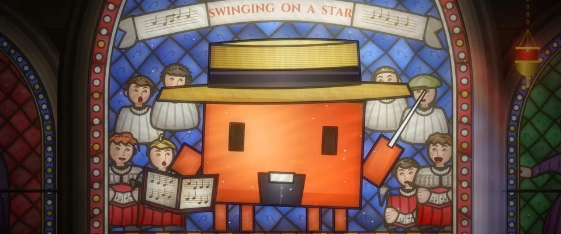

# 逆光哥特彩色玻璃窗 · Backlit Gothic Stained Glass

> 原文：lemo-opuscar `styleboard/opuscar98_styles.json` 第 17 条（OPUSCAR 98 纪念片里《与我同行》Going My Way（1944）那一段的风格；LemoLab，MIT，commit `413a6bd`），2026-10-27 收入本仓库作参考（不在风格库里，片子不能选它当风格），未改动。
> 这是约 5 秒片段的风格，没有完整的十一节说明，所以不进风格库。用法：当视觉语言的参考——某一段画面想要这种质感时，借它的提示词写进决策单，声音、镜头、坑由模型自己补。

**渲染**：2D（2D）　**手法组合**：铅条拼色玻璃 + 灰调描绘 · 沙特尔蓝菱形格 · Harry Clarke 宝石色（Leaded pot-metal glass with grisaille · Chartres blue quarries · Harry Clarke jewel colour）

## 风格提示词（中文原文）

逆光的哥特彩窗，占画面高度八到九成、宽度约六成，两边露出相邻发光的窗。每个形状是一块切好的玻璃：每块明度浮动约 8%，有流纹气泡和褐色内描边，外压黑铅条（宽约画幅宽 1/250）。天空和空地切成菱形格（每格约画幅宽 1/30）；边框是带圆珠的宝石红。主要人物至少占窗高一半，用尖细的深褐线描脸和衣褶。配色按用途：背景钴蓝 #1B3F9E，边框宝石红 #B3121F，高光金 #E3A526，铅条 #16161A；皮肤淡琥珀；景物用深绿、青绿。只有故事围绕的那个主角是橙色玻璃（如 #D97757）。亮玻璃光晕吃进铅条；彩光落在地面和窗台上。镜头：下摇、横摇，落到光斑上。对标沙特尔大教堂、Harry Clarke。避免：平涂、随意切割、窗四周大片暗墙。

## Style prompt (English original)

A backlit Gothic stained-glass window filling 80-90% of frame height and ~60% of width, neighbours glowing at edges. Every shape is cut glass: lightness varied ±8% per piece, streaks, seed bubbles, a brown edge mat, black lead (about 1/250 of frame width). Sky and empty ground: diamond quarries (about 1/30 of frame width); the border is ruby with beads. The main figure is at least half the window's height, in dark-brown grisaille line. Palette by role: background cobalt #1B3F9E, border ruby #B3121F, highlights gold #E3A526, lead #16161A; skin pale amber; scenery deep greens. Only the hero the story centres on is orange glass (e.g. #D97757). Bright glass blooms into the leads; coloured light spills onto floor and sill. Camera: tilt down, pan, settle on the pooled light. References: Chartres Cathedral; Harry Clarke. Avoid: flat fills, random cuts, dark empty wall.

## 这个风格是什么（上游说明）

逆光的哥特彩色玻璃：铅条拼起的色玻璃、灰调描出的人脸、沙特尔蓝和宝石红边框，彩光洒在教堂地上。奥马利神父和唱诗班嵌在窗里，头顶是金色星章。

Backlit Gothic stained glass: leaded pot-metal pieces with grisaille-painted faces, Chartres blue, ruby borders, and coloured light pooling on the church floor. Father O'Malley's boys' choir is set into the window under a gold star for 'Swinging on a Star'.

## 上游示范用法（只是一个例子，不要照搬故事和镜头）

Clawd 在玻璃画里扮奥马利神父：身体是最暖的陶土色玻璃，戴草帽和罗马领，拿指挥棒和歌本。它跟着拍子指挥，男孩们的口型各自错开。一个下摇从星章落到 Clawd，再硬切到唱诗班，最后落到地上的彩光。表演 1.8 倍速。

| 机位 | 镜头 | Shot |
|---|---|---|
| star | 从金色八角星章和「SWINGING ON A STAR」飘带开始，沿尖拱窗往下摇，落到扮奥马利神父的 Clawd，它在玻璃里指挥男孩唱诗班。 | Starts on the gold star medallion and the SWINGING ON A STAR banderole, then tilts down the lancet onto Clawd as Father O'Malley, conducting the glass boys' choir. |
| choir | 玻璃唱诗班的中景：穿红袍白衣的男孩们在唱，镜头向右横摇，扫过 Clawd 举指挥棒的手。 | Medium on the glass choir: boys in red cassocks and surplices singing, the camera panning right past Clawd's baton arm. |
| nave | 切到教堂中殿：彩窗的颜色洒在长椅之间的大理石过道上，祭坛蜡烛亮着；镜头往地面下摇。 | Cut down into the nave: the window's colours pooled on the marble aisle between the pews, altar candles lit; the camera tilts down toward the floor. |

参考：Leo McCarey, 1944；Going My Way one-sheet (1944)；Chartres Cathedral glass；Harry Clarke

