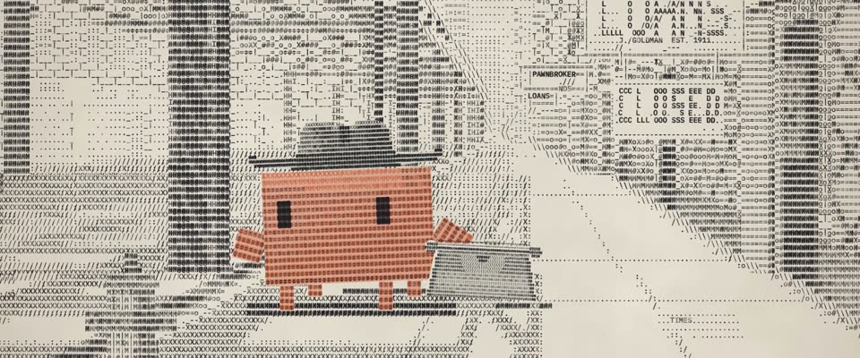

# 打字机字符画 · Typewriter Character Art

> 原文：lemo-opuscar `styleboard/opuscar98_styles.json` 第 18 条（OPUSCAR 98 纪念片里《失去的周末》The Lost Weekend（1945）那一段的风格；LemoLab，MIT，commit `f171360`），2026-10-31 收入本仓库作参考（不在风格库里，片子不能选它当风格），未改动。
> 这是约 5 秒片段的风格，没有完整的十一节说明，所以不进风格库。用法：当视觉语言的参考——某一段画面想要这种质感时，借它的提示词写进决策单，声音、镜头、坑由模型自己补。

**渲染**：2D（2D·B&W）　**手法组合**：叠打的打字机字符画 · Paul Smith、Flora Stacey · John F. Seitz 硬光黑白（Typewriter art with overstrikes · Paul Smith and Flora Stacey · John F. Seitz hard-light noir）

## 风格提示词（中文原文）

所有画面都用打字机字符打出来：等宽粗体字逐个敲，落在固定网格上，格宽约画幅宽 1/150、格高是格宽两倍。85%–95% 的格子都要打字，只有最亮的光留纸白。灰阶靠字键分级（浅 . : -，中 = + o，深 X # M），暗部约占三成，用 M# 这样的叠打。形体靠边界清楚的字块和剪影读出。每种材质重复自己的字键（如竖向结构 I H，砖缝 _|，水 ~）。招牌或说明要打得能读。色带墨色不匀：半边缺墨，几个键总是偏高或偏低。纸 #EBE6DA，墨 #1D1C21；只有故事围绕的那个主角用红橙色带 #D4704F 打，至少占画面高度三分之一，影子仍是黑的。硬侧光投出边缘清楚的密集长影。画面在第一秒内打完，然后停住。对标 Paul Smith 的打字机画。避免：稀疏空白、看不出形的横向字条。

## Style prompt (English original)

Type every image: one bold monospaced glyph per keystroke, fixed grid, cells 1/150 of frame width wide, twice as tall. Strike 85-95% of cells; bare paper only for highlights. Grey from a key ladder (light . : -, mid = + o, dark X # M); darks (about 30%) are overstrikes like M#. Shapes read as crisp-edged fields, clear silhouettes. Each material repeats its own keys (e.g. I H verticals, _| courses, ~ water). Signs stay legible. Uneven ribbon: half-inked strikes, a few keys always high or low. Paper #EBE6DA, ink #1D1C21; only the hero the story centres on, at least 1/3 of frame height, is struck in red-orange #D4704F, its shadow black. Hard sidelight casts long, crisp, dense shadows. The picture types itself within the first second, then holds. Reference: Paul Smith's typewriter art. Avoid: sparse frames, shapeless streaks.

## 这个风格是什么（上游说明）

画面是打出来的：等宽字符落在 pica 网格上，灰阶靠字符疏密和叠打，色带墨色不匀。唐抱着打字机去当铺，于是整条街由打字机打出；Clawd 用橙色色带打。

The picture is typed: monospaced characters on a pica grid, grey built from character density and overstrikes, uneven ribbon ink on bond paper. Don Birnam lugs his typewriter to the pawnshops, so his own machine types the street; Clawd is struck in orange ribbon.

## 上游示范用法（只是一个例子，不要照搬故事和镜头）

Clawd 扮唐·伯南：字符打出的软呢帽，提着想拿去当掉的打字机，四条腿逐帧交替迈步。街道像被打字机打出来一样在它身边出现；接着两个快速硬切，近景和 CLOSED 牌，把「当铺关门」交代完。表演 1.8 倍速。

| 机位 | 镜头 | Shot |
|---|---|---|
| still | 第三大道高架铁下的一点透视全景：街景一行行打到纸上，戴软呢帽的 Clawd 提着打字机往前走；镜头微微后拉。 | Wide one-point view under the Third Avenue El: the street types itself onto the page row by row while Clawd, in a fedora, walks with the typewriter in hand; the camera eases back. |
| close | Clawd 近景：字符打出的帽子、眼睛和身边灰色的打字机，背后是钢梁；镜头慢推。 | Close on Clawd: typed hat, eyes and the grey typewriter at its side, girders behind; slow push-in. |
| pawn | J. GOLDMAN 的 LOANS 当铺招牌特写，字母由字符拼成，下面挂着 CLOSED 牌；镜头慢推。 | Insert on J. GOLDMAN's LOANS sign in typed block letters, the CLOSED card hanging below; slow push-in. |

参考：Billy Wilder, 1945；John F. Seitz (cinematography)；The Lost Weekend one-sheet (1945)；Paul Smith (typewriter art)；Flora Stacey

