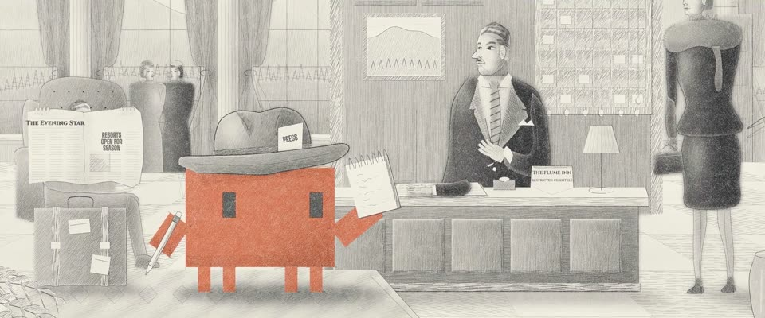

# 40 年代杂志铅笔插画 · 1940s Graphite Magazine Illustration

> 原文：lemo-opuscar `styleboard/opuscar98_styles.json` 第 20 条（OPUSCAR 98 纪念片里《君子协定》Gentleman's Agreement（1947）那一段的风格；LemoLab，MIT，commit `413a6bd`），2026-10-27 收入本仓库作参考（不在风格库里，片子不能选它当风格），未改动。
> 这是约 5 秒片段的风格，没有完整的十一节说明，所以不进风格库。用法：当视觉语言的参考——某一段画面想要这种质感时，借它的提示词写进决策单，声音、镜头、坑由模型自己补。

**渲染**：2D（2D·B&W）　**手法组合**：石墨排线与擦抹 · Al Parker、Robert Fawcett · 彩色铅笔主体（Graphite hatching and rubbed tone · Al Parker and Robert Fawcett · Coloured-pencil subject）

## 风格提示词（中文原文）

用石墨铅笔画成 40 年代杂志插画，画得完整、有控制。画面在前 1–1.5 秒内画成，然后停住：先淡淡的透视线和头部椭圆，再画两头轻中间重、转角出头的轮廓（宽约画幅宽 1/600），然后一到四遍近乎平行的排线（遍数越多越暗），间距约画幅宽 1/300，顺着形体走，再擦抹出平滑的过渡，用橡皮提亮。完成的画面几乎铺满：环境和背景都画充分，以中灰为主，深色约占一成半，只有最外一圈约十分之一淡成没画完的边角。纸 #F2EEE5 带轻齿纹，铅色 #2C2B2E。只有故事围绕的那个主角的衣服用彩铅（如 #D97757），皮肤仍是铅笔灰。戏在脸上。镜头：缓缓拉远，再切特写。对标插画家 Al Parker、Robert Fawcett。避免：交叉网格、潦草速写感、大片空白纸面。

## Style prompt (English original)

Graphite pencil like a 1940s magazine illustration, finished and controlled. The drawing builds in the first 1-1.5 s, then holds: faint perspective rays and head ovals, pressure-tapered contours (about 1/600 of frame width) overshooting at corners, then 1-4 near-parallel hatching passes (more for darker), about 1/300 of frame width apart, following the form, then rubbed tone and eraser lifts. The finished frame is toned nearly edge to edge: setting fully drawn in mid-greys, about 15% dark accents, only the outer tenth fading to loose margins. Paper #F2EEE5 with a light tooth; lead #2C2B2E. Only the hero the story centres on wears coloured pencil (e.g. #D97757) on its clothing; skin stays graphite. Faces carry the drama. Camera: a slow ease out, then cuts to close-ups. References: illustrators Al Parker and Robert Fawcett. Avoid: cross-hatch grids, scribbly sketching, a near-empty page.

## 这个风格是什么（上游说明）

40 年代杂志插画式的石墨铅笔：先打构图线，再一遍遍平行排线，擦抹暗部、橡皮提亮。画面围绕酒店前台一次客气的拒绝逐步画出，只有 Clawd 是彩色铅笔。

Graphite pencil in the manner of 1940s magazine illustration: construction lines, near-parallel hatching passes, rubbed darks and eraser lifts on toothy paper. The drawing builds itself around a polite refusal at a hotel desk; Clawd alone is in coloured pencil.

## 上游示范用法（只是一个例子，不要照搬故事和镜头）

Clawd 扮记者菲尔：插 PRESS 卡的软呢帽、采访本和铅笔，站在前台不动。第一镜是画面在它身边被画出来；接着两个硬切给旁观者，经理客气的拒绝和女士斜过来的目光，意思全在这两张脸上。拍点落在剪切上。表演 1.8 倍速。

| 机位 | 镜头 | Shot |
|---|---|---|
| still | 酒店大堂全景，画面当场被画出来，从构图线到排线：戴着插 PRESS 卡软呢帽的 Clawd 把采访本举到前台；镜头微微后拉。 | Wide on the hotel lobby being drawn as we watch, from construction lines to hatching: Clawd, in a PRESS-card fedora, holds its notepad up to the front desk; the camera eases back. |
| clerk | 从前台经理推到他的特写：微微欠身、微笑，眼睛却不笑，身后钥匙架上每把钥匙都还挂着。 | Push in from the manager to his close-up: the slight bow, the smile, the eyes that don't smile, every key still on the rack behind him. |
| lady | 固定机位中景：电梯旁披狐皮围脖的女士，眼睛回头瞟向 Clawd。 | Locked-off medium on the lady in the fox stole by the lift, her eyes turned back toward Clawd. |

参考：Elia Kazan, 1947；Gentleman's Agreement one-sheet (1947)；Al Parker；Robert Fawcett

