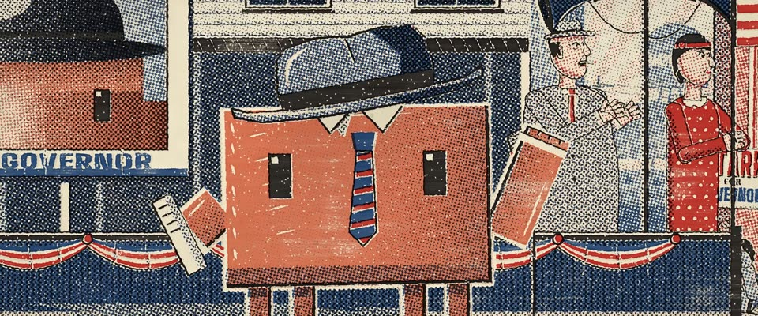

# 南方竞选木活字海报 · Wood-Type Campaign Poster

> 原文：lemo-opuscar `styleboard/opuscar98_styles.json` 第 22 条（OPUSCAR 98 纪念片里《国王班底》All the King's Men（1949）那一段的风格；LemoLab，MIT，commit `413a6bd`），2026-10-27 收入本仓库作参考（不在风格库里，片子不能选它当风格），未改动。
> 这是约 5 秒片段的风格，没有完整的十一节说明，所以不进风格库。用法：当视觉语言的参考——某一段画面想要这种质感时，借它的提示词写进决策单，声音、镜头、坑由模型自己补。

**渲染**：2D（2D）　**手法组合**：木活字凸版印刷 · Hatch Show Print · 麻胶版画人物 · 半调网点肖像（Wood-type letterpress · Hatch Show Print · Linocut figures · Halftone portraits）

## 风格提示词（中文原文）

每帧都是木活字和刻版印的凸版海报。米黄纸 #EEE3C7 上印三色：蓝 #20488C 管天空、水和大块暗部，红 #C82C28 管暖色面和条纹，黑 #1E1B1E 管轮廓和字；只有故事围绕的那个主角多加一块专色（如 #D97757）。每色一版，错位 2–4 像素；实地挖空下层，只有网点处叠印。实地有木纹、缺墨针孔，边缘挤墨。中间调走粗网点（约画幅宽 1/200），各版网角不同，不超过画面三分之一。人物像麻胶版画：粗黑轮廓、刻刀白线、月牙阴影。画面约七成是图；一两行粗木活字短句写在图里的横幅和招牌上，带错位投影，字高约画面十分之一，用用户语言。镜头：小推，横移，重拍上特写一震（无音乐每 2 秒）。对标 Hatch Show Print。避免：碎灰调代替大块实地、套色精准得像电脑。

## Style prompt (English original)

A letterpress poster from wood type and cuts. Three inks on cream stock #EEE3C7: blue #20488C (sky, water, shadow masses), red #C82C28 (warm surfaces, stripes), black #1E1B1E (outlines, type); only the hero the story centres on gets a spot ink (e.g. #D97757). Each ink 2-4 px off register; solids knock out the inks beneath, halftones overprint. Wood grain, pinholed starved patches, squeezed edges. Mid tones: coarse dots (about 1/200 of frame width), varied angles, on at most a third of the frame. Figures as linocuts: heavy outlines, gouged white lines, crescent shadows. Picture fills about 70%; short wood-type lines (about 1/10 of frame height, user's language) with offset shadows sit on banners and signs. Camera: small pushes, a lateral track, a bump on each strong beat (or every 2 s). Reference: Hatch Show Print. Avoid: busy grey mid-tones, perfect registration.

## 这个风格是什么（上游说明）

南方竞选海报的木活字凸版：红、蓝、黑三色油墨印在米黄纸上，实地有木纹，供墨不匀，版间错位，肖像走半调网点。这是斯塔克的竞选集会，Clawd 用第四版橙墨印。

A Southern campaign poster in wood-type letterpress: red, blue and black ink on cream stock, wood grain in the solids, starved patches, misregistered formes and halftone portraits. It is Willie Stark's rally; Clawd is printed in a fourth, orange ink.

## 上游示范用法（只是一个例子，不要照搬故事和镜头）

Clawd 扮威利·斯塔克：往后推的软呢帽、拉松的红蓝领带，一只手里卷着讲稿。全景里拳头举到一半，中间一镜是人群的回应，特写里它踩着拍子一拳举到顶、再挥一次，镜头在出拳时轻轻一震。全部硬切。

| 机位 | 镜头 | Shot |
|---|---|---|
| rally | 小镇广场挂满彩旗的讲台全景：扮斯塔克的 Clawd 站在自己的巨幅半调肖像前，拳头举到一半，台下人群举着 STARK FOR GOVERNOR 牌子欢呼；镜头小幅推进。 | Wide on the bunting-hung platform in the town square: Clawd as Stark in front of its own giant halftone portrait, fist half up, the crowd roaring under STARK FOR GOVERNOR placards; small push-in. |
| crowd | 切进人群：牌子上下挥动，拳头和喊叫的嘴，EVERY MAN A KING；镜头向右横移。 | Into the crowd: placards pumping, fists and shouting mouths, EVERY MAN A KING; lateral track right. |
| close | Clawd 近景，软呢帽往后推、领带拉松：拳头一下举到顶，再挥一次；镜头在出拳那一下跟着一震。 | Close on Clawd, fedora pushed back and tie loosened: the fist punches all the way up and pumps again; the camera bumps on the punch. |

参考：Robert Rossen, 1949；Burnett Guffey (cinematography)；All the King's Men one-sheet (1949)；Hatch Show Print；Huey Long campaign posters

