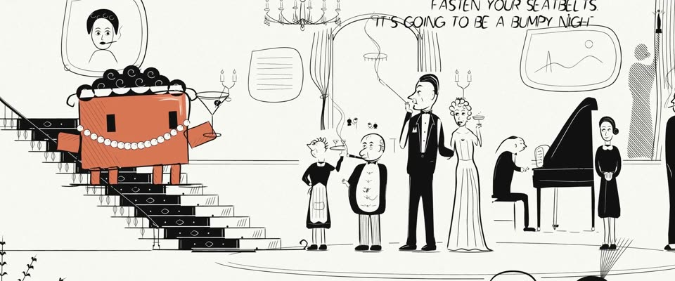

# 赫希菲尔德一笔画漫画 · Hirschfeld One-Line Caricature

> 原文：lemo-opuscar `styleboard/opuscar98_styles.json` 第 23 条（OPUSCAR 98 纪念片里《彗星美人》All About Eve（1950）那一段的风格；LemoLab，MIT，commit `413a6bd`），2026-10-27 收入本仓库作参考（不在风格库里，片子不能选它当风格），未改动。
> 这是约 5 秒片段的风格，没有完整的十一节说明，所以不进风格库。用法：当视觉语言的参考——某一段画面想要这种质感时，借它的提示词写进决策单，声音、镜头、坑由模型自己补。

**渲染**：2D（2D·B&W）　**手法组合**：一笔墨线漫画 · Al Hirschfeld 剧场漫画 · 手写台词（Single-line ink caricature · Al Hirschfeld theatre drawings · Hand-lettered dialogue）

## 风格提示词（中文原文）

画成 Al Hirschfeld 式的漫画，白纸黑墨。线条有弹性、长而连贯，能一笔画完的轮廓就一笔：两端约画幅宽 1/800，转弯处加粗到 1/250。深色衣服、头发和大件物体用实心黑块；灰调只用稀疏的平行排线。环境用细线画完整：建筑、家具、道具连同细节都画，物与物之间留白；约六成纸面留白，但绝不是空纸。每个人物靠姿态和比例夸张一个特征（长脖子、大头），五官具体。纸 #FBFAF6，墨 #131012；只有故事围绕的那个主角的身体或主要衣服用一种颜色平涂（如 #D97757），代替黑块。线条在第一秒内一笔笔写完，然后停住；留白处可有一句手写短句。镜头：拉远，横摇扫过场景，小推。避免：四肢僵直、火柴人、空荡荡的环境。

## Style prompt (English original)

An Al Hirschfeld-style caricature. Lines are elastic, long and continuous, one stroke per contour: about 1/800 of frame width at the ends, swelling to 1/250 on curves. Dark clothing, hair and big objects go solid black; grey only as sparse parallel hatching. The setting is fully drawn in thin line, architecture, furniture and props in detail, white kept between objects: about 60% paper white, never an empty page. Push one trait per figure (a long neck, a big head). Paper #FBFAF6, ink #131012; only the hero the story centres on has its body or main garment filled flat with one colour (e.g. #D97757) instead of black. Lines write on within the first second, then hold; a short hand-lettered line may sit in the white. Camera: ease back, pan across, push in. Avoid: stiff limbs, stick figures, a bare setting.

## 这个风格是什么（上游说明）

艾尔·赫希菲尔德的百老汇漫画：粗细变化的流畅墨线、黑块对白、大量留白，每人只抓一个夸张特征。这部片讲剧场，派对就画成报纸剧场版漫画；Clawd 是唯一的颜色。

Al Hirschfeld's Broadway caricature: one flowing ink line that swells and tapers, solid blacks against white, lots of empty paper, one exaggerated trait per person. The film is about the theatre, so its party is drawn as a theatre-page cartoon; Clawd is the only colour.

## 上游示范用法（只是一个例子，不要照搬故事和镜头）

Clawd 扮玛戈：一排黑色短卷发、一串珍珠、一杯马提尼，手搭在扶手上。第一镜是画面被画出来、台词被写出来；一个横摇找到角落里盯着她的伊芙；最后一个硬切后，玛戈踩着拍子举杯。表演 1.8 倍速。

| 机位 | 镜头 | Shot |
|---|---|---|
| wide | 玛戈家派对的全景一笔笔画出来：先是楼梯，再是宾客和钢琴；留白处手写出 "FASTEN YOUR SEATBELTS, IT'S GOING TO BE A BUMPY NIGHT"，扮玛戈的 Clawd 站在楼梯上；镜头微微拉远。 | Wide on Margo's party inking itself on, stairs first, then the guests and the piano; 'FASTEN YOUR SEATBELTS, IT'S GOING TO BE A BUMPY NIGHT' is hand-lettered into the white space, with Clawd as Margo on the staircase; slight pull-back. |
| party | 向右横摇扫过宾客：伯蒂、马克斯、艾迪森、卡斯韦尔小姐、钢琴师，停在角落里的伊芙。 | Pan right across the guests, Birdie, Max, Addison, Miss Caswell and the pianist, to Eve in the corner. |
| close | 楼梯上 Clawd 的近景：黑色卷发、珍珠项链，举起马提尼；镜头轻推。 | Close on Clawd in pearls and black curls on the staircase, raising the martini; slight push-in. |

参考：Joseph L. Mankiewicz, 1950；All About Eve one-sheet (1950)；Al Hirschfeld

