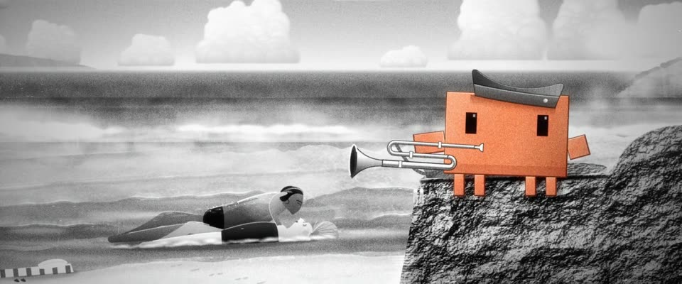

# 高调海滩黑白银幕 · High-Key Beach Black-and-White

> 原文：lemo-opuscar `styleboard/opuscar98_styles.json` 第 26 条（OPUSCAR 98 纪念片里《乱世忠魂》From Here to Eternity（1953）那一段的风格；LemoLab，MIT，commit `f171360`），2026-10-31 收入本仓库作参考（不在风格库里，片子不能选它当风格），未改动。
> 这是约 5 秒片段的风格，没有完整的十一节说明，所以不进风格库。用法：当视觉语言的参考——某一段画面想要这种质感时，借它的提示词写进决策单，声音、镜头、坑由模型自己补。

**渲染**：2D（2D·B&W）　**手法组合**：1953 年高调黑白摄影 · Burnett Guffey · 银盐颗粒与光晕（1953 high-key black-and-white photography · Burnett Guffey · Silver grain and halation）

## 风格提示词（中文原文）

50 年代初高调的黑白外景摄影，用 2D 画出照片感：不描线、不平涂，只用柔和渐变加细腻纹理（沙粒、岩石麻点、布纹）。明暗：约七成画面亮于中灰；天空浅中灰，只比亮云暗一档；深黑很少。默认正午硬朗的太阳，影子短而清楚；其他光线下仍保持浅天空和明亮结构。水、浪沫或雾在最亮处冲白，留住蕾丝细节；湿的表面映着天空。按印片收尾：柔和 S 曲线、略软的镜头、高光晕、每帧刷新的细颗粒（±4%）、轻暗角、轻微闪烁。只有故事围绕的那个主角整个人保留颜色（如 #D97757），明暗也有照片感。镜头：从天空下摇，平视紧框，再慢慢拉远。对标摄影师 Burnett Guffey（《乱世忠魂》）。避免：低调暗沉、死白一片、卡通平涂。

## Style prompt (English original)

Early-1950s high-key black-and-white photography, painted in 2D to read as a photo: no outlines or flat fills, only soft gradients plus fine texture (sand, rock pitting, cloth). Values: about 70% of the frame above mid-grey; sky light-mid grey, one step below the bright clouds; deep blacks small. Default: hard midday sun, short crisp shadows; under other light keep the pale sky and bright values. Water, foam and mist blow out at the peaks, keeping lace detail; wet surfaces mirror the sky. Print finish: gentle S-curve, slightly soft lens, halation, fresh fine grain (±4%), light vignette, flicker. Only the hero the story centres on keeps colour, whole figure (e.g. #D97757), shaded photographically. Camera: tilt down from the sky, tight level frame, slow pull-back. Reference: cinematographer Burnett Guffey (*From Here to Eternity*). Avoid: low-key frames, white blanks, cartoon fills.

## 这个风格是什么（上游说明）

1953 年的高调黑白：硬朗阳光、压暗的天空、泛白的浪沫、映着天的湿沙，银盐颗粒和光晕。拍哈洛纳海湾浪里那一吻；坐在熔岩上吹军号的 Clawd 是唯一的颜色。

1953 high-key black-and-white: hard sun, dark filtered sky, blown white foam, wet sand mirroring the sky, silver grain and halation. It stages the kiss in the surf at Halona Cove; Clawd, playing the bugle on the lava rock, is the only colour.

## 上游示范用法（只是一个例子，不要照搬故事和镜头）

Clawd 扮普鲁伊特：橄榄色船形帽，拿着海报上那支军号。天空一镜往下摇进海湾，中间一镜海浪盖过那一吻，切到全景时 Clawd 踩着拍子把军号举到嘴边，像是在为这场戏吹号。

| 机位 | 镜头 | Shot |
|---|---|---|
| sky | 开在哈洛纳海湾上空，积云间飞过一队飞机；镜头往下摇到海面。 | Open on the sky over Halona Cove, a formation of planes among the cumulus; tilt down to the sea. |
| wave | 平视紧框浪里的恋人：浪头冲上来盖过他们，又退成蕾丝般的白沫，两人一直在吻；镜头慢推并向右漂移。 | Tight and level on the lovers in the swash: the breaker runs up over them and recedes to lace while the kiss goes on; slow push with a drift right. |
| still | 海湾全景：戴船形帽的 Clawd 坐在熔岩石台上，举起军号朝恋人吹响；镜头微微拉远。 | Wide on the cove: Clawd, in a garrison cap on the lava ledge, lifts the bugle and plays toward the lovers; slight pull-back. |

参考：Fred Zinnemann, 1953；Burnett Guffey (cinematography)；From Here to Eternity one-sheet (1953)

