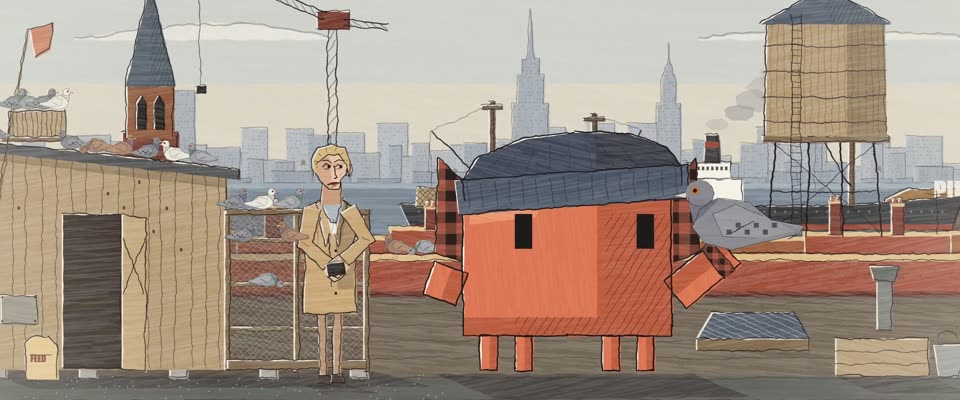

# 本·沙恩社会现实主义 · Ben Shahn Social Realism

> 原文：lemo-opuscar `styleboard/opuscar98_styles.json` 第 27 条（OPUSCAR 98 纪念片里《码头风云》On the Waterfront（1954）那一段的风格；LemoLab，MIT，commit `413a6bd`），2026-10-27 收入本仓库作参考（不在风格库里，片子不能选它当风格），未改动。
> 这是约 5 秒片段的风格，没有完整的十一节说明，所以不进风格库。用法：当视觉语言的参考——某一段画面想要这种质感时，借它的提示词写进决策单，声音、镜头、坑由模型自己补。

**渲染**：2D（2D）　**手法组合**：颤抖的转印墨线 · 平涂蛋彩色块 · 本·沙恩 · 50 年代美国社会现实主义（Trembling blotted ink line · Flat tempera colour blocks · Ben Shahn · 1950s American social realism）

## 风格提示词（中文原文）

仿本·沙恩的社会写实蛋彩画。墨线（宽约画幅宽 1/500）会颤：细抖叠着慢摆，一个轮廓分两三笔、不闭合，偶有转印鬼线（旁边多一道偏移的淡线）。颜色是平涂蛋彩块，比墨线偏 2–4 像素，边缘毛糙，每块约三分之一面积带干笔拖痕，拖痕一笔宽（约画幅宽 1/100），不随色块放大；明暗只用同色深一档的硬边平色。配色按用途：灰蓝 #768492 管天空和冷色区，砖红 #9E4834、赭黄 #C89852 管房屋、土地和衣服，墨 #1F1A1A，底板暖白 #F0E9DA；皮肤浅赭；其他颜色由这几色加深或加灰。故事围绕的那个主角的主要衣服用唯一的暖色（如 #D97757）。人物头大手大、长脸重下巴，衣服下垂。镜头：短推，上摇，收在近景。避免：平滑渐变、干净闭合的轮廓、鲜亮讨喜的颜色。

## Style prompt (English original)

Ben Shahn's social-realist tempera. Ink lines (about 1/500 of frame width) jitter and wander, break each outline into two or three strokes, sometimes doubled by a fainter offset ghost (a blotted line). Flat tempera blocks sit 2-4 px off the line, rough-edged, dry-brush streaks (one brush wide, about 1/100 of frame width) over a third of each block; model form with a darker flat of the same hue. Palette by role: slate #768492 sky and cool areas, brick #9E4834 and ochre #C89852 ground, buildings, clothes, ink #1F1A1A, warm board #F0E9DA; skin pale ochre; other colours: these darkened or greyed. The hero the story centres on wears the one warm accent on its main garment (e.g. #D97757). Big heads and hands, long faces, heavy jaws, heavy clothes. Camera: short pushes, tilt up, close-up. Avoid: smooth gradients, clean closed outlines, cheerful colour.

## 这个风格是什么（上游说明）

本·沙恩的社会现实主义：颤抖的转印墨线，下面是错开的平涂蛋彩色块，大手长脸的工人，颜色克制在灰蓝、砖红、赭黄。沙恩画的就是码头工人和工会，正是这部片的世界。

Ben Shahn's social realism: a trembling, blotted ink line over flat tempera blocks laid slightly off the drawing, big hands and long working faces, restrained slate, brick and ochre. Shahn painted dockers and union halls, which is this film's world.

## 上游示范用法（只是一个例子，不要照搬故事和镜头）

Clawd 扮特里：深藏青针织帽、红黑格子的领子和袖口，手上停着一只鸽子。从码头上争抢的手硬切到安静的屋顶，两个镜头就把这部片的两个世界摆在一起；中间一镜鸽群飞起，近景停在 Clawd 和鸽子身上。表演 1.8 倍速。

| 机位 | 镜头 | Shot |
|---|---|---|
| hands | PIER B 门口清晨派工的中景：码头工人挤在门前，一双双手举起来抢铜工牌，Clawd 不在画面里；镜头轻推。 | Medium on the morning shape-up at Pier B: dockers jam the gate and their hands go up for the brass tags, Clawd out of frame; slight push-in. |
| still | 屋顶鸽舍全景：戴针织帽、立着格子领的 Clawd 举手托着一只鸽子，旁边是伊迪，身后是水塔和曼哈顿天际线，鸽群飞起；镜头慢推并略微上摇。 | Wide on Terry's rooftop coop: Clawd, in a knit cap and plaid collar, holds a pigeon on its raised hand beside Edie, the water tower and Manhattan skyline behind, as the flock lifts off; slow push with a slight tilt up. |
| close | Clawd 和手上灰鸽的近景，肩后是货轮、屋顶和天际线；镜头轻推。 | Close on Clawd and the grey pigeon on its hand, a freighter, rooftops and the skyline over its shoulder; slight push-in. |

参考：Elia Kazan, 1954；Boris Kaufman (cinematography)；On the Waterfront one-sheet (1954)；Ben Shahn, Handball (1939)；Ben Shahn, Welders (1943)

