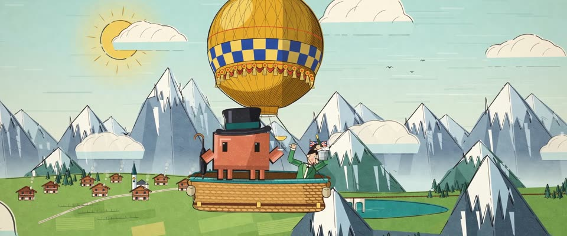

# 50 年代 UPA 现代主义卡通 · 1950s UPA Modernist Cartoon

> 原文：lemo-opuscar `styleboard/opuscar98_styles.json` 第 29 条（OPUSCAR 98 纪念片里《环游地球八十天》Around the World in 80 Days（1956）那一段的风格；LemoLab，MIT，commit `f171360`），2026-10-31 收入本仓库作参考（不在风格库里，片子不能选它当风格），未改动。
> 这是约 5 秒片段的风格，没有完整的十一节说明，所以不进风格库。用法：当视觉语言的参考——某一段画面想要这种质感时，借它的提示词写进决策单，声音、镜头、坑由模型自己补。

**渲染**：2D（2D）　**手法组合**：UPA 有限动画 · Saul Bass 片尾动画 · 1956 原海报配色 · 蜡笔颗粒印刷（UPA limited animation · Saul Bass end-title animation · 1956 poster colours · Crayon-grain print）

## 风格提示词（中文原文）

50 年代 UPA 现代主义卡通。墨线 #221C19 约画面宽的 1/400，有粗细、偶尔断开；色块相对墨线统一朝一个方向错开约 1/300。物体由重叠的平面剪片拼成：一块受光面，加一块同色深约一成半的平色暗面。明亮通透：浅水绿天空和奶油纸 #F2E9D3 占大半画面，芥末黄 #E3A92B、青绿 #2B8C86、橙红 #D4452B 只作点缀；天空、草绿、灰蓝由这些色兑纸色得到。其他时段只改天空颜色。全画面轻蜡笔颗粒（亮度 ±5%），少量纸白斑点。海报构图：一个大图形（建筑、日轮或山峰），旁边是带轮廓的棱角人物。光束画成浅色平涂楔形。机位之间每一两秒硬切，段内慢视差。对标 UPA《Gerald McBoing-Boing》（1950）、Saul Bass《环游地球八十天》片尾（1956）。避免：渐变、套色太准、饱和色铺满画面。

## Style prompt (English original)

1950s UPA modernist cartoon. Uneven ink lines #221C19 about 1/400 of frame width, sometimes broken; colour blocks sit about 1/300 of frame width off them, all one way. Objects are overlapping flat cut-out facets: a lit face and a shadow face one flat step (about 15%) darker. Pale aqua sky and cream paper #F2E9D3 cover most of the frame; mustard #E3A92B, teal #2B8C86, orange-red #D4452B are accents; sky, greens and slate blues are these mixed toward paper. Other times of day change only the sky colour. Crayon grain ±5% brightness everywhere, few flecks. Poster layout: one big graphic shape (a building or sun disc), angular outlined figures beside it. Light beams: flat pale wedges. Hard cuts every 1–2 s; slow parallax drift. After UPA, *Gerald McBoing-Boing* (1950); Saul Bass, *Around the World in 80 Days* titles (1956). Avoid: gradients, perfect registration, saturated colour everywhere.

## 这个风格是什么（上游说明）

50 年代平面几何卡通：色块和墨线错位套印、墨线断续、奶油纸上的蜡笔颗粒。本片 6 分钟的片尾动画就出自 Saul Bass，正是这种现代主义画法。

A flat, geometric 1950s cartoon: colour blocks printed off their ink lines, broken outlines, crayon grain on cream paper. The film's own six-minute end-title animation was made by Saul Bass in this modernist style.

## 上游示范用法（只是一个例子，不要照搬故事和镜头）

Clawd 扮福格：高礼帽、收起的雨伞、一杯香槟。每两拍一刀硬切：地图、全景、近景。红色航线绕地球跑一圈，气球飘过阿尔卑斯，近景落在路路通从雪峰上舀雪冰镇香槟。

| 机位 | 镜头 | Shot |
|---|---|---|
| globe | 地图插入镜头，定机位：青绿底上的地球仪转动，红色航线依次跑过伦敦、苏伊士、孟买、横滨、旧金山；右边一只小气球里坐着 Clawd。 | Map insert, locked off: a globe turns on a teal ground as the red route runs London, Suez, Bombay, Yokohama, San Francisco; a small balloon carrying Clawd floats at the right. |
| balloon | 全景：芥末黄配蓝色棋盘带的热气球飘过分面的阿尔卑斯和瑞士小镇，戴高礼帽的 Clawd 站在吊篮边；缓慢横移。 | Wide: the mustard-and-blue checkerboard balloon drifts over the faceted Alps and a Swiss village, Clawd in a top hat at the basket rail; slow lateral pan. |
| close | Clawd 扮的福格近景：高礼帽、收起的雨伞、举着香槟杯，旁边路路通探身用冰桶从雪峰尖上舀雪；轻微推近。 | Close on Clawd as Fogg, with top hat, furled umbrella and a raised champagne coupe, while Passepartout leans out with an ice bucket to scoop snow off the peak; slight push in. |

参考：Michael Anderson, 1956；Saul Bass (end-title animation)；UPA, Gerald McBoing-Boing (1950)；1956 original poster

