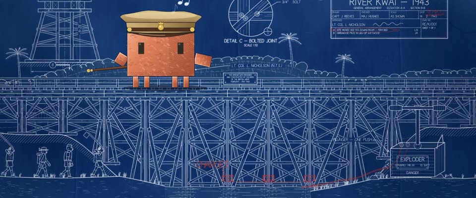

# 氰版工程蓝图 · Cyanotype Engineering Blueprint

> 原文：lemo-opuscar `styleboard/opuscar98_styles.json` 第 30 条（OPUSCAR 98 纪念片里《桂河大桥》The Bridge on the River Kwai（1957）那一段的风格；LemoLab，MIT，commit `413a6bd`），2026-10-27 收入本仓库作参考（不在风格库里，片子不能选它当风格），未改动。
> 这是约 5 秒片段的风格，没有完整的十一节说明，所以不进风格库。用法：当视觉语言的参考——某一段画面想要这种质感时，借它的提示词写进决策单，声音、镜头、坑由模型自己补。

**渲染**：2D（2D）　**手法组合**：氰版晒图 · 木栈桥总布置图 · 红铅笔修改 · 水粉上色的主角（Cyanotype blueprint · Timber trestle G.A. drawing · Red-pencil revisions · Gouache-tinted hero）

## 风格提示词（中文原文）

青晒工程蓝图。图纸铺满画面（胡桃木绘图桌只在拉远时露出）：斑驳的普鲁士蓝纸 #143874，曝光不匀，边缘过曝发绿，有折痕和淡水渍。白线 #ECF4FF 锐利但是印出来的：轮廓约画面宽的 1/600，剖面线和尺寸线减半，曝光弱处断续，带几像素青色微晕。用制图语法把主体画得密：立面、剖面、详图圈、尺寸链、虚线、单线工程字、标题栏。批注和动作用红铅笔 #D63426，写用户的语言。唯一的主角是图上唯一手绘上色的东西，比图纸比例放大（至少占画面高五分之一），不透明水粉，一种暖色分几个深浅（比如橙 #D97757），其余没有暖色。镜头：推近时各层视差，再切详图。避免：霓虹发光、干净的数码蓝、空荡的图纸。

## Style prompt (English original)

Cyanotype engineering blueprint. The sheet fills the frame (the walnut drafting table shows only on a pull-back): mottled Prussian-blue paper #143874, uneven exposure, a greenish over-exposed margin, creases, faint water stains. White lines #ECF4FF, sharp but printed: outlines about 1/600 of frame width, hatching and dimensions half that, broken where exposure was weak, a slight cyan bloom. Draw the subject densely in drafting grammar: elevations, sections, detail circles, dimension chains, hidden lines, single-stroke lettering, a title block. Notes and actions in red pencil #D63426, in the user's language. The one hero subject is the only hand-painted element, drawn above scale (at least 1/5 of frame height), opaque gouache in one warm hue (e.g. orange #D97757); nothing else is warm. Camera: layered parallax push-in; cut to detail views. Avoid: neon glow, clean digital blue, sparse sheets.

## 这个风格是什么（上游说明）

钉在绘图桌上的总布置图：普鲁士蓝底上的白线、折痕、水渍和红铅笔修改。电影讲一个执意把桥造好的上校，所以把桥画成他的工程图。

A general-arrangement blueprint pinned to a drafting table: white lines on Prussian blue, folds, water stains, red-pencil revisions. The film is about a colonel obsessed with building a perfect bridge, so the bridge appears as his engineering drawing.

## 上游示范用法（只是一个例子，不要照搬故事和镜头）

Clawd 扮尼科尔森上校：英军大檐帽、军官短手杖，站在自己的桥上吹口哨。三个镜头讲因果：火车开上桥、引爆器手柄按下、桥跨炸断。爆炸也留在图纸里：红铅笔乱线成火球，排线画烟，不画真实的火光。

| 机位 | 镜头 | Shot |
|---|---|---|
| still | 桥立面的中全景：Clawd（尼科尔森上校）站在桥面上吹口哨，音符往上飘，左下战俘列队行进，右边是引爆器，火车从最右边开上来；缓慢推近。 | Medium wide on the bridge elevation: Clawd (Colonel Nicholson) on the deck whistling, notes rising, POWs marching below left, the exploder at right and a train coming on from the far right; slow push in. |
| detonator | 引爆器箱特写（PLUNGER – ONE PUSH）：T 形手柄按下，红铅笔引线通向炸药；轻微推近。 | Insert on the exploder box ('PLUNGER – ONE PUSH'): the T-handle goes down, the red-pencil wire running off to the charges; slight push in. |
| bridge | 回到桥立面：炸药炸开，红铅笔乱线画成的火球裹在排线画的烟团里，桥跨和火车车厢落进河里；缓慢拉远。 | Back on the elevation: the charges go off in a scribbled red-pencil fireball inside hatched smoke clouds, the span and the train's carriages drop into the river; slow pull back. |

参考：David Lean, 1957；1957 original poster；Timber trestle engineering drawings

