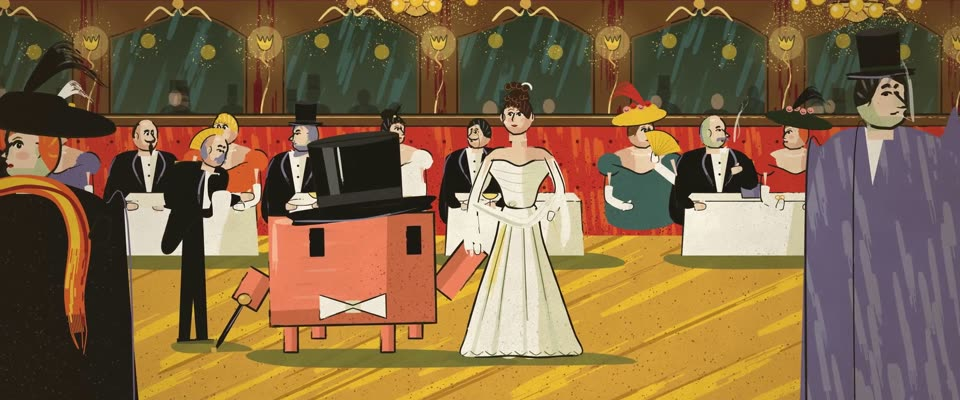

# 罗特列克美好年代石印 · Lautrec Belle Époque Lithograph

> 原文：lemo-opuscar `styleboard/opuscar98_styles.json` 第 31 条（OPUSCAR 98 纪念片里《金粉世界》Gigi（1958）那一段的风格；LemoLab，MIT，commit `f171360`），2026-10-31 收入本仓库作参考（不在风格库里，片子不能选它当风格），未改动。
> 这是约 5 秒片段的风格，没有完整的十一节说明，所以不进风格库。用法：当视觉语言的参考——某一段画面想要这种质感时，借它的提示词写进决策单，声音、镜头、坑由模型自己补。

**渲染**：2D（2D）　**手法组合**：彩色石印海报 · 图卢兹-罗特列克 · 牙刷喷墨点（crachis） · Cecil Beaton 服装（Colour lithograph poster · Henri de Toulouse-Lautrec · Crachis ink spatter · Cecil Beaton costumes）

## 风格提示词（中文原文）

罗特列克式美好年代彩色石印。大块平涂色版，边缘略手抖；人物和主要形体用饱蘸的笔刷勾轮廓，起笔钝、中段鼓、收尾分叉飞白，粗约画面宽的 1/250。牙刷弹的墨点只在背光面、投影和光晕处：1920×1080 下点径一到三像素，稀疏，合计不到画面一成半，颜色取底色深一档。大面用成组的同向干笔条纹。色板：黄 #F1C232、橙红 #E0602C、橄榄绿 #6E7036、黑 #1D1A16，底是带石版颗粒的奶油纸 #EFE3C3；另加灰暗的瓶绿和淡紫，肤色是橙红兑纸色。人物是夸张的讽刺侧脸，画出五官；前景放一个被画框裁掉的大人物。光平而匀，阴影也是平涂色版。镜头：浅视差，慢慢横摇过场景，落到中景。避免：慕夏式光环、平滑渐变、规整网点、满屏黑点。

## Style prompt (English original)

Belle Époque colour lithograph after Toulouse-Lautrec. Flat colour plates with wobbly edges; figures and main shapes outlined in a loaded brush (blunt start, swelling middle, split dry tail), about 1/250 of frame width. Crachis only on shadow sides, cast shadows and glows: 1–3 px dots at 1920×1080, sparse, under 15% of the frame, a darker step of the colour beneath. Large surfaces get grouped dry-brush streaks. Palette: yellow #F1C232, orange-red #E0602C, olive #6E7036, black #1D1A16 on cream stone-grained paper #EFE3C3, plus a muted bottle teal and greyed mauve; flesh is orange-red thinned with paper. Caricatured profiles with drawn faces; one large figure cropped by the frame edge in front. Flat, even light; shadows are flat plates. Camera: shallow parallax, a slow pan settling on a medium shot. Avoid: Mucha halos, smooth gradients, regular halftone, all-over speckle.

## 这个风格是什么（上游说明）

图卢兹-罗特列克式彩色石印：大块平涂、飞白轮廓、用喷溅墨点代替网点、讽刺漫画式面孔。琪琪的高光时刻是走进马克西姆餐厅、全巴黎回头盯着她，正是罗特列克画过的巴黎。

A Toulouse-Lautrec colour lithograph: flat poster colour, dry-brush contours, spattered ink instead of halftone, caricatured faces. Gigi's big moment is walking into Maxim's while all of Paris stares, and Lautrec drew exactly that Paris.

## 上游示范用法（只是一个例子，不要照搬故事和镜头）

Clawd 扮加斯东：高礼帽、白领结、手杖，琪琪挽着它。两人一直往里走，满屋的目光跟着转。三刀卡在拍子上：进门全景、横摇众人瞪眼、再回到两人，琪琪对镜头眨眼收尾。

| 机位 | 镜头 | Shot |
|---|---|---|
| maxims | 马克西姆餐厅全景：戴高礼帽、白领结的 Clawd（加斯东）挽着琪琪走进来，两侧是被裁掉的前景剪影；最近的几桌客人开始回头；缓慢推近并向右漂移。 | Wide of Maxim's: Clawd (Gaston) in top hat and white tie walks Gigi in on its arm between two cropped foreground silhouettes; the nearest diners start to turn; slow push, drifting right. |
| faces | 沿红丝绒卡座横摇：一张张讽刺漫画式的面孔转过来瞪着看，长柄眼镜举起，扇子停住。 | Lateral pan along the red banquette: caricatured diners turn to stare, lorgnettes up, fans stopped. |
| gigi | 两人继续往里走的中景；琪琪的目光转向镜头，眨了一下眼，和原海报一样；轻微右移。 | Mid shot of the pair still walking in; Gigi's eyes come to the lens and she winks, as on the poster; slight drift right. |

参考：Vincente Minnelli, 1958；Henri de Toulouse-Lautrec, Moulin Rouge: La Goulue (1891)；Toulouse-Lautrec, Divan Japonais (1893)；Cecil Beaton (costumes)；1958 MGM poster

