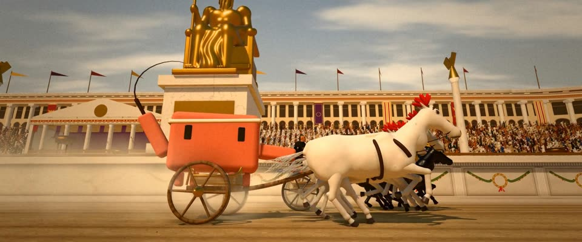

# 3D 大竞技场战车赛 · 65mm 史诗 · 3D Circus Chariot Race, 65mm Epic

> 原文：lemo-opuscar `styleboard/opuscar98_styles.json` 第 32 条（OPUSCAR 98 纪念片里《宾虚》Ben-Hur（1959）那一段的风格；LemoLab，MIT，commit `413a6bd`），2026-10-27 收入本仓库作参考（不在风格库里，片子不能选它当风格），未改动。
> 这是约 5 秒片段的风格，没有完整的十一节说明，所以不进风格库。用法：当视觉语言的参考——某一段画面想要这种质感时，借它的提示词写进决策单，声音、镜头、坑由模型自己补。

**渲染**：3D（3D）　**手法组合**：程序生成 3D（three.js） · MGM Camera 65 宽银幕 · 特艺七彩印片调色 · 第二摄制组动作调度（Procedural 3D (three.js) · MGM Camera 65 widescreen · Technicolor print grade · Second-unit action staging）

## 风格提示词（中文原文）

1959 年 65mm 宽银幕史诗，用 3D 搭。默认是硬朗的高太阳（约 50°），影子短而利，天空钴蓝、到地平线渐成沙白；太阳低时影子仍硬但拉长，天空转琥珀色。大理石、镀金、红花岗岩和沙色石头，做出线脚和槽柱，不能是光秃方盒。暖色尘雾约两成混进中景颜色。调色像 Technicolor 拷贝：暖、饱和、略高反差，不过曝不加辉光；细颗粒（±3%）、轻微片门晃动。核心是规模：背景布满宏伟建筑、雕像和重复元素，绝不空。唯一的主角（比如橙 #D97757）是画面里最饱和的东西；重复动作（步伐、轮、桨）节奏随速度。招牌镜头：全画幅等效 35 到 50mm，低机位贴着运动的主角跟拍；其次是大全景、正俯、近景、仰拍。避免：干净的 CG 光、空荡粗糙的布景、过曝。

## Style prompt (English original)

1959 65mm widescreen epic built in 3D. Default: hard high sun (about 50°), short crisp shadows, cobalt sky fading to sandy white; under a low sun shadows stay hard but long, the sky turns amber. Marble, gilt, red granite and sandstone, with mouldings and fluted columns, never bare boxes. Warm sunlit haze mixes about 20% into mid-distance colours. Technicolor-print grade: warm, saturated, slightly contrasty, no clipping or bloom; fine grain (±3%), slight gate weave. Scale is the point: monumental architecture, statues and repeated elements fill the background, never empty. The one hero subject (e.g. orange #D97757) is the most saturated thing in frame; any repeated motion (stride, wheel, oar) keeps time with speed. Signature shot: low tracking beside the moving hero, 35–50 mm full-frame; then wide, top-down, close-up, low angle. Avoid: clean CG light, empty or primitive sets, overexposure.

## 这个风格是什么（上游说明）

程序生成的 3D 大竞技场，宽银幕史诗光感：沙漠烈日、沙尘、大理石和金色，特艺七彩调色加 65mm 颗粒。战车赛是全片最有名的段落，就直接拍比赛，头顶是海报上的金色巨神。

A fully procedural 3D Circus in widescreen-epic light: hard desert sun, dust, marble and gold, a Technicolor grade and 65mm grain. The chariot race is the film's most famous sequence, so the scene is the race, under the poster's golden colossus.

## 上游示范用法（只是一个例子，不要照搬故事和镜头）

Clawd 扮犹大·宾虚：额上一条亚麻头带，一手握缰一手举鞭，驾四匹白马。五秒六个镜头，照 1959 年第二摄制组的拍法走一遍：起跑、弯道、跟拍、车轮、近景、海报构图。每个机位都跟着战车在动，节奏不掉。

| 机位 | 镜头 | Shot |
|---|---|---|
| start | 起跑白线大全景：九辆四马战车并排，Clawd 的白马队在其中，身后看台坐满；车队冲出，镜头慢慢收紧。 | Wide on the white start line: nine four-horse chariots side by side, Clawd's white team among them, the packed stands behind; the teams launch as the lens slowly tightens. |
| turn | 东弯高位俯拍：战车绕过镀金转弯柱甩出去，身后扬起弧形尘土。 | High overhead on the east turn: the chariots sling round the gilded turning posts, dust arcing behind them. |
| track | 贴着 Clawd 的战车并行跟拍：白马全速奔跑、车辐飞转、尘土飞扬；镜头随车前移。 | Low tracking shot alongside Clawd's chariot: white horses at full gallop, spinning spokes, dust; the camera moves forward with it. |
| wheel | 两车之间的低机位：梅萨拉的锯齿刀毂咬住 Clawd 的车轮，火花四溅；镜头跟车一起走。 | Low between the two chariots: Messala's bladed hub bites into Clawd's wheel and throws sparks; the camera rides with the chariots. |
| close | Clawd 在战车上挥鞭的近景，旁边是梅萨拉的黑马；缓慢推近。 | Close on Clawd cracking the whip from its chariot, Messala's black team alongside; slow push in. |
| still | 海报构图：低角度侧拍，Clawd 的白马队在中央隔墙的金色坐像巨神下追平，身后是看台和总督看台；镜头慢慢放宽。 | The poster shot: low side angle as Clawd's white team draws level under a golden seated colossus on the spina, stands and governor's box behind; the lens slowly widens. |

参考：William Wyler, 1959；Yakima Canutt & Andrew Marton (chariot race)；Robert Surtees (cinematography)；1959 MGM poster

