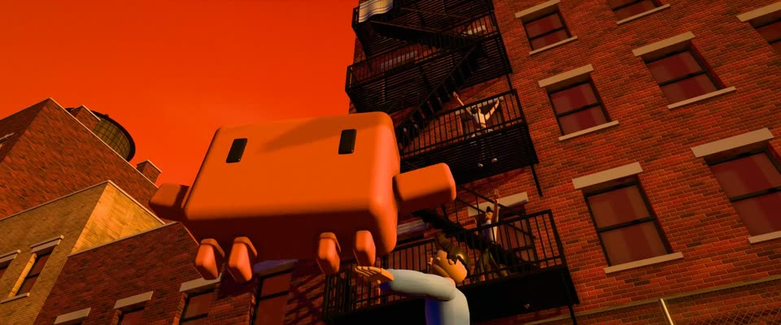

# 特艺七彩 3D 舞台 · Technicolor 3D Stage Set

> 原文：lemo-opuscar `styleboard/opuscar98_styles.json` 第 34 条（OPUSCAR 98 纪念片里《西区故事》West Side Story（1961）那一段的风格；LemoLab，MIT，commit `f171360`），2026-10-31 收入本仓库作参考（不在风格库里，片子不能选它当风格），未改动。
> 这是约 5 秒片段的风格，没有完整的十一节说明，所以不进风格库。用法：当视觉语言的参考——某一段画面想要这种质感时，借它的提示词写进决策单，声音、镜头、坑由模型自己补。

**渲染**：3D（3D）　**手法组合**：程序生成 3D（three.js） · 特艺七彩晚霞调色 · Boris Leven 布景 · 1961 海报：红天、黑消防梯（Procedural 3D (three.js) · Technicolor sunset grade · Boris Leven set design · 1961 poster: red sky, black fire escape）

## 风格提示词（中文原文）

Technicolor 3D 舞台布景，像 60 年代棚拍歌舞片。几何简化，每个面都细节密集（窗洞窗台、檐口、栏杆、梯子、绳线）；表面是有质感的砖、灰泥或岩石，不能素面。剧场布光：低角度暖阳斜扫表面拉出长影；冷补光约为主光四分之一。手绘天空以橙红 #E0481E 为主，云带镶金边，只在最上沿带一点紫；远处融进暖雾。唯一的主角用饱和橙 #D97757，至少占画面高六分之一，背后衬深色砖墙或加一圈黑边，不能化进天空。人物是木偶式假人。暖而饱和的调色，细颗粒（±3%）。招牌镜头：衬着橙色天空的低角度仰拍；其次一个连续镜头从高处降进布景、再贴地推进。避免：写实脏旧、紫粉天空、素面墙、动作跳变。

## Style prompt (English original)

Technicolor 3D stage set, like a 1960s studio musical. Simplified geometry, dense detail on every built surface (openings with sills, ledges, railings, ladders, strung lines); textured brick, plaster or rock, never plain. Theatrical light: a low warm sun rakes surfaces with long shadows; cool fill a quarter of the key. Painted sky of red-orange #E0481E, gold-edged cloud bands, violet only at the top edge; warm haze in the distance. The one hero subject in saturated orange #D97757, at least 1/6 of frame height, set against dark brick or given a black rim so it never melts into the sky. Puppet-like mannequin figures. Warm, saturated grade, fine grain (±3%). Signature shot: a low angle against the orange sky; then one continuous descent into the set and a ground-level push. Avoid: photoreal grime, violet-pink skies, plain walls, poses that pop.

## 这个风格是什么（上游说明）

红橙特艺七彩晚霞下的上西区 3D 街区，饱和、舞台化：红砖、之字形消防梯、屋顶水塔、能摆姿势的舞者人偶。重演电影的俯拍开场、Jets 打响指和海报上那一跃。

A saturated, stage-like 3D block of the Upper West Side under a red-orange Technicolor sunset: red brick, zigzag fire escapes, rooftop water towers, posable dancers. It restages the aerial opening, the Jets' snaps and the poster's leap against the red sky.

## 上游示范用法（只是一个例子，不要照搬故事和镜头）

Clawd 混进 Jets 帮，没有戏服，靠场景认片。响指卡在鼓点上；腾跃是一条干净的抛物线，从下蹲到落地缓冲一气呵成。开场俯拍呼应上一部的桌阵网格；结尾划亮的火柴在画面正中，正是下一部日出的位置，做匹配剪辑。

| 机位 | 镜头 | Shot |
|---|---|---|
| aerial | 正上方俯拍西区街区网格（屋顶、水塔、操场球场），一路下降、抬头落进街道。 | Straight-down aerial over the West Side grid (rooftops, water towers, the playground court), descending and tilting up into the street. |
| street | 球场边低机位，Jets 帮在涂鸦墙前排成楔形打响指，Clawd 在前；一条连续的推镜绕过去推到 Clawd 近景，它的响指卡在鼓点上。 | Low at the court's edge, the Jets' wedge snapping fingers behind Clawd by the graffiti wall; one continuous push swings round and in to a close-up of Clawd snapping on the drum hits. |
| leap | 消防梯下仰拍：Clawd 下蹲、起跳，一条抛物线压在红天上，旁边是舞者的大跳；镜头随弧线抬起。 | Low angle under the fire escape: Clawd crouches and leaps in one arc against the red sky beside a dancer's jeté, the camera tilting up with the arc. |
| escape | 消防梯平台近景：Clawd 划亮火柴，镜头推近直到火苗停在画面正中，随后被吹灭。 | Close on the fire-escape landing: Clawd strikes a match, the camera pushes in until the flame sits at frame centre, then it is blown out. |

参考：Robert Wise & Jerome Robbins, 1961；Boris Leven (production design)；Saul Bass (end titles)；1961 original poster

