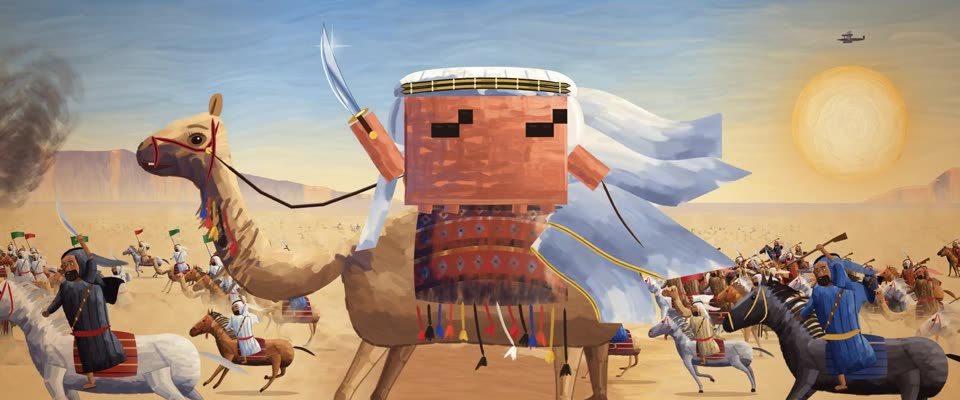

# Terpning 史诗海报水粉 · Terpning Epic Poster Gouache

> 原文：lemo-opuscar `styleboard/opuscar98_styles.json` 第 35 条（OPUSCAR 98 纪念片里《阿拉伯的劳伦斯》Lawrence of Arabia（1962）那一段的风格；LemoLab，MIT，commit `413a6bd`），2026-10-27 收入本仓库作参考（不在风格库里，片子不能选它当风格），未改动。
> 这是约 5 秒片段的风格，没有完整的十一节说明，所以不进风格库。用法：当视觉语言的参考——某一段画面想要这种质感时，借它的提示词写进决策单，声音、镜头、坑由模型自己补。

**渲染**：2D（2D）　**手法组合**：水粉加油彩海报画 · Howard Terpning 1962 海报 · Freddie Young 70mm 沙漠光（Gouache and oil poster painting · Howard Terpning's 1962 poster · Freddie Young's 70mm desert light）

## 风格提示词（中文原文）

60 年代手绘史诗电影海报，水粉打底、油彩提亮。先把形体画扎实再上色：铺不透明中间调底色，再用顺形体走的笔触（大面宽约画面宽的 1/80 到 1/50，脸和手用小笔），边缘柔和衔接；每个形体分亮、中、暗三级；干笔只用在尘土、布料和远处人物上；最后在受光边缘压锐利的暖奶油色高光。冷暖对比：钴蓝天空 #1F4D97 过渡到浅蓝 #A9C3D6，低垂的太阳周围转暖；地面 #EEC27A（任何地形），皮肤、泥土和衣服用赭红 #B56A33，远处阴影用紫 #6C6394。主角居中最大，一个斜向动作，布料飘起；身后可以有更小更松的人物退远。轻画板颗粒、暖暗角、雾气。运动：起伏、缓推到仰角近景、甩镜出画。避免：又碎又匀的刮擦线、平涂数码色、只有冷色。

## Style prompt (English original)

1960s hand-painted epic film poster, gouache with oil highlights. Draw forms solidly, then paint: an opaque mid-tone base, directional strokes following each form (1/80–1/50 of frame width on large areas, smaller on faces and hands), soft-blended edges; model every form in three values; dry-brush only on dust, cloth and distant figures; sharp warm-cream highlights last on lit edges. Warm–cool contrast: cobalt sky #1F4D97 to pale blue #A9C3D6, warming to cream near a low sun; ground #EEC27A (any terrain); ochre-red #B56A33 for skin, earth and costume; violet #6C6394 for distant shadows. The hero centred and largest, a diagonal gesture, cloth streaming; smaller, looser figures may recede behind. Light board grain (±3%), warm vignette, haze. Motion: bounce, slow push to a low close-up, a whip pan out. Avoid: scratchy uniform hatching, flat digital fills, cold-only colour.

## 这个风格是什么（上游说明）

看得见笔触方向的史诗海报水粉，冷暖对比强烈：琥珀色沙漠对钴蓝天空。《阿拉伯的劳伦斯》原海报就是 Howard Terpning 用这种画法画的。

Painterly epic-poster gouache with visible directional strokes and a hard warm–cool split: amber sand against cobalt sky. Lawrence of Arabia's original poster was painted by Howard Terpning in exactly this manner.

## 上游示范用法（只是一个例子，不要照搬故事和镜头）

Clawd 扮劳伦斯：白袍、白头巾、金色头箍，骑骆驼举弯刀。开场就是影史最有名的匹配剪辑：上一部的火柴火苗变成沙漠日出。整段冲锋恒定 1.5 倍速，弯刀卡拍举起、刀尖一闪，最后甩镜头出画，接《汤姆·琼斯》。

| 机位 | 镜头 | Shot |
|---|---|---|
| sun | 空旷沙漠的黎明大远景：一轮巨大的太阳在画面正中透过热浪升起，和上一部吹灭的火柴做匹配剪辑；缓慢推近。 | Extreme wide of an empty desert at dawn: a huge sun rising through heat haze at frame centre, matched to the blown-out match; slow push in. |
| charge | 跟拍车上的海报构图：Clawd（劳伦斯）骑骆驼混在冲锋的骑兵里奔来，弯刀先放低，卡拍举起、刀尖一闪；颠簸晃动，缓慢推近。 | Poster framing from the camera car: Clawd (Lawrence) gallops in on a camel among charging riders, scimitar low, then raised on the beat with a glint; jolting shake, gentle push. |
| whip | 低角度推向高举的弯刀，然后向右甩镜头出画，接下一部。 | Low angle pushing up to the raised blade, then a whip pan right, out of the frame and into the next film. |

参考：David Lean, 1962；Howard Terpning (1962 poster)；Freddie Young (70mm cinematography)

