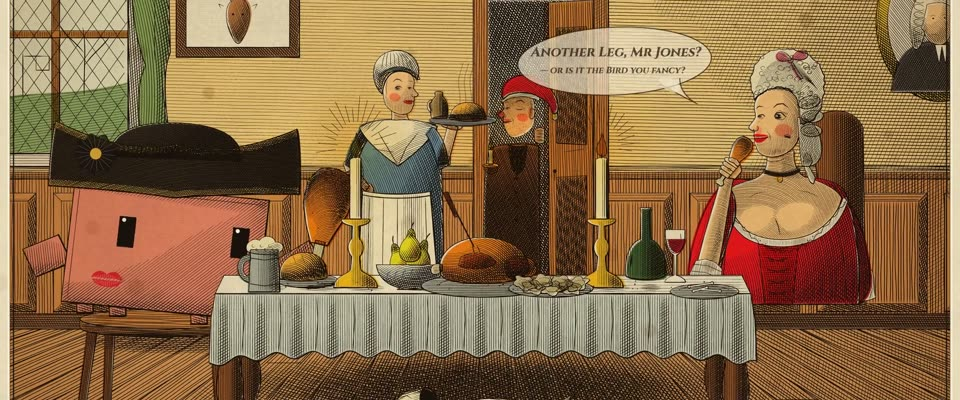

# 手工上色讽刺铜版画 · Hand-Coloured Georgian Satirical Print

> 原文：lemo-opuscar `styleboard/opuscar98_styles.json` 第 36 条（OPUSCAR 98 纪念片里《汤姆·琼斯》Tom Jones（1963）那一段的风格；LemoLab，MIT，commit `413a6bd`），2026-10-27 收入本仓库作参考（不在风格库里，片子不能选它当风格），未改动。
> 这是约 5 秒片段的风格，没有完整的十一节说明，所以不进风格库。用法：当视觉语言的参考——某一段画面想要这种质感时，借它的提示词写进决策单，声音、镜头、坑由模型自己补。

**渲染**：2D（2D）　**手法组合**：霍加斯铜版线刻 · 罗兰森/吉尔雷式手工上色 · 讽刺画对白气泡（Hogarth copperplate engraving · Rowlandson/Gillray hand colouring · Satirical speech balloon）

## 风格提示词（中文原文）

乔治王时代讽刺版画：先刻铜版，印完再手工上色。墨只有棕黑色的线：雕刀轮廓约画面宽的 1/400，起伏鼓胀，背光一侧更粗；排线顺形体走、铺满每个面（线距约画面宽的 1/250），只在暗部交叉，平面用直尺排线。颜色几乎铺满整幅，清透但饱满：水色溢出墨线几像素，用酒红 #B3262E、黄铜 #D8A93A、肉色 #F0C4A4、石板蓝 #6D8AA6，大面用暖赭和棕褐。浅棕褐帘纹纸，淡霉点，版框印痕，刻线边框。按 William Hogarth 的方式布置：大鼻子的漫画人物，主体身边是旁观者或搞笑的道具、动物；一个手写斜体对话气泡，用用户的语言。镜头：全幅停两秒，急推，横滑到另一处细节，再给近景。避免：机械均匀的排线、大片空白纸、颜色严丝合缝填在线里、颜色发脏。

## Style prompt (English original)

Georgian satirical print: a copperplate engraving, hand-coloured. Brown-black line only: swelling burin outlines about 1/400 of frame width, heavier on the shadow side; hatching follows each form and covers every surface (spacing about 1/250 of frame width), cross-hatched in the darks, ruled on flat areas. Colour covers nearly the whole picture, clear but strong: washes spilling a few pixels off the line in claret #B3262E, brass #D8A93A, flesh #F0C4A4, slate blue #6D8AA6, warm ochre and umber on large surfaces. Sepia laid paper, foxing, plate mark, engraved border. Stage it like William Hogarth: big-nosed caricatures, bystanders or comic props and animals around the subject; one slanted handwritten speech balloon in the user's language. Camera: hold the full plate 2 s, whip in, glide to another detail, close-up. Avoid: even mechanical hatching, blank paper, colour exactly inside lines, muddy colour.

## 这个风格是什么（上游说明）

乔治王时代的讽刺版画：霍加斯式粗细变化的刻线和有方向的排线，上面刷罗兰森式鲜艳的手工淡彩，稍稍出线，再加一个对白气泡。电影本身就在模仿霍加斯笔下的 18 世纪英国。

A Georgian satirical print: Hogarth's swelling burin lines and directional hatching under bright Rowlandson-style hand colour brushed slightly off the line, plus a speech balloon. The film itself imitates Hogarth's 18th-century England.

## 上游示范用法（只是一个例子，不要照搬故事和镜头）

Clawd 扮汤姆·琼斯：金边三角帽、脸上一个口红唇印、手拿鸡腿。不用正反打，用一次横滑：从隔桌的双人镜头滑到沃特斯夫人眨眼、冒出对白气泡。再切近景：心形眼、陶醉一晃，摘下三角帽扣向镜头，画面全黑，下一部从黑里开场。

| 机位 | 镜头 | Shot |
|---|---|---|
| two | 从左边甩进隔着满桌菜的双人镜头，Clawd（汤姆）大口啃鸡腿；镜头横滑过桌面落到沃特斯夫人，她冒出对白气泡（Another Leg, Mr Jones?）并眨了一下眼。 | Whip in from the left onto the two-shot across the laden table, Clawd (Tom) tearing into a drumstick; the camera glides across the table onto Mrs Waters as her speech balloon appears ('Another Leg, Mr Jones?') and she winks. |
| clawd | Clawd 近景：眼睛变成心形，陶醉地一晃，又啃一小口，然后摘下三角帽扣向镜头，画面变黑；缓慢推近。 | Close on Clawd: heart eyes pop, a swoon and a lovesick nibble, then it doffs the tricorn and claps it over the lens to black; slow push in. |

参考：Tony Richardson, 1963；William Hogarth, A Rake's Progress / Marriage A-la-Mode；Thomas Rowlandson；James Gillray

