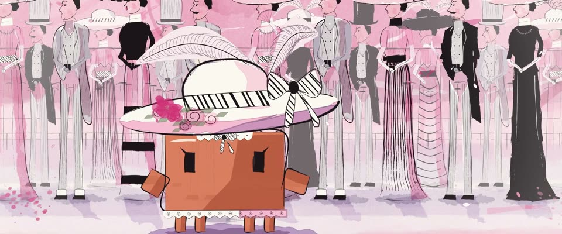

# Bob Peak 时装插画 · Bob Peak Fashion Illustration

> 原文：lemo-opuscar `styleboard/opuscar98_styles.json` 第 37 条（OPUSCAR 98 纪念片里《窈窕淑女》My Fair Lady（1964）那一段的风格；LemoLab，MIT，commit `413a6bd`），2026-10-27 收入本仓库作参考（不在风格库里，片子不能选它当风格），未改动。
> 这是约 5 秒片段的风格，没有完整的十一节说明，所以不进风格库。用法：当视觉语言的参考——某一段画面想要这种质感时，借它的提示词写进决策单，声音、镜头、坑由模型自己补。

**渲染**：2D（2D）　**手法组合**：快速墨线 · 粉色与品红水彩 · Bob Peak 1964 海报 · Cecil Beaton 阿斯科特服装（Fast ink line · Pink and magenta watercolour · Bob Peak's 1964 poster · Cecil Beaton's Ascot costumes）

## 风格提示词（中文原文）

仿 Bob Peak 的 60 年代时装插画。墨线很快：转弯处变粗、直线处变细，后段飞白，收笔一甩；粗细在画面宽的 1/600 到 1/250 之间，小弯处变细。深色衣服、帽子和条纹用实心墨块；脸留白纸 #FBF7F1。水彩是松散柔边的色池，干后边缘积色更深：粉 #EE84B2 做主色，品红 #CE3076 做热点，加玫瑰粉 #F4B2CC 和一点梅紫 #80285C；次要人物和阴影用暖灰；带方向的甩点。场景只用几根线和这几种水彩带过。横排人物是核心：修长侧身，九到十个头高，横向重复（主角加暖灰人物或重影），黑白图案压在粉色上；水彩盖住画面六到八成。镜头：沿人物慢横移；转场借图形遮罩。避免：轮廓粗细一样、平涂数码色、多边形硬边色块、空白页上孤零零一个人。

## Style prompt (English original)

1960s fashion illustration after Bob Peak. Fast ink line, thicker in turns, dry-brush tail, a flick off; 1/600–1/250 of frame width, thinning on tight curves. Solid black for dark clothing, hats and stripes; faces bare paper #FBF7F1. Loose, soft-edged watercolour pools, darker at drying edges: pink #EE84B2 as the main field, magenta #CE3076 for hot spots, rose #F4B2CC, a touch of plum #80285C; warm grey for secondary figures and shading; directional splatter. Settings are a few lines in these washes, not literal colour. The frieze is essential: slender profile figures 9–10 heads tall repeated across the frame (the hero plus grey-wash figures or echoes), black-and-white pattern over pink; washes cover 60–80% of the frame. Camera: slow drift along the figures; graphic-mask transitions. Avoid: even-width outlines, flat digital fills, polygon-edged washes, a lone figure on an empty page.

## 这个风格是什么（上游说明）

快速、带飞白的墨线，配粉色和品红水彩晕染、甩点，四周化进白纸。1964 年原海报就是 Bob Peak 的墨线加粉彩；场景是 Cecil Beaton 设计的黑白阿斯科特。

Fast, dry-edged ink line with pink and magenta watercolour washes, splatter and edges fading to white paper. The original 1964 poster was Bob Peak's ink and pink; the scene is Cecil Beaton's black-and-white Ascot.

## 上游示范用法（只是一个例子，不要照搬故事和镜头）

Clawd 扮伊莉莎：巨大的白帽（条纹缎带、玫瑰、白鸵鸟羽），领口和裙边一圈蕾丝。开场从上一部的黑画面里掀起帽檐，结尾收进人群望远镜的两个圆圈，下一部《音乐之声》就在这两个圆里开场。三个镜头，节奏不急。

| 机位 | 镜头 | Shot |
|---|---|---|
| reveal | 从黑里，阿斯科特大帽的帽檐抬起，露出 Clawd（伊莉莎）的近景；它把目光转向镜头，微微屈膝行礼，画面轻轻往后收。 | Out of black, the Ascot hat brim lifts to reveal Clawd (Eliza) close; it turns its eyes to the lens and dips a small curtsey as the frame settles back slightly. |
| wide | 阿斯科特全景：Clawd 站在两排穿 Beaton 黑白服装、僵立的贵族前面；缓慢横移，它抬起下巴。 | Wide on the Ascot tableau: Clawd in front of two rows of stiff aristocrats in Beaton black and white; slow lateral glide as it lifts its chin. |
| crowd | 沿僵立的人群横摇，所有人同时举起望远镜，最后画面收进两个望远镜圆圈。 | Pan along the frozen crowd as every pair of binoculars goes up, then the frame closes into two binocular circles. |

参考：George Cukor, 1964；Bob Peak (1964 poster)；Cecil Beaton (costume designs)

