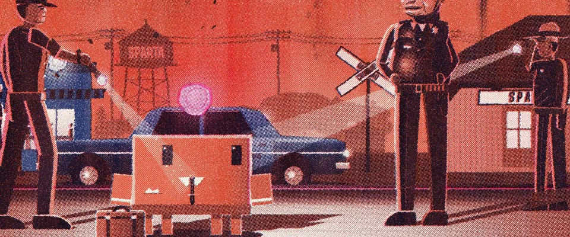

# 三色 Risograph 夜景 · Three-Ink Risograph Night

> 原文：lemo-opuscar `styleboard/opuscar98_styles.json` 第 40 条（OPUSCAR 98 纪念片里《炎热的夜晚》In the Heat of the Night（1967）那一段的风格；LemoLab，MIT，commit `f171360`），2026-10-31 收入本仓库作参考（不在风格库里，片子不能选它当风格），未改动。
> 这是约 5 秒片段的风格，没有完整的十一节说明，所以不进风格库。用法：当视觉语言的参考——某一段画面想要这种质感时，借它的提示词写进决策单，声音、镜头、坑由模型自己补。

**渲染**：2D（2D）　**手法组合**：Risograph 叠印 · 1967 海报橙红 · Haskell Wexler 夜景 · 剪影式调度（Risograph overprint · 1967 poster orange-red · Haskell Wexler night exteriors · Silhouette staging）

## 风格提示词（中文原文）

三色专色 Risograph 印刷：橙红 #EC5032 是主场（约占画面六成，带竖向流淌痕），深蓝 #162C76 给剪影和阴影，荧光粉 #FF48B0 只给轮廓光和光晕，印在暖白纸 #F7F2E7 上。每色是各自网角的半调，点径约画面宽的 1/300，版间错位二到四像素；有墨粒、针孔，逐帧轻微抖动。蓝剪影底下挖掉橙色，印成纯蓝；只有最暗处两色叠成近黑。光就是没有墨：光束、灯和被照亮的地面露出纸白，外圈一道粉。人物是带粉色边缘光的蓝剪影，肤色用三到六成橙色网点加一级蓝暗部。时间偏冷时仍保留红场，只让蓝色升到天空顶部。镜头：手持跟在提着光源的人身后，一个反打近景，一次缓推。避免：蓝色占满画面、平滑渐变、第四种墨、套印太准。

## Style prompt (English original)

Three-ink Risograph: orange-red #EC5032 as the dominant field (about 60%, with drip streaks), deep blue #162C76 for silhouettes and shadows, fluorescent pink #FF48B0 only for rims and halos, on warm paper #F7F2E7. Each ink is halftoned at its own angle, dots 1/300 of frame width, plates misregistered 2–4 px; grain, pinholes, slight boil. Knock orange out under blue silhouettes so they print pure blue; only the darkest accents overprint to near-black. Light is the absence of ink: beams, lamps and lit ground show bare paper, ringed in pink. Figures: blue silhouettes, pink rims; skin is 30–60% orange with a blue shadow step. At cooler times keep the red field; blue rises only into the top of the sky. Camera: handheld behind someone carrying a light, a reverse close-up, a push. Avoid: blue-dominated frames, smooth gradients, a fourth ink, clean registration.

## 这个风格是什么（上游说明）

三色 Risograph 印刷：深蓝、海报橙红、荧光粉，带网点、颗粒和套色错位；光是用「少上墨」印出来的。呼应 1967 年海报的橙红热浪底和黑色剪影。

A three-ink Risograph print in deep blue, poster orange-red and fluorescent pink, with halftone, grain and misregistration; light is printed as less ink. It echoes the 1967 poster's orange heat field and black silhouettes.

## 上游示范用法（只是一个例子，不要照搬故事和镜头）

Clawd 扮维吉尔·蒂布斯：白衬衫领尖、深色窄领带、袖口，脚边一只手提箱。上一部熄灭的烛光把夜带进来。三个镜头堆出对峙：手电找到它、警长停下嚼口香糖、它挺直腰板，像在说「They call me MISTER Tibbs!」

| 机位 | 镜头 | Shot |
|---|---|---|
| pov | 黑暗中的手持手电主观镜头：副警长的光束扫过车站站台，找到手提箱旁的 Clawd（蒂布斯）；它抬头睁大眼，其他几束手电随即亮起。 | Handheld flashlight POV out of the dark: a deputy's beam sweeps the depot platform and finds Clawd (Tibbs) by its suitcase; it looks up, eyes wide, and the other beams snap on. |
| sheriff | 反打警长吉莱斯皮近景：大檐帽、飞行员墨镜，嚼着口香糖，然后停住；缓慢推近。 | Reverse close on Chief Gillespie: peaked cap, aviator shades, chewing gum, then stopping; slow push in. |
| standoff | 对峙中全景：Clawd 站在副警长和警长之间，几束手电光交叉打在它身上，身后是蓝色警车和斯巴达镇水塔；它挺直身子、端平肩膀，镜头推近。 | The stand-off, medium wide: Clawd between the deputies and the chief in crossing flashlight beams, the blue cruiser and the Sparta water tower behind; it straightens up and squares its shoulders as the camera pushes in. |

参考：Norman Jewison, 1967；Haskell Wexler (cinematography)；1967 original poster；Tom Haugomat

