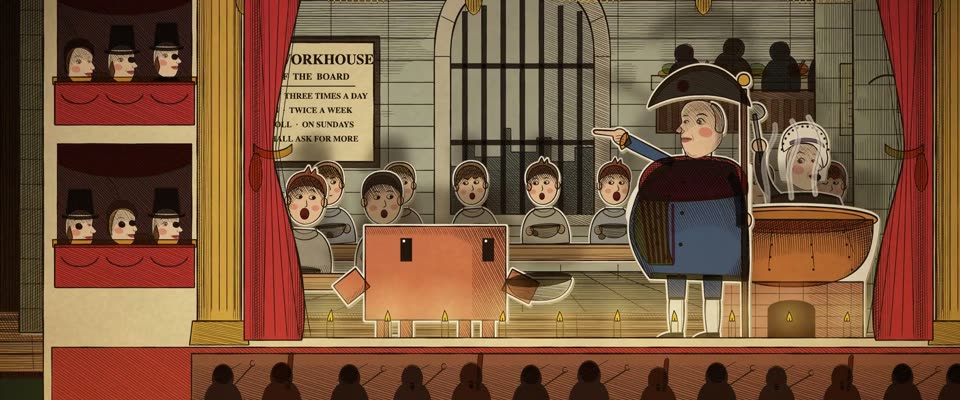

# 维多利亚玩具纸剧场 · Victorian Toy Theatre

> 原文：lemo-opuscar `styleboard/opuscar98_styles.json` 第 41 条（OPUSCAR 98 纪念片里《雾都孤儿》Oliver!（1968）那一段的风格；LemoLab，MIT，commit `413a6bd`），2026-10-27 收入本仓库作参考（不在风格库里，片子不能选它当风格），未改动。
> 这是约 5 秒片段的风格，没有完整的十一节说明，所以不进风格库。用法：当视觉语言的参考——某一段画面想要这种质感时，借它的提示词写进决策单，声音、镜头、坑由模型自己补。

**渲染**：2.5D（2.5D）　**手法组合**：Pollock's 玩具剧场 · 手工上色石印纸偶 · 剪卡与脚灯投影 · Cruikshank 漫画人物（Pollock's toy theatre · Hand-coloured lithograph sheets · Cut card with footlight shadows · Cruikshank caricature）

## 风格提示词（中文原文）

维多利亚玩具纸剧场（Pollock's 式）。一切都是印出来的卡纸：黑色石印轮廓约画面宽的 1/400，每张剪纸一侧有稀疏蜡笔排线；手工上色是沉稳旧色：深红 #C8262C 和暗金 #E0AB36 用在台口和帷幔（金色不能是亮黄），蓝 #2F5A9A 给服装；布景、天空、水和肤色用发灰的棕、灰和奶油卡纸 #F4ECD6。每个人物和景片留一圈剪刀白边（约画面宽的 1/200）。景片是平行的 2.5D 层，层间视差，层内无透视。烛光脚灯把剪纸影子放大约一倍半投到后面景片上，柔边，随烛火闪动。镀金台口、红帷幔和画出来的包厢观众框住舞台，台口宽占画面八到九成。镜头：慢推、横移，近景微震；结尾拉远露出暗房间。避免：鲜艳矢量色、真 3D 纵深、柔和摄影光、没有剪边的人物。

## Style prompt (English original)

Victorian toy paper theatre (Pollock's), all printed card: black lithographic outlines about 1/400 of frame width, sparse crayon hatching on one side of each piece; muted antique hand colouring: deep red #C8262C and dull gold #E0AB36 on proscenium and curtains (never bright yellow), blue #2F5A9A for costumes; scenery, sky, water and skin in greyed browns, greys and cream card #F4ECD6. Every cut-out keeps a white scissor margin (1/200 of frame width). Flats are parallel 2.5D layers in parallax, flat within each plane. Candle footlights throw each cut-out's shadow onto the scenery behind, about 1.5× enlarged, soft, flickering. Gilt proscenium, red drapes and painted audience boxes frame a stage opening 80–90% of frame width. Camera: slow push, lateral tracking, shaky close-ups; a final pull-back shows the dark room. Avoid: bright vector colour, true 3D depth, soft studio light, figures without margins.

## 这个风格是什么（上游说明）

维多利亚玩具纸剧场：手工上色的石印卡纸人物留着剪刀白边，景片分层插在滑杆上，镀金台口下的烛光脚灯把影子投上景片。《雾都孤儿》是歌舞片，正好搬上维多利亚家庭小舞台。

A Victorian toy theatre: hand-coloured lithographed card figures with a white scissor margin, layered flats on wire slides, a gilt proscenium and flickering candle footlights throwing shadows up the scenery. Oliver! is a musical, staged here on the Victorian home stage.

## 上游示范用法（只是一个例子，不要照搬故事和镜头）

Clawd 扮奥利弗：插在自己滑杆上的纸偶，手里举着空碗。全景、舞台、近景三种景别拉开层次：上前一步，卡拍举起空碗，班布尔一吼，它缩了一下，碗还是举着。

| 机位 | 镜头 | Shot |
|---|---|---|
| table | 全景：暗房间里红木桌上的玩具剧场，「Theatre Royal」台口，桌上一张人物剪纸，旁边伸进来一只操偶的手；缓慢推近。 | Wide: the toy theatre on a mahogany table in a dark parlour, the 'Theatre Royal' proscenium, a sheet of cut-out characters and the player's hand at the side; slow push in. |
| stage | 沿舞台横移，济贫院饭堂：Clawd（奥利弗）从一排孩子里走出来，举起空碗（Please, sir…），冒着热气的粥锅旁，班布尔的眉头皱起来；镜头随它向右跟。 | Tracking shot across the stage, the workhouse hall: Clawd (Oliver) steps out of the line of boys and lifts its empty bowl ('Please, sir…') as Mr Bumble's brow gathers by the steaming copper; the camera tracks right with it. |
| close | Clawd 和班布尔的近景：班布尔一声大吼，Clawd 缩了一下、发抖，碗还是举着；吼声那一下镜头轻震。 | Close on Clawd and Mr Bumble: Bumble roars, Clawd cowers with a shiver but keeps the bowl up; a small camera shake on the roar. |

参考：Carol Reed, 1968；Benjamin Pollock (toy theatre sheets)；George Cruikshank；Pollock's Toy Museum

