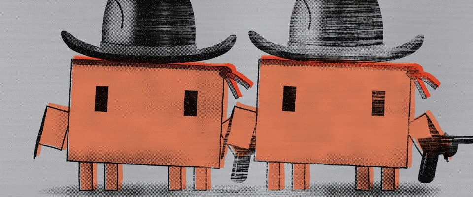

# 沃霍尔照片丝网 · Double Elvis · Warhol Photo-Silkscreen, Double Elvis

> 原文：lemo-opuscar `styleboard/opuscar98_styles.json` 第 42 条（OPUSCAR 98 纪念片里《午夜牛郎》Midnight Cowboy（1969）那一段的风格；LemoLab，MIT，commit `f171360`），2026-10-31 收入本仓库作参考（不在风格库里，片子不能选它当风格），未改动。
> 这是约 5 秒片段的风格，没有完整的十一节说明，所以不进风格库。用法：当视觉语言的参考——某一段画面想要这种质感时，借它的提示词写进决策单，声音、镜头、坑由模型自己补。

**渲染**：2D（2D）　**手法组合**：照片丝网印 · 沃霍尔《Double Elvis》（1963） · 银漆底 · 错位色块（Photo silkscreen · Andy Warhol, Double Elvis (1963) · Silver paint ground · Off-register colour blocks）

## 风格提示词（中文原文）

安迪·沃霍尔式照片丝网印。两块版：一块是 45° 的高反差黑色半调照片，网点约画面宽的 1/200，几乎没有中间调；下面是手刷平涂色块，相对照片错开约画面宽的 1/100，边缘歪扭：出租车黄 #F3BE14、肤粉 #F2A197、奶油 #EFE6CF、红 #E2462B，底是带柔和光泽的刷涂银漆 #BABCC0。唯一的主角用最强的那块颜色。刮板压力不匀：有的地方网点糊成墨团，有的地方拖成横向干笔条纹和针孔，底下隐约有画布纹。重复就是构图：同一个人物或物体全身，在空银底上并排印两次、再印三次，略有重叠。场景只以褪成银色的印样出现在重复里。镜头：手持晃动、推近、正面平面定格。对标沃霍尔《Double Elvis》（1963）。避免：干净均匀的网点、套色完全对齐、处处一样清晰。

## Style prompt (English original)

Andy Warhol photo-silkscreen. Two plates: a high-contrast black halftone photograph at 45°, dots about 1/200 of frame width, few mid-tones; and hand-painted flat colour blocks underneath, offset about 1/100 of frame width with wobbly edges: taxi yellow #F3BE14, skin pink #F2A197, cream #EFE6CF, red #E2462B, on brushed silver paint #BABCC0 with a soft sheen. The one hero subject takes the strongest block colour. Uneven squeegee pressure: dots flood into blotches in places, drag into dry horizontal streaks and pinholes elsewhere, over faint canvas weave. Repetition is the composition: the same figure or object, full-length, printed side by side two then three times, slightly overlapping, on empty silver. Settings appear only as drained-to-silver prints in the repeat. Camera: handheld shake, a push in, flat frontal tableaux. Reference: Andy Warhol, *Double Elvis* (1963). Avoid: clean even halftone, perfect registration, uniform crispness.

## 这个风格是什么（上游说明）

沃霍尔的照片丝网：黑色网点照片层印得不匀，错位地压在松散的平涂色块上，底是银色，画面重复两次、三次。片里就有沃霍尔工厂式的派对，而他画的猫王正是牛仔。

Warhol's photo-silkscreen: a black halftone photo printed unevenly over loose flat colour blocks on silver, the image repeated two and three times. The film has a Factory-style party in it, and his Elvis is a cowboy.

## 上游示范用法（只是一个例子，不要照搬故事和镜头）

Clawd 扮乔·巴克：黑色斯泰森帽、红色领巾、手臂上的麂皮流苏。先演电影里那句「I'm walkin' here!」：出租车急刹、它往后一跳、拉索拍车头大吼。然后画面变成沃霍尔丝网，Clawd 摆出猫王的枪手站姿，先印两次，再印三次。

| 机位 | 镜头 | Shot |
|---|---|---|
| street | 第六大道的人行横道：黄色出租车急刹冲进来，Clawd（乔·巴克）往后一跳、瞪着眼，拉索拍了一下车头；手持晃动，缓慢推近。 | Sixth Avenue crosswalk: a yellow cab brakes in, Clawd (Joe Buck) jumps back and stares as Ratso slaps the hood; handheld shake, slow push. |
| taxi | 拉索的近景：叼着烟冲出租车大吼、手指着司机（I'm walkin' here!）；推近。 | Closer on Ratso yelling into the cab, cigarette on his lip, finger pointing ("I'm walkin' here!"); push in. |
| warhol | 街景褪成银色，印成沃霍尔的 Double：两个戴斯泰森帽、手持左轮的 Clawd 叠在一起，再变成三个；正面平视的定格画面。 | The street drains to silver and prints itself into Warhol's Double: two overlapping Clawds in Stetsons with revolvers, then three; flat frontal frame. |

参考：John Schlesinger, 1969；Andy Warhol, Double Elvis (1963)；Andy Warhol, Silver Car Crash (Double Disaster) (1963)；1969 original poster

