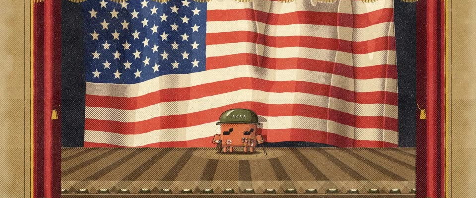

# 二战战争债券石印海报 · WWII War-Bond Lithograph

> 原文：lemo-opuscar `styleboard/opuscar98_styles.json` 第 43 条（OPUSCAR 98 纪念片里《巴顿将军》Patton（1970）那一段的风格；LemoLab，MIT，commit `413a6bd`），2026-10-27 收入本仓库作参考（不在风格库里，片子不能选它当风格），未改动。
> 这是约 5 秒片段的风格，没有完整的十一节说明，所以不进风格库。用法：当视觉语言的参考——某一段画面想要这种质感时，借它的提示词写进决策单，声音、镜头、坑由模型自己补。

**渲染**：2D（2D）　**手法组合**：石印海报 · 1942–45 美军征兵与战争债券海报 · 45° 网点、套色错位（Stone lithograph poster · 1942–45 US war-bond and recruiting posters · 45° halftone, off-register colour stones）

## 风格提示词（中文原文）

1940 年代美国战争债券石印海报。平涂油墨：红 #C2342C、海军蓝 #213261、橄榄绿 #5F5C31、卡其 #B7975E，印在米白 #E6D5B3 的纸上，有纤维、霉点和磨边。每个形体三档：留纸、平涂、油墨加网点，压成硬边色阶。棕黑轮廓线约画面宽的 1/500，最后压上；阴影是粗的 45° 网点带（点径约画面宽的 1/150），带蜡笔颗粒；色版错开约画面宽的 1/600。默认像舞台：对称正面，小主体站在占满大半画面的巨大图形前（旗帜、徽章、放射光芒），灯光是硬边浅色块或留纸；户外也一样，光落成地上的硬边浅斑。文字可有可无，用用户的语言。镜头慢推，配一次干脆的拉出。对标 1942–45 年美国战争债券海报。避免：喷枪渐变、套色完全对齐、网点细到像一片灰。

## Style prompt (English original)

1940s US war-bond lithograph poster. Flat inks: red #C2342C, navy #213261, olive #5F5C31, khaki #B7975E, on fibrous, foxed cream #E6D5B3 paper. Three values per form (bare paper, flat ink, ink plus halftone), posterised in hard steps. Brown-black key line about 1/500 of frame width, printed last; shadows as coarse 45° halftone bands (dots about 1/150 of frame width) with crayon grain; colour plates offset about 1/600 of frame width. Default: a symmetrical frontal stage, a small subject before a huge graphic shape filling most of the frame (flag, emblem, sunburst), lights as hard pale shapes or bare paper; outdoors too, light falling as a hard pale pool. Lettering optional, in the user's language. Camera: slow push-ins, one crisp pull-back. Reference: US war-bond posters, 1942–45. Avoid: airbrushed gradients, perfect registration, halftone so fine it reads grey.

## 这个风格是什么（上游说明）

仿 1940 年代美军战争债券海报的石印画法：分级平涂的褶皱、深色轮廓、网点阴影、泛黄的纸。对应《巴顿将军》开场：小小的将军站在一面占满舞台的巨幅国旗前训话。

Flat-colour stone lithograph in the manner of 1940s US war-bond posters: posterised folds, a dark key line, halftone shadows, yellowed stock. It fits Patton's opening speech, where a tiny general stands before a stage-high flag.

## 上游示范用法（只是一个例子，不要照搬故事和镜头）

Clawd 扮巴顿：四星钢盔、勋表和奖章、象牙柄左轮、马鞭。它在条纹下走到位，切进近景时啪地敬礼，停住，放下，马鞭拍进手心、一点头，像训话开始。两次硬切，最后的拉镜头让它在巨旗前缩成一个小点。

| 机位 | 镜头 | Shot |
|---|---|---|
| reveal | 红白条纹铺满画面（接上一部沃霍尔网格的图形匹配），随即一个拉镜头，Clawd 从画面下方走上来，站到巨幅国旗前。 | Red and cream stripes fill the frame (a graphic match from the previous film's Warhol grid), then one pull-back finds Clawd walking up from below frame to its mark before the flag. |
| close | 中近景，镜头带轻微抖动慢推：Clawd 在四星钢盔下啪地敬礼，停住，放下，马鞭拍进手心，用力一点头。 | Medium close-up, a slow push with a slight shake: Clawd snaps up the salute under the four-star helmet, holds it, drops it, and the riding crop cracks into its palm with a hard nod. |
| wide | 全景：镜头拉出，越过国旗看到整个空剧场：红幕、镀金台口、脚灯，Clawd 在舞台中央缩成一个小点。 | Wide: the camera pulls out past the flag to the whole empty theatre, red curtains, gilt proscenium and footlights, Clawd tiny at centre stage. |

参考：Franklin J. Schaffner, Patton (1970)；Patton one-sheet (1970)；J. C. Leyendecker；US war-bond and recruiting posters, 1942–45

