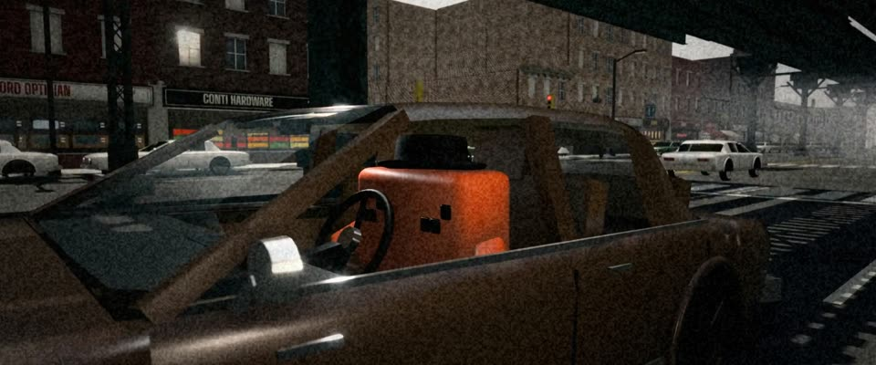

# 高架铁下追车 · 16mm 颗粒 3D · 16mm Chase Under the El

> 原文：lemo-opuscar `styleboard/opuscar98_styles.json` 第 44 条（OPUSCAR 98 纪念片里《法国贩毒网》The French Connection（1971）那一段的风格；LemoLab，MIT，commit `413a6bd`），2026-10-27 收入本仓库作参考（不在风格库里，片子不能选它当风格），未改动。
> 这是约 5 秒片段的风格，没有完整的十一节说明，所以不进风格库。用法：当视觉语言的参考——某一段画面想要这种质感时，借它的提示词写进决策单，声音、镜头、坑由模型自己补。

**渲染**：3D（3D）　**手法组合**：three.js 3D 街景 · 16mm 纪录片颗粒 · 暗部偏青的冷灰印片调色（three.js 3D street set · 16mm documentary grain · cold cyan-shadow print grade）

## 风格提示词（中文原文）

70 年代初粗粝的纪实感，放在细致的 3D 世界里，按增感冲洗的 16mm 收尾。调色：低饱和、高反差；中性冷灰 #7A7C7A、带青的暗部 #1E2A2C，砖、木头、车辆保持暖棕 #6E4A34，至少占四分之一画面，绝不整体泛蓝；唯一的主角（比如橙 #D97757）保持饱和。默认阴天，天空亮到近白，任何时段都一样；阳光穿过头顶格栅（轨道、桥、栈桥）落成硬边条纹。颗粒成团，约画面宽的 1/700，亮度 ±8%；片门晃动、闪烁、灰尘，亮处偶有淡重影。杂物多且符合地点。手持机位跟着动作走：18 到 25mm 低机位向前冲，重复物体频闪掠过；回看主体的跟拍机位；墙角广角。对标 William Friedkin《法国贩毒网》（1971）和摄影师 Owen Roizman。避免：干净的 CG 反光、整体泛蓝、空荡的方块场景、颗粒糊成一片。

## Style prompt (English original)

Gritty early-1970s documentary look in a detailed 3D world, finished as pushed 16mm. Grade: low saturation, high contrast; neutral-cold greys #7A7C7A, cyan shadows #1E2A2C, warm-brown mid-tones #6E4A34 in brick, wood, vehicles (at least a quarter of the frame), never an overall blue; the one hero (e.g. #D97757) stays saturated. Default overcast, sky near-white, at any time of day; sun through any overhead grid (track, bridge, pier) falls in hard stripes. Grain clumps about 1/700 of frame width, ±8% brightness; gate weave, flicker, dust, occasional faint ghosts of bright lights. Dense clutter fitting the place. Handheld cameras ride the action: a low 18–25 mm lens rushing forward as repeated objects strobe past, a rig looking back at the subject, a corner wide. References: William Friedkin, *The French Connection* (1971); cinematographer Owen Roizman. Avoid: clean CG shine, blue tint, empty places, mushy grain.

## 这个风格是什么（上游说明）

整条布鲁克林高架铁下的大街用 3D 建出来，再调成粗颗粒 16mm：冷灰、暗部偏青、高反差、片门抖动。这部片最有名的就是高架铁下的追车，3D 才拍得出那种速度。

A full 3D Brooklyn avenue under the elevated railway, graded like grainy 16mm: cold grey, cyan shadows, high contrast, gate weave. The film is remembered for its car chase under the el, and only a real 3D world gives that speed.

## 上游示范用法（只是一个例子，不要照搬故事和镜头）

Clawd 扮“大力水手”道尔：猪肉派帽、怒眼、双手握方向盘。追车的场景时间比屏幕时间跑得快得多，加速看起来就是车更快。三个硬切：路口甩尾 → 保险杠狂冲 → 驾驶员，中间不停。

| 机位 | 镜头 | Shot |
|---|---|---|
| wide | 路口全景：列车从头顶驶过，棕色庞蒂亚克甩尾冲上大街，后轮冒烟；镜头视角慢慢放宽。 | Wide at the corner: a train crosses overhead as the brown Pontiac skids onto the avenue with its rear tyres smoking; the lens slowly widens. |
| bumper | 片中有名的保险杠机位：超低机位带着运动模糊往前冲，高架铁的柱子一根根闪过。 | The famous bumper mount: a low lens rushing up the avenue with motion blur, the el's columns strobing past. |
| window | 中景，从车外透过摇下的车窗看 Clawd 扮的道尔：猪肉派帽、咬牙握着方向盘，身后高架铁和店面滑过，带车载抖动。 | Medium shot from outside the car through the rolled-down window: Clawd as Doyle in a pork-pie hat, grim at the wheel, the el and storefronts sliding behind, with vehicle shake. |

参考：William Friedkin, The French Connection (1971)；Owen Roizman (cinematography)；The French Connection one-sheet (1971)

