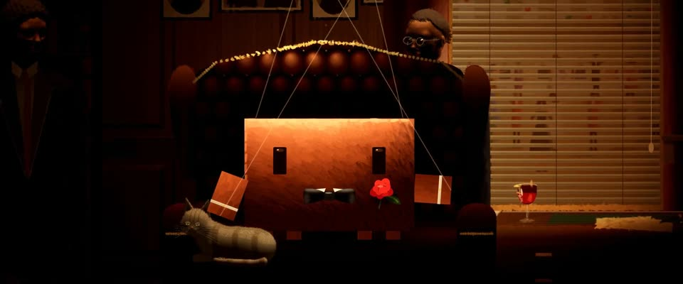

# 伦勃朗顶光明暗油画 · Rembrandt Top-Light Oil Painting

> 原文：lemo-opuscar `styleboard/opuscar98_styles.json` 第 45 条（OPUSCAR 98 纪念片里《教父》The Godfather（1972）那一段的风格；LemoLab，MIT，commit `f171360`），2026-10-31 收入本仓库作参考（不在风格库里，片子不能选它当风格），未改动。
> 这是约 5 秒片段的风格，没有完整的十一节说明，所以不进风格库。用法：当视觉语言的参考——某一段画面想要这种质感时，借它的提示词写进决策单，声音、镜头、坑由模型自己补。

**渲染**：2D（2D）　**手法组合**：明暗油画 · 戈登·威利斯的顶光 · 伦勃朗、卡拉瓦乔式罩染（Chiaroscuro oil painting · Gordon Willis's top light · Rembrandt and Caravaggio glazing）

## 风格提示词（中文原文）

伦勃朗、卡拉瓦乔式明暗油画，只有一盏顶光。约七成画面是看得出形体的暖暗部，大多是赭褐 #24150B，近黑 #070403 只在最深的角落。琥珀 #8F5D2A 中间调约两成；朝上的面亮到 #E2B673。主角整个站在光池里，受光部分至少占画面高的四分之一；眉骨把眼睛压进阴影。一处饱和的红 #9C1A1A。暗部薄而平滑地罩染，亮部是带亮笔脊的厚涂，笔触约画面宽的 1/100；过渡柔和，不用刮擦线条。琥珀光油，重暗角，细画布纹（±3%）。背景可有一处暖色亮口（窗、门洞、发亮的天边）；画内的小灯只是一小团光，不算第二个主光。镜头慢拉、慢推。对标 Francis Ford Coppola《教父》（1972），摄影师 Gordon Willis。避免：提亮暗部、平光、人脸跳出来、暗到看不清。

## Style prompt (English original)

Chiaroscuro oil painting after Rembrandt and Caravaggio, one overhead light. About 70% of the frame is readable warm dark, mostly umber #24150B, near-black #070403 only in the deepest corners. Amber #8F5D2A mid-tones about 20%; top planes reach #E2B673. The hero stands in the light pool, lit area at least 1/4 of frame height; brows shade the eyes. One red accent #9C1A1A. Darks thin smooth glazes; lights thick impasto, ridged strokes about 1/100 of frame width; modelling soft, never scratchy. Amber varnish, heavy vignette, canvas grain (±3%). A warm bright opening (window, doorway, horizon) may glow behind; a small lamp in frame is a small glow, not a second key. Camera: slow pull-backs and pushes. Reference: Francis Ford Coppola, *The Godfather* (1972), cinematographer Gordon Willis. Avoid: lifting the darks, flat light, faces popping out, frames too dark to read.

## 这个风格是什么（上游说明）

深琥珀和赭褐的油画，只有顶光落下的地方是暖的：暗部是透明的薄罩染，受光边缘是厚涂。重现戈登·威利斯在“I believe in America”那间书房里的顶光。

Oil painting in deep amber and umber where only the top light is warm: thin transparent glazes in the darks, thick impasto on the lit edges. It recreates Gordon Willis's overhead light in the 'I believe in America' study.

## 上游示范用法（只是一个例子，不要照搬故事和镜头）

Clawd 扮唐·柯里昂：黑领结、翼领、红玫瑰、白袖口，一只手压在猫背上。12 拍全按 1 倍速，保留威利斯那种耐心的镜头；抚猫一下约 4 秒，中间眨一次眼。全部硬切，最后一镜让原海报的提线手降到它头上。

| 机位 | 镜头 | Shot |
|---|---|---|
| opening | 从暗处博纳塞拉的灰发开始，镜头缓缓拉出，露出坐在翼背椅里的教父和他膝前的猫。 | From Bonasera's grey head in the dark, the camera pulls slowly back to reveal the Don in his wing chair, a cat at his knee. |
| close | 近景：顶光下的 Clawd 缓缓抚摸灰色虎斑猫，领结和红玫瑰吃到光；镜头慢推。 | Close on Clawd under the top light, slowly stroking the grey tabby, bow tie and red rose catching the light; a slow push. |
| window | 推向百叶窗：窗外阳光下的婚礼，虚而过曝，左边是黑根的剪影。 | Push toward the blinds: the wedding outside, soft and overexposed in the sun, Hagen silhouetted at left. |
| hand | 书房全景，镜头略推：提线木偶的手从画面顶上降下来，提线在 Clawd 身上慢慢绷紧。 | The whole study with a slight push: the puppeteer's hand comes down from the top of frame and its strings draw taut over Clawd. |

参考：Francis Ford Coppola, The Godfather (1972)；Gordon Willis (cinematography)；Rembrandt, The Night Watch；Caravaggio；S. Neil Fujita, The Godfather poster logo

