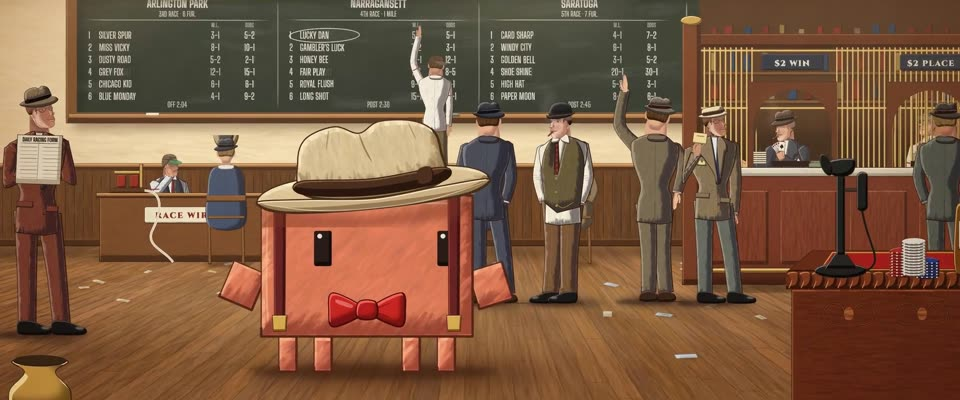

# 《星期六晚邮报》插画 · Saturday Evening Post Illustration

> 原文：lemo-opuscar `styleboard/opuscar98_styles.json` 第 46 条（OPUSCAR 98 纪念片里《骗中骗》The Sting（1973）那一段的风格；LemoLab，MIT，commit `413a6bd`），2026-10-27 收入本仓库作参考（不在风格库里，片子不能选它当风格），未改动。
> 这是约 5 秒片段的风格，没有完整的十一节说明，所以不进风格库。用法：当视觉语言的参考——某一段画面想要这种质感时，借它的提示词写进决策单，声音、镜头、坑由模型自己补。

**渲染**：2D（2D）　**手法组合**：《星期六晚邮报》封面插画 · Leyendecker 式块面塑形 · Jaroslav Gebr 的章节卡（Saturday Evening Post cover illustration · Leyendecker block modelling · Jaroslav Gebr's chapter cards）

## 风格提示词（中文原文）

30 年代《星期六晚邮报》封面插画。写实人物，比例准确、表情生动，用块面塑造（受光、背光、下方暖色反光），块面里填顺着形体、长短不一的笔触，宽约画面宽的 1/150，柔和衔接，不成条纹。深色轮廓在背光一侧加粗，画面宽的 1/800 到 1/300。暖色主光从左上来。配色：灰泥 #E2C492、橡木 #764626、石板 #28322C、黄铜 #E2B046、墨 #341E18；橡木和墨色暗部约占三分之一画面；天空灰泥偏石板，水是浅石板，皮肤灰泥加黄铜。轻颗粒画板（±3%）加暖暗角。默认一点透视，时代细节，薄雾，故事有就加次要人物。每个人物只画一遍，整体移动（呼吸、摇摆、沿路径滑行）。镜头：一次长而平滑的推进。对标 J. C. Leyendecker、Norman Rockwell。避免：僵硬剪纸人物、粗细一样的轮廓、发脏的颜色。

## Style prompt (English original)

1930s Saturday Evening Post cover illustration. Realist figures, correct proportions, expressive faces, built from blocky planes (lit, shadow, warm bounce from below) filled with blended strokes about 1/150 of frame width, varied in length, following the form, never stripes. Dark contour thicker on the shadow side, 1/800–1/300 of frame width. Warm key from upper left. Palette: plaster #E2C492, oak #764626, slate #28322C, brass #E2B046, ink #341E18; oak and ink darks about a third of the frame; sky plaster cooled with slate, water light slate, skin plaster plus brass. Grainy board (±3%), warm vignette. Default one-point perspective, period detail, haze, secondary figures if the story has any. Each figure is drawn once and moves whole (breathing, sway, sliding along a path). Camera: one long, smooth push in. References: J. C. Leyendecker, Norman Rockwell. Avoid: stiff cut-out figures, even outlines, muddy colour.

## 这个风格是什么（上游说明）

Leyendecker、Rockwell 一路的杂志插画：块面受光、平行笔触、利落的深色轮廓。片中章节卡就仿《星期六晚邮报》封面，1936 年的下注厅也照这个画。

Warm, clean magazine illustration in the Leyendecker–Rockwell line: blocky lit planes, parallel strokes, crisp dark contours. The Sting's own chapter cards imitate Saturday Evening Post covers, so its 1936 betting parlour is drawn the same way.

## 上游示范用法（只是一个例子，不要照搬故事和镜头）

Clawd 扮胡克：浅色礼帽、红领结、背带。整段不切，只有一个推镜头。推到位时它打出骗子们的暗号（手指贴鼻侧），接着压帽檐、冲镜头眨眼，像把观众拉进骗局。

| 机位 | 镜头 | Shot |
|---|---|---|
| push | 一镜到底：从下注厅全景（赔率黑板、下注窗口、窗口里的冈多夫）一路推到扮胡克的 Clawd，它把手指贴到鼻侧打暗号，再冲镜头压一下帽檐。 | One continuous push from the whole betting parlour (odds board, betting cages, Gondorff in his window) in to Clawd as Hooker, who lays a finger beside its nose, then tips its hat to the camera. |

参考：George Roy Hill, The Sting (1973)；Jaroslav Gebr (chapter cards)；Richard Amsel (poster)；J. C. Leyendecker；Norman Rockwell

