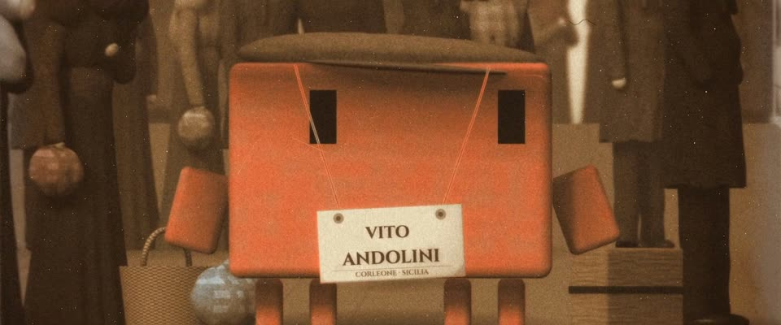

# 手工上色棕褐老照片 · Hand-Tinted Sepia Photograph

> 原文：lemo-opuscar `styleboard/opuscar98_styles.json` 第 47 条（OPUSCAR 98 纪念片里《教父2》The Godfather Part II（1974）那一段的风格；LemoLab，MIT，commit `f171360`），2026-10-31 收入本仓库作参考（不在风格库里，片子不能选它当风格），未改动。
> 这是约 5 秒片段的风格，没有完整的十一节说明，所以不进风格库。用法：当视觉语言的参考——某一段画面想要这种质感时，借它的提示词写进决策单，声音、镜头、坑由模型自己补。

**渲染**：2.5D（2.5D）　**手法组合**：调色银盐照片 · Lewis Hine 的埃利斯岛照片 · 手工刷色 · 光线步进的 3D 人物（Toned silver print · Lewis Hine's Ellis Island photographs · hand-brushed dyes · raymarched 3D figures）

## 风格提示词（中文原文）

1900 年前后手工上色的棕褐银盐照片。先做受光的立体形体，柔光从左上来，再“印”出来：柔焦带轻微光晕，颗粒在中间调最重（±5%）；棕褐调从 #281A12 经 #987048 到 #EEE0C2 完整铺开，至少五分之一画面落到最深一端，任何光线下都一样。人物比例真实（头约七分之一身高），明暗柔和。透明颜料松松地刷，溢出边缘：唯一的主角最重（比如橙红 #D97757，不透明度六到八成），一两件道具轻点；颜色进暗部就被吞掉。做旧要轻：暗角、边缘银化（靠边暗部泛灰蓝金属光）、几个小霉点、细划痕，最多一个裂角。构图正面、纪实，人物静立面对镜头。镜头缓慢横摇扫过人脸。对标 Lewis Hine、Augustus Sherman 的埃利斯岛照片。避免：积木人物、数码填色、低反差雾灰、大片霉斑。

## Style prompt (English original)

A hand-coloured toned silver print from about 1900. Build lit 3D forms, soft key from upper left, then 'print' them: soft focus, light halation, grain heaviest in mid-tones (±5%), full sepia range #281A12, #987048, #EEE0C2; at least a fifth of the frame reaches the dark end, in any light. Figures: real proportions (head 1/7 of body), soft shading. Transparent dyes brushed loosely past edges: the one hero subject strongly (e.g. orange-red #D97757 at 60–80% opacity), a faint touch on one or two props; dyes die in shadow. Light ageing: vignette, silvered edges (grey-blue sheen in border darks), small foxing spots, fine scratches, at most one cracked corner. Frontal, documentary: figures stand still facing the lens. Camera: slow pan across faces. References: Lewis Hine; Augustus Sherman (Ellis Island). Avoid: toy figures, digital fill colour, low-contrast fog, big mould blotches.

## 这个风格是什么（上游说明）

世纪之交的调色银盐照片，手工刷色：棕褐调、柔焦、银盐颗粒、霉斑、裂角，局部淡淡的红、蓝、铜绿。画的是 1901 年少年维托抵达埃利斯岛，像 Lewis Hine 的照片。

A turn-of-the-century toned silver print with dyes brushed on by hand: sepia, soft lens, silver grain, foxing, a cracked corner, faint red, blue and verdigris. It shows young Vito arriving at Ellis Island in 1901, as in Lewis Hine's photographs.

## 上游示范用法（只是一个例子，不要照搬故事和镜头）

Clawd 扮少年维托：灰色粗花呢鸭舌帽，脖子上挂着纸名牌，夹在大人中间显得很小。平均 1.3 倍速，自由女神那一镜是 1 倍。三个硬切：人群 → 雕像（主观）→ 反应；最后的表演点是低头看自己的新名字，再抬头望向新的国家。

| 机位 | 镜头 | Shot |
|---|---|---|
| crowd | 横摇扫过甲板上仰头的移民群像，画面随船身起伏。 | A horizontal sweep across the upturned faces of immigrants on deck, rising and falling with the ship's roll. |
| liberty | Clawd 的主观视角：自由女神从港口的雾里显出来，带一点铜绿色；镜头慢推。 | Clawd's point of view: the Statue of Liberty emerging from the harbour fog, tinted verdigris; a slow push. |
| close | 近景：戴粗花呢鸭舌帽的少年维托（Clawd），胸前挂着“VITO ANDOLINI”名牌；它低头看名牌，又抬头踮脚；镜头略微拉开。 | Close on Clawd as young Vito in a tweed flat cap, the 'VITO ANDOLINI' tag on its chest; it looks down at the tag and up again, rising on its toes; a slight pull back. |

参考：Francis Ford Coppola, The Godfather Part II (1974)；Gordon Willis (cinematography)；Lewis Hine, Ellis Island photographs；Augustus Sherman, Ellis Island portraits

