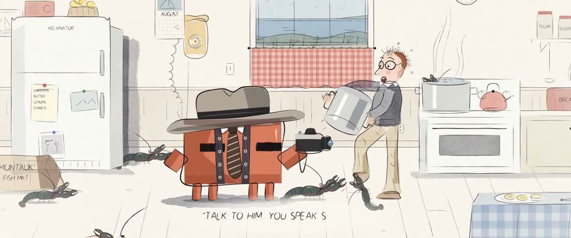

# 《纽约客》单格漫画 · 墨线淡彩 · New Yorker Cartoon, Ink and Wash

> 原文：lemo-opuscar `styleboard/opuscar98_styles.json` 第 50 条（OPUSCAR 98 纪念片里《安妮·霍尔》Annie Hall（1977）那一段的风格；LemoLab，MIT，commit `f171360`），2026-10-31 收入本仓库作参考（不在风格库里，片子不能选它当风格），未改动。
> 这是约 5 秒片段的风格，没有完整的十一节说明，所以不进风格库。用法：当视觉语言的参考——某一段画面想要这种质感时，借它的提示词写进决策单，声音、镜头、坑由模型自己补。

**渲染**：2D（2D）　**手法组合**：《纽约客》单格漫画 · 钢笔墨线 · 淡水彩 · 手写图说（New Yorker single-panel cartoon · nib-pen ink line · light watercolour wash · hand-lettered caption）

## 风格提示词（中文原文）

《纽约客》单格漫画，满版出血，不画格框。蘸水笔墨线直线处细到约画面宽的 1/1000，转弯处粗到约 1/300，收笔一甩；方盒子几笔分开画，角上交叉出头。淡水彩带积色边，铺在大部分物体上，溢出墨线不超过画面宽的 1/150：灰 #9698A0、海蓝 #78A0BE、沙色 #E2CCA0、铁锈 #C45C32，底是冷压纸 #FBF8F1，四边化成白。人物夸张、有表情、画出五官，周围有日常道具，留白但不空荡。画面下方一行手写说明，用用户的语言，字高约画面高的 1/30，逐字写出：一句冷面幽默。画面不动，活物微微颤动。镜头：轻微漂移和推近；画面可一分为二，左右并排两幅。对标 James Thurber、William Steig、桑贝。避免：浓重饱和的颜色、粗细一样的矢量线、白纸中间漂着一个小格子。

## Style prompt (English original)

New Yorker single-panel cartoon, full-bleed, no border. Nib-pen lines about 1/1000 of frame width on straights, swelling to 1/300 in turns, flicking off at the ends; box corners overlap. Pale watercolour washes with pooled edges over most objects, slipping past the lines by at most 1/150 of frame width: grey #9698A0, sea blue #78A0BE, sand #E2CCA0, rust #C45C32, on cold-press paper #FBF8F1 fading to white at the edges. Exaggerated, expressive figures with drawn faces among everyday props. One hand-lettered caption line under the action, in the user's language, about 1/30 of frame height, appearing letter by letter: a deadpan remark. The drawing holds still; living things wobble. Camera: small drifts and pushes; the frame may split into two side-by-side drawings. References: James Thurber, William Steig, Jean-Jacques Sempé. Avoid: saturated colour, uniform vector lines, a small framed panel floating in white.

## 这个风格是什么（上游说明）

《纽约客》单格漫画：灵动的钢笔墨线、几块克制的淡彩、大量白纸，画下面一行手写图说。伍迪·艾伦的喜剧和这本杂志是一个调子，龙虾那场戏正好是一格笑话漫画。

A New Yorker single-panel cartoon: lively nib-pen lines, a few restrained washes, plenty of white paper and a hand-lettered caption beneath. Woody Allen's comedy shares the magazine's voice, and the lobster scene plays as one gag panel.

## 上游示范用法（只是一个例子，不要照搬故事和镜头）

Clawd 扮安妮：黛安·基顿那顶宽檐帽、松垮的条纹领带和马甲，手里一台 35mm 相机。约 1.8 倍速，跳起来那一下接近 1 倍：两次闪光拍照，龙虾爬到脚边，吓得一跳，落地笑开。全部硬切，最后用分屏饭桌做一个图形化的出口。

| 机位 | 镜头 | Shot |
|---|---|---|
| lobster | 冰箱后缝的大特写：一只龙虾慢慢探出头；镜头缓慢漂移。 | Extreme close-up on the gap behind the fridge: a lobster slowly peeks out; a slow drift. |
| still | 厨房全景：扮安妮的 Clawd 边笑边给抱着汤锅的艾尔维拍闪光照；龙虾爬到脚边，它一跳，落地笑开，下方一笔笔写出“TALK TO HIM. YOU SPEAK SHELLFISH.”；镜头略微拉开，带一点手持晃动。 | The kitchen: Clawd as Annie laughs and snaps flash photos of Alvy clutching a stockpot; a lobster reaches its foot, it hops, lands laughing, and 'TALK TO HIM. YOU SPEAK SHELLFISH.' writes itself out below; a slight pull back with a handheld wobble. |
| split | 复活节饭桌分屏：左边安静的霍尔家，Clawd 坐在其中；右边吵闹的辛格家。 | The Easter dinner split screen: the quiet Halls on the left with Clawd seated among them, the noisy Singers on the right. |

参考：Woody Allen, Annie Hall (1977)；James Thurber；William Steig；Jean-Jacques Sempé；Annie Hall one-sheet (1977)

