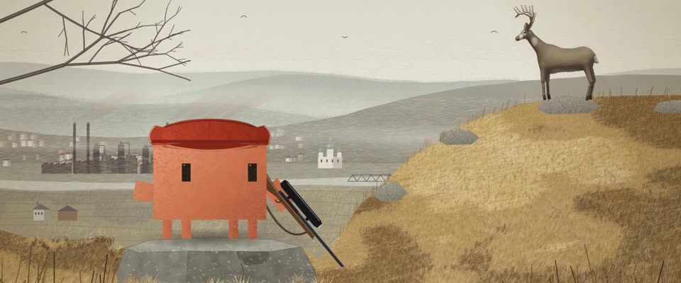

# 安德鲁·怀斯蛋彩 · Andrew Wyeth Egg Tempera

> 原文：lemo-opuscar `styleboard/opuscar98_styles.json` 第 51 条（OPUSCAR 98 纪念片里《猎鹿人》The Deer Hunter（1978）那一段的风格；LemoLab，MIT，commit `413a6bd`），2026-10-27 收入本仓库作参考（不在风格库里，片子不能选它当风格），未改动。
> 这是约 5 秒片段的风格，没有完整的十一节说明，所以不进风格库。用法：当视觉语言的参考——某一段画面想要这种质感时，借它的提示词写进决策单，声音、镜头、坑由模型自己补。

**渲染**：2D（2D）　**手法组合**：石膏底蛋彩 · 安德鲁·怀斯 · 细密交叉短笔（Egg tempera on gesso · Andrew Wyeth · fine cross-hatched strokes）

## 风格提示词（中文原文）

安德鲁·怀斯式石膏底板蛋彩画。干、哑光、极细：颜色全靠密密的交叉短笔叠出来，每笔长约画面宽的 1/400，细如发丝。低饱和配色：苍白阴天 #D9D5C6、草黄 #CDB27A、赭褐 #6A5234、灰绿远山 #8E938C、铁锈色 #8A4E32；水、石、衣服和皮肤都从这几色调出。强调色只给唯一的主角（比如一顶红帽）；画里的光源只是一个淡淡的小点，不带光晕。地面（默认枯草，其他地面同理）先铺大块深浅，再叠细笔、暗色草团，最后是被风梳过的单根草叶；岩石和房屋用短笔顺着各面排。空间空旷孤独，主体小而偏离中心。默认阴天软光，其他时段也保持苍白、不要暖光。镜头缓慢漂移、安静推近；圆形遮罩可作剪切点。避免：湿水彩晕染、饱和色、厚重发亮的笔触。

## Style prompt (English original)

Egg tempera on gesso panel after Andrew Wyeth. Dry, matte, very fine: colour built from dense cross-hatched strokes, each about 1/400 of frame width long, hairline thin. Muted palette: pale overcast sky #D9D5C6, straw grass #CDB27A, umber #6A5234, misty grey-green hills #8E938C, rust #8A4E32; water, stone, clothes and skin mixed from these. One accent colour, only on the one hero subject (e.g. a red cap); any light source is a small pale dot, no halo. Ground (dry grass by default, other ground alike): big light and dark patches, fine strokes, dark tufts, then single wind-combed blades; rocks, buildings hatched along their planes. Empty, lonely space; the subject small, off-centre. Soft overcast light; at other times of day stay pale, no warm glow. Camera: slow drift, quiet push; a circular iris may mark a cut. Avoid: wet watercolour blooms, saturated colour, thick shiny strokes.

## 这个风格是什么（上游说明）

仿安德鲁·怀斯的蛋彩：干燥细密的交叉短笔，低饱和的草黄、赭褐、灰绿，草叶一根根画出来，天空苍白。怀斯是宾州画家，“一枪”猎鹿就在宾州钢铁小镇上方的山里。

Dry, finely hatched egg tempera after Andrew Wyeth: muted straw, umber and grey-green, grass drawn blade by blade, a pale empty sky. Wyeth was a Pennsylvania painter, and the 'one shot' hunt takes place in the Pennsylvania mountains above a steel town.

## 上游示范用法（只是一个例子，不要照搬故事和镜头）

Clawd 扮麦克：红色羊毛猎帽、带瞄准镜的猎枪。河谷 → 瞄准镜 → 鹿眼 → 猎人，四个硬切，平均约 1.24 倍速，安静、稳。表演点是那一枪没开：枪放下，闭眼，呼出一口气，再抬头看那头鹿。

| 机位 | 镜头 | Shot |
|---|---|---|
| town | 河谷雾里的钢铁小镇全景：高炉、冒烟的烟囱、洋葱顶教堂；镜头缓慢横移。 | Wide on the steel town in the valley mist (blast furnaces, smoking chimneys, an onion-domed church), drifting sideways. |
| scope | 瞄准镜视角：黑色圆形遮罩和十字线里，山脊上的雄鹿；画面随猎人的手微微晃动。 | Through the rifle scope: the buck on the crest inside a black circular mask and crosshair, swaying slightly with the hunter's hands. |
| deer | 雄鹿头部和眼睛的特写；镜头慢推。 | Close-up of the buck's head and eye; a slow push. |
| still | Clawd 扮麦克站在花岗岩上，放下猎枪，闭眼呼出一口气，再抬头望向雄鹿；镜头拉开到整条山脊。 | Clawd as Michael on a granite outcrop lowers the rifle, shuts its eyes, breathes out and looks up at the buck again, as the camera pulls back to the whole ridge. |

参考：Michael Cimino, The Deer Hunter (1978)；Vilmos Zsigmond (cinematography)；Andrew Wyeth, Christina's World (1948)；Andrew Wyeth, Winter 1946

