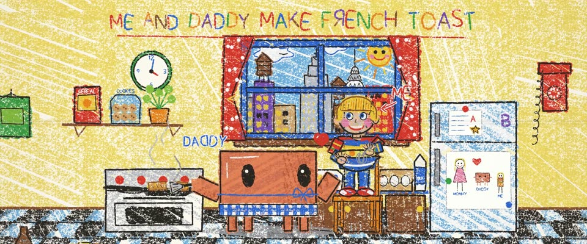

# 儿童蜡笔画 · Child's Wax-Crayon Drawing

> 原文：lemo-opuscar `styleboard/opuscar98_styles.json` 第 52 条（OPUSCAR 98 纪念片里《克莱默夫妇》Kramer vs. Kramer（1979）那一段的风格；LemoLab，MIT，commit `413a6bd`），2026-10-27 收入本仓库作参考（不在风格库里，片子不能选它当风格），未改动。
> 这是约 5 秒片段的风格，没有完整的十一节说明，所以不进风格库。用法：当视觉语言的参考——某一段画面想要这种质感时，借它的提示词写进决策单，声音、镜头、坑由模型自己补。

**渲染**：2D（2D）　**手法组合**：纹理纸上的蜡笔 · 6–8 岁儿童画的画法 · 手写标签（Wax crayon on textured paper · 6–8-year-old's drawing conventions · hand-lettered labels）

## 风格提示词（中文原文）

认真的六到八岁孩子在白纸上画的蜡笔画。蜡笔只蹭到纸纹凸起；轻涂露出四到六成纸白，用力处填满；叠色时下层透出。轮廓用黑色或深棕蜡笔，蜡质、发抖，粗约画面宽的 1/300。填色是来回涂抹，每笔长约画面宽的 1/40、宽约 1/250，一排排涂、冲出轮廓，每块各有方向，间距和角度不均匀，不能排成规整的网。基础色：红 #E0382C、橙 #F28A1E、黄 #F7D23A、绿 #3AA345、蓝 #2E6BD8。儿童画惯例：地面线、压扁的透视、带箭头的标注、笑脸太阳、写反一个字母（中文写反一个偏旁）、图案一格格涂。文字用用户的语言、发抖的蜡笔笔画写，不用字体。镜头：先晃动近景，再平稳扫过全画。避免：大人式的工整画法、没细节的乱涂、均匀点状或网状肌理、平滑渐变。

## Style prompt (English original)

A careful 6–8-year-old's wax-crayon drawing on white paper. Crayon catches the paper grain's peaks; light pressure leaves 40–60% paper showing, heavy pressure fills it; overlaps show through. Outlines in black or dark-brown crayon, waxy, wobbling, about 1/300 of frame width. Fills are back-and-forth scribbles, strokes about 1/40 of frame width long and 1/250 wide, rows overshooting the outlines, each area in its own direction, spacing and angle uneven, never a regular mesh. Primary box: red #E0382C, orange #F28A1E, yellow #F7D23A, green #3AA345, blue #2E6BD8. Child conventions: a ground line, flattened perspective, arrowed labels, a smiling sun, one mirrored letter (in Chinese, a reversed stroke), patterns coloured cell by cell. Text in the user's language, in wobbly crayon strokes, not a typeface. Camera: shaky close-ups, then a calm drift. Avoid: neat adult rendering, random scrawl, uniform stipple or mesh, smooth gradients.

## 这个风格是什么（上游说明）

孩子用蜡笔画的厨房：歪扭的线、用力涂进纸纹又涂出边界的颜色、标签和箭头、带笑脸的太阳。这是比利眼里他和爸爸做法式吐司的样子。

A kitchen drawn by a child in wax crayon: wobbly lines, colour pressed into the paper grain and over the edges, labels and arrows, a smiling sun. It is Billy's view of making French toast with his father.

## 上游示范用法（只是一个例子，不要照搬故事和镜头）

Clawd 扮泰德：系着蓝色围裙带，拿锅铲；比利站在椅子上打蛋。第一次和最后一次用同一口锅做匹配剪辑，父子关系在一次跳切里讲完。整体约 1.35 倍速；切进全景时正好接住吐司，接着小跳一下、看一眼镜头。

| 机位 | 镜头 | Shot |
|---|---|---|
| toast | 第一次做的平底锅大特写：焦吐司、黑色蜡笔烟、蛋壳；手持抖动，慢慢拉开。 | Extreme close-up of the pan the first time: burnt toast, black crayon smoke, eggshells; a shaky handheld slowly pulling back. |
| toast2 | 匹配剪辑到片尾的同一口锅，干干净净：一片金黄的吐司从锅里翻起来。 | Match cut to the same pan at the end of the film, clean now: a golden slice flips up out of it. |
| still | 标题“ME AND DADDY MAKE FRENCH TOAST”下父子并肩：Clawd 用锅铲接住吐司，比利笑开，冒出一颗红心，Clawd 得意地小跳一下；镜头往上漂到窗外的蜡笔天际线。 | Father and son side by side under the title 'ME AND DADDY MAKE FRENCH TOAST': Clawd catches the toast on its spatula, Billy beams and a heart pops up, Clawd hops with pride; the camera drifts up to the crayon skyline in the window. |

参考：Robert Benton, Kramer vs. Kramer (1979)；Néstor Almendros (cinematography)；Kramer vs. Kramer one-sheet (1979)；Children's drawings, ages 6–8

