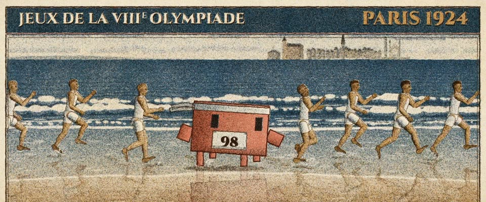

# 1924 巴黎奥运石印海报 · 1924 Paris Olympics Stone Lithograph

> 原文：lemo-opuscar `styleboard/opuscar98_styles.json` 第 54 条（OPUSCAR 98 纪念片里《烈火战车》Chariots of Fire（1981）那一段的风格；LemoLab，MIT，commit `413a6bd`），2026-10-27 收入本仓库作参考（不在风格库里，片子不能选它当风格），未改动。
> 这是约 5 秒片段的风格，没有完整的十一节说明，所以不进风格库。用法：当视觉语言的参考——某一段画面想要这种质感时，借它的提示词写进决策单，声音、镜头、坑由模型自己补。

**渲染**：2D（2D）　**手法组合**：四版石印 · Jean Droit 的 1924 奥运海报 · 古典解剖人体（Four-stone lithograph · Jean Droit's 1924 Olympic poster · classical anatomical figures）

## 风格提示词（中文原文）

20 年代石版印刷海报，四色：海蓝 #245A8C、赭黄 #D49640、深棕 #40271B、暖红 #E47E62，印在泛旧的奶油纸 #F1E7D1 上，每色错位约画面宽的 1/700。所有色调都由油墨颗粒组成，不平涂：颗粒约画面宽的 1/1000，聚成软团，浅色区覆盖两到四成，中间调五到八成，实色几乎满版、留针孔；空白纸上不能有零散孤点。分工：蓝给天空、水和冷阴影；赭黄给地面和皮肤；深棕给轮廓、暗部和衣服；红少量点缀。明暗安静偏浅。人物古典：受光侧赭黄，四肢顺一道深棕明暗交界线，头约身高八分之一；多人排成横列。动作慢，靠水花、尘土、头发、布料带出。镜头：长焦正面、贴地低机位；可加衬线字标题横带。对标 Jean Droit 的 1924 年巴黎奥运海报。避免：粗噪点、象形小人、矢量平涂。

## Style prompt (English original)

1920s stone lithograph poster in four inks: sea blue #245A8C, ochre #D49640, deep brown #40271B, warm red #E47E62, on aged cream #F1E7D1, misregistered about 1/700 of frame width. Every tone is ink grain, never a flat fill: specks about 1/1000 of frame width in soft clumps, covering 20–40% of pale areas, 50–80% of mid-tones, nearly all of solids (with pinholes); no stray specks on bare paper. Roles: blue for sky, water, cool shadow; ochre for ground and skin; brown for outlines, darks, clothes; red sparingly. Values calm and pale. Classical figures: ochre lit side, brown core-shadow line down each limb, head 1/8 of body; groups in a row. Slow motion carried by spray, dust, hair, cloth. Camera: long-lens front views, ground-level shots; optional serif title band. Reference: Jean Droit, 1924 Paris Olympics poster. Avoid: coarse speckle, pictogram figures, vector fills.

## 这个风格是什么（上游说明）

仿 Jean Droit 1924 巴黎奥运海报的四色石印：古典人体、有限油墨、成团的石版颗粒、参差套色。《烈火战车》讲的是 1924 年奥运，海滩长跑像那张海报活了过来。

A four-colour stone lithograph after Jean Droit's 1924 Paris Olympics poster: classical bodies, a few inks, clumped stone grain, ragged registration on cream paper. Chariots of Fire builds to the 1924 Games, so its beach run becomes that poster coming to life.

## 上游示范用法（只是一个例子，不要照搬故事和镜头）

Clawd 跑在队伍里：白头带、胸前别着 98 号码布。跑步按 1 倍速，看起来就是原片的慢镜头。四个硬切：面孔、脚、利德尔仰头的跑姿、侧面整队；最后一镜印上海报字框，把这场戏变成 1924 年的海报。

| 机位 | 镜头 | Shot |
|---|---|---|
| faces | 长焦正面：跑者队伍沿着浪边迎面跑来，Clawd 在其中，戴白头带、别着 98 号码布；镜头略微拉开。 | Long-lens front view: the pack comes toward camera along the surf, Clawd among them with a white headband and race number 98; a slight pull back. |
| feet | 贴地近景：赤脚踩进浅水溅起水花，湿沙上有倒影；镜头横向滑动。 | Low and tight on bare feet splashing through the shallows, reflections in the wet sand; the camera slides sideways. |
| liddell | 利德尔的近景：仰头张嘴，亚伯拉罕斯在他身后；镜头略微拉开。 | Close on Liddell, head thrown back and mouth open, Abrahams behind him; a slight pull back. |
| still | 侧面看整队跑者，Clawd 在中间；镜头拉开时，“JEUX DE LA VIIIe OLYMPIADE · PARIS 1924”的海报字框印上画面。 | Side view of the whole line with Clawd in the middle; as the camera pulls back, the 'JEUX DE LA VIIIe OLYMPIADE · PARIS 1924' poster band prints in over the frame. |

参考：Hugh Hudson, Chariots of Fire (1981)；Jean Droit, Jeux de la VIIIe Olympiade, Paris 1924 (poster)；Chariots of Fire one-sheet (1981)；Vangelis (score)

