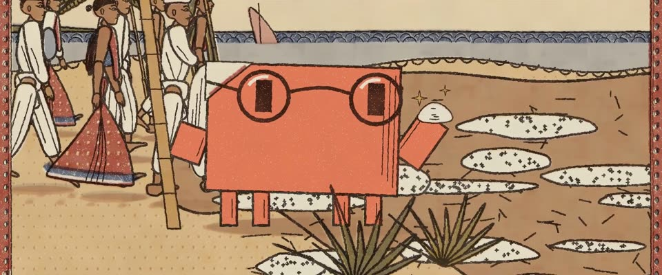

# 拉贾斯坦手工木刻印花布 · Rajasthani Hand Block Print

> 原文：lemo-opuscar `styleboard/opuscar98_styles.json` 第 55 条（OPUSCAR 98 纪念片里《甘地传》Gandhi（1982）那一段的风格；LemoLab，MIT，commit `413a6bd`），2026-10-27 收入本仓库作参考（不在风格库里，片子不能选它当风格），未改动。
> 这是约 5 秒片段的风格，没有完整的十一节说明，所以不进风格库。用法：当视觉语言的参考——某一段画面想要这种质感时，借它的提示词写进决策单，声音、镜头、坑由模型自己补。

**渲染**：2D（2D）　**手法组合**：Bagru 泥防染靛蓝 · Sanganer 木版印花边 · 拉贾斯坦细密画侧脸（Bagru dabu indigo resist · Sanganer block-printed borders · Rajasthani miniature profiles）

## 风格提示词（中文原文）

拉贾斯坦手工木刻印花布（Bagru、Sanganer）。本色棉布 #EEE5CF 是主底，占画面一半以上，也是皮肤色；靛蓝 #2A3A68 给水面或天空色带和纹样；茜草红 #AA322A 给边框、衣服和主角；姜黄 #DEA42C 给小纹样；黑色雕版 #281E1C 印轮廓。按雕版一块块盖（每块约画面高的 1/8），错位二到四像素，大色带也在版缝处轻微跳变；染料顺经纬微渗，上色不匀。泥防染冰裂纹只在靛蓝里，细而稀疏。轮廓像刻出来的，略毛糙，粗约画面宽的 1/300。平铺成横幅，外框是佩斯利和花藤；海浪是扇贝纹；人物取侧面，细密画式的脸，描黑的眼尾。镜头沿横幅横摇、推近；借转动的纹样转场。避免：矢量硬边、套色完全对齐、没有五官的人、满屏冰裂纹、靛蓝铺满画面。

## Style prompt (English original)

Hand block print on cotton, Rajasthan style (Bagru, Sanganer). Undyed cotton #EEE5CF is the ground, over half the frame, and the skin colour; indigo #2A3A68 for water or sky bands and patterns; madder red #AA322A for borders, clothing and the hero; turmeric #DEA42C for small motifs; black key block #281E1C for outlines. Stamp blocks about 1/8 of frame height, misregistered 2–4 px, tone jumping slightly at seams even in large bands; dye bleeds along the weave, fills unevenly. Mud-resist crackle only inside indigo, fine and sparse. Carved, rough outlines about 1/300 of frame width. Flat frieze in a paisley and vine border; waves as scallop rows; profile figures with miniature-painting faces, kohl-lined eyes. Camera: pan along the frieze, push in; cut on a turning motif. Avoid: vector edges, perfect registration, faceless figures, dense crackle, indigo flooding the frame.

## 这个风格是什么（上游说明）

棉布上的手工木刻印花：靛蓝、茜草红、姜黄加黑色雕版轮廓，版缝处套色错位，染料顺着经纬渗开。手纺土布是甘地的象征，所以食盐进军就印成一块布。

Hand block print on cotton in indigo, madder and turmeric with a carved black key block, misregistered at the block seams, dye bleeding along the weave. Homespun khadi was Gandhi's symbol, so the Salt March is printed as cloth.

## 上游示范用法（只是一个例子，不要照搬故事和镜头）

Clawd 扮甘地：圆框钢丝眼镜、土布披巾的边、竹杖、一把盐。全程 1.1 倍速，不做慢放。从队伍硬切到动作：弯腰、捧盐、举起，再转向队伍举得更高。最后用纺车转动的轮子做转场收尾。

| 机位 | 镜头 | Shot |
|---|---|---|
| crowd | 沿海边的队伍横摇：穿白土布的志愿者、穿靛蓝和茜草红纱丽的妇女、自治旗；Clawd 在队伍最前面入画。 | A lateral pan along the procession on the shore: volunteers in white khadi, women in indigo and madder saris, the Swaraj flag; Clawd comes into frame at the head of the line. |
| salt | 中近景，镜头慢推：戴圆框眼镜、披土布披巾的 Clawd 弯腰捧起一把盐，举起来盐粒闪光，再转向队伍举得更高。 | Medium close-up, a slow push: Clawd as Gandhi in round spectacles and a khadi shawl stoops, scoops a handful of salt, raises it glinting, then turns to the marchers and lifts it higher. |
| wheel | 村妇坐在纺车前纺线；镜头推向转动的纺车轮，接下一部。 | A village woman spinning at her charkha; the camera pushes in on the turning wheel for the cut to the next film. |

参考：Richard Attenborough, Gandhi (1982)；Gandhi one-sheet (1982)；Bagru dabu and Sanganer block prints；Rajasthani miniature painting

