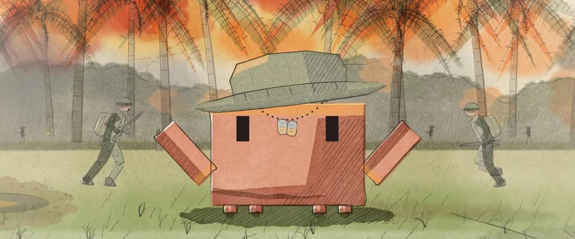

# 越战随军速写 · 钢笔淡彩 · Combat Artist Field Sketch · Pen & Wash

> 原文：lemo-opuscar `styleboard/opuscar98_styles.json` 第 59 条（OPUSCAR 98 纪念片里《野战排》Platoon（1986）那一段的风格；LemoLab，MIT，commit `f171360`），2026-10-31 收入本仓库作参考（不在风格库里，片子不能选它当风格），未改动。
> 这是约 5 秒片段的风格，没有完整的十一节说明，所以不进风格库。用法：当视觉语言的参考——某一段画面想要这种质感时，借它的提示词写进决策单，声音、镜头、坑由模型自己补。

**渲染**：2D（2D）　**手法组合**：快速钢笔线 · 透明淡彩 · 速写本纸 · 美国陆军越战战地艺术计划（Fast pen line · Transparent wash · Sketchbook paper · Vietnam Combat Artists Program）

## 风格提示词（中文原文）

现场报道式钢笔淡彩速写。钢笔用暖黑，线宽约画面宽度的 1/600，快而肯定，收笔甩出，转角冲出头；暗部用快速排线和折线，人物和地面都排线。淡彩透明而大胆：边缘湿软、有回流花、深浅不匀（不要硬边多边形），铺满画面约七成，整体错开线稿 2–4px（按 1920×1080）。颜色：橄榄绿 #70783E、土黄 #CEA054、烟灰 #706C70，加一个热烈点缀色 #F0822E 给天空和光源；肤色用淡土黄；暖米色速写本纸 #F2ECDE。只有最亮处、四边窄条和笔刷漏掉处留纸，纸纹很轻。角落用用户的语言潦草写一句铅笔速记（地点、时间、天气），字高约画面 1/40。分层便于横移；换视角硬切，像翻页。对标美国陆军越战战地艺术计划（1966–70）。避免：插画式精修；空着的纸；发脏的淡彩；重噪点。

## Style prompt (English original)

Reportage pen-and-wash field sketch. Pen: warm black, fast confident lines ~1/600 of frame width, flicked ends, overshooting corners; quick hatching and zigzags for shadow, on figures and ground. Bold transparent washes with soft wet edges, blooms and uneven pigment (not flat polygons) cover about 70% of the frame, shifted 2–4 px (at 1920×1080) off the line. Colours: olive #70783E, ochre #CEA054, smoke grey #706C70, one hot accent #F0822E for sky and light sources; skin in diluted ochre; sketchbook paper #F2ECDE. Bare paper only in highlights, a thin edge band and brush gaps; light grain. A scrawled pencil note (place, time, weather) in a corner, 1/40 of frame height, in the user's language. Layer for lateral tracks; hard cuts like turning a page. Reference: US Army Vietnam Combat Artists Program (1966–70). Avoid: polished finish; empty page; muddy washes; heavy noise.

## 这个风格是什么（上游说明）

快而有力的钢笔线，橄榄绿、土黄、烟灰和火光橙的淡彩，速写本纸四边留白。像随军画家在现场画下的，贴近这部片从步兵眼里看越战的视角。

Quick, hard pen lines with loose washes of olive, ochre, smoke grey and fire orange on sketchbook paper left bare at the edges. It reads as a war artist drawing on the spot, close to the film's infantryman's view of Vietnam.

## 上游示范用法（只是一个例子，不要照搬故事和镜头）

Clawd 扮伊莱亚斯：丛林帽、狗牌。两个硬切从地面到空中再回到地面，每个镜头像速写本里的另一页；切到最后一个镜头，双臂随即猛地张成海报姿势，直升机拉起时手臂微微垂下。场景以 1.1 倍速播放。

| 机位 | 镜头 | Shot |
|---|---|---|
| jungle | 横移跟着在象草里前进的巡逻队；戴丛林帽、挂狗牌的 Clawd 站在中间，士兵从它身边走过。 | Lateral track along a patrol pushing through elephant grass; Clawd, in a boonie hat and dog tags, stands among them as the soldiers file past. |
| heli | 硬切到从休伊直升机舱门往下看：燃烧的着陆区、被旋翼压平的草和直升机自己的影子，Clawd 小小地站在空地上；镜头缓慢拉远。 | Hard cut to the view down from the Huey's door: the burning landing zone, rotor-flattened grass and the helicopter's own shadow, Clawd tiny in the clearing; a slow pull-out. |
| still | 硬切到 Clawd 的近景，拉回海报构图：它在凝固汽油弹的橙色火光下双臂张成 V 字，两侧士兵跑过，直升机拉起离开。 | Hard cut close on Clawd, pulling back to the poster framing: arms flung up in a V under a napalm-orange sky, soldiers running past on both sides as the helicopter lifts away. |

参考：Oliver Stone, Platoon (1986)；Platoon (1986) poster；US Army Vietnam Combat Artists Program (1966–70)

