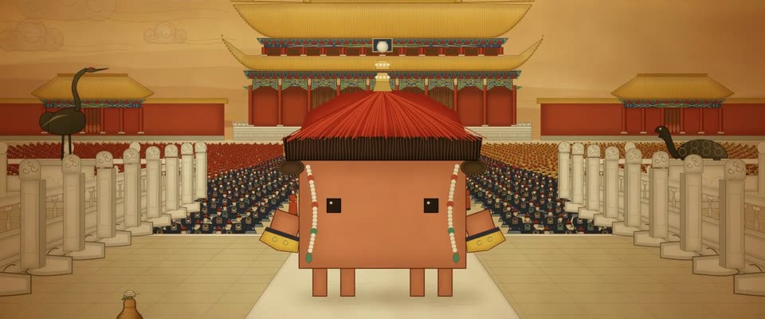

# 工笔重彩 · 绢本宫廷画 · Gongbi Court Painting on Silk

> 原文：lemo-opuscar `styleboard/opuscar98_styles.json` 第 60 条（OPUSCAR 98 纪念片里《末代皇帝》The Last Emperor（1987）那一段的风格；LemoLab，MIT，commit `f171360`），2026-10-31 收入本仓库作参考（不在风格库里，片子不能选它当风格），未改动。
> 这是约 5 秒片段的风格，没有完整的十一节说明，所以不进风格库。用法：当视觉语言的参考——某一段画面想要这种质感时，借它的提示词写进决策单，声音、镜头、坑由模型自己补。

**渲染**：2D（2D）　**手法组合**：工笔重彩 · 界画 · 清代宫廷画卷 · Storaro 的色彩（Gongbi zhongcai · Ruled-line architecture (jiehua) · Qing court scrolls · Storaro's colour）

## 风格提示词（中文原文）

绢本工笔重彩（清代宫廷画法）。由远到近画，每个形：平涂底色 → 分染（沿下缘和被遮处加深）→ 均匀铁线描（深褐，线宽约画面 1/900）→ 提金、提白；最后全画面叠三成浓度的暖赭罩染，线仍清楚。矿物色：朱砂 #C23A22、石青 #2C5A9A、石绿 #3A8A6A、藤黄 #E8B830、泥金 #CAA04A，被罩染压稳；地面和天空是中等明度的暖赭绢色，不要近白，不画饱和蓝天和橙色落日，时段变化只靠整体冷暖。不画投影和眩光。水用细线水纹。建筑用界画，瓦片一片片画出；有人群时人人不同，单人也行。绢纹淡（±3%），褐色暗角。一点透视、左右对称，大人物在前，身后深远规整。缓推。对标清代宫廷长卷，如《康熙南巡图》。避免：复制粘贴人物；不分染的平涂；写意水墨；海报式饱和色。

## Style prompt (English original)

Chinese gongbi zhongcai (fine-line, heavy-colour court painting) on aged silk. Far to near, each form: flat base, a wash darkening its lower, overlapped edges, an even iron-wire outline (dark brown, ~1/900 frame width), gold and white lifts. Last, a 30% warm ochre glaze over everything, lines still clear. Minerals: cinnabar #C23A22, azurite #2C5A9A, malachite #3A8A6A, gamboge #E8B830, gold #CAA04A, muted by the glaze; ground and sky mid-value warm silk ochre, never near-white, saturated blue or orange; time of day shows only as overall warmth. No cast shadows or glare. Fine-line water ripples. Ruled-line architecture, every tile drawn; crowds all differ; a lone figure works. Faint silk weave (±3%), brown vignette. Symmetrical one-point composition: a large figure before a deep, ordered space. Slow pushes. Reference: Qing court scrolls, e.g. *Kangxi's Southern Inspection Tour*. Avoid: copy-pasted figures; unwashed flat fills; loose ink wash; poster saturation.

## 这个风格是什么（上游说明）

绢本上的铁线描和层层渲染的石青、石绿、朱砂、泥金，界画的宫殿，几千名跪拜的百官。小皇帝的登基是清宫仪典，就用清宫画师记录仪典的画法来画。

Iron-wire outlines and graded mineral washes of azurite, malachite, cinnabar and gold on silk, with a ruled-line palace and thousands of kneeling officials. The boy emperor's coronation is a Qing court ceremony, painted the way Qing court painters recorded ceremonies.

## 上游示范用法（只是一个例子，不要照搬故事和镜头）

Clawd 扮小溥仪：红缨朝冠、朝珠、马蹄袖。帘幕分开，Clawd 踩着节拍走出来；硬切到百官叩首的波浪，最后几拍落在海报式的全景上。场景以 1.1 倍速播放。

| 机位 | 镜头 | Shot |
|---|---|---|
| curtain | 绣着团龙的黄色绸帘占满画面，帘子分开，戴红缨朝冠的 Clawd 走上丹陛；镜头微微后拉。 | The yellow dragon-roundel silk fills the frame and parts, and Clawd steps out onto the terrace in a Qing court hat with a red-fringed crown; a slight pull-back. |
| officials | 硬切到低机位横移，扫过跪着的百官，一排排穿补服的官员波浪般叩首。 | Hard cut to a low lateral track across the kneeling court, rows of officials in rank badges bowing in a wave. |
| still | 硬切到海报构图并慢慢拉宽：Clawd 大大地站在丹陛上，身后是跪满百官的广场和金色重檐，前景是蝈蝈罐。 | Hard cut to the poster composition, easing wider: Clawd large on the terrace, the square of kneeling officials and the gold double roof behind, the cricket's gourd in the foreground. |

参考：Bernardo Bertolucci, The Last Emperor (1987)；Vittorio Storaro (cinematography)；The Last Emperor (1987) poster；Kangxi Southern Inspection Tour scrolls；Qianlong's Grand Review

