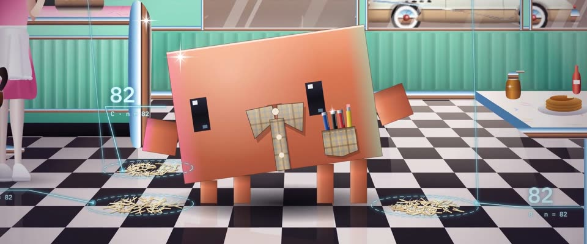

# 80 年代喷枪插画 + 雷蒙的计数 · 80s Airbrush + Raymond's Count

> 原文：lemo-opuscar `styleboard/opuscar98_styles.json` 第 61 条（OPUSCAR 98 纪念片里《雨人》Rain Man（1988）那一段的风格；LemoLab，MIT，commit `413a6bd`），2026-10-27 收入本仓库作参考（不在风格库里，片子不能选它当风格），未改动。
> 这是约 5 秒片段的风格，没有完整的十一节说明，所以不进风格库。用法：当视觉语言的参考——某一段画面想要这种质感时，借它的提示词写进决策单，声音、镜头、坑由模型自己补。

**渲染**：2D（2D）　**手法组合**：80 年代喷枪插画 · Patrick Nagel 式人物 · 空山基式镀铬 · 工程图标注（80s airbrush illustration · Patrick Nagel figures · Hajime Sorayama chrome · Technical-drawing callouts）

## 风格提示词（中文原文）

80 年代喷枪插画，叠一层工程制图标注。每个形是硬边遮罩里喷出的平滑渐变，边缘 1–2px（按 1920×1080）细飞沫。明亮高调：薄荷绿 #79BDA6 的墙或天空、奶油白，霓虹粉 #F58CB5 和品红 #C9467F 点缀，地面铺黑白棋盘格；紫色和夜色不超过两成，其他时段仍是薄荷绿奶油底，晚霞用粉色画。人物学 Patrick Nagel：苍白平整的皮肤、少而利落的线、成块深色头发，粉与薄荷绿轮廓光，但保留本人的年龄衣着。金属玻璃学空山基镀铬：天空色带、硬地平线、十字星光。最上层是细青色标注 #56E6FF、白字 #D9FBFF（字高约画面 1/40）：圆点引线、虚线圈组、尺寸线；像《雨人》的雷蒙，等宽数字数故事里要数的东西，圈一组滚一次。慢推或慢拉。避免：合成波式的条纹太阳；UI 框；发糊的边。

## Style prompt (English original)

1980s airbrush illustration with a drafting overlay. Every shape: a hard-edged mask filled with a smooth sprayed gradient, 1–2 px overspray rim (at 1920×1080). Bright, high-key: mint #79BDA6 walls or sky, cream, neon pink #F58CB5 and magenta #C9467F accents, black-and-white checker floor or ground; purple and night under 20%; at other times of day keep mint and cream; pink carries any sunset. Figures à la Patrick Nagel (flat pale skin, few crisp lines, dark hair masses, pink and mint rim light), keeping their own age and dress. Metal and glass in Hajime Sorayama chrome: banded sky reflection, hard horizon line, cross-star glints. Overlay: thin cyan callouts #56E6FF, near-white text #D9FBFF (1/40 frame height), dotted leaders, dashed rings, dimension lines; monospace numbers count whatever the story counts, Rain Man style, as each group is circled. Slow push/pull. Avoid: synthwave suns; UI boxes; soft edges.

## 这个风格是什么（上游说明）

平滑的喷枪渐变、硬边遮罩、镀铬高光和粉绿霓虹，叠一层细细的青色计数标注。80 年代画风配上雷蒙眼里的世界：82、82、82，共 246 根牙签，还有牌桌算牌。

Smooth airbrushed gradients, hard masked edges, chrome glints and pink-and-mint neon, overlaid with thin cyan callouts that count. It pairs the film's 1980s look with what Raymond sees: 82, 82, 82, 246 toothpicks, then cards counted at the table.

## 上游示范用法（只是一个例子，不要照搬故事和镜头）

Clawd 扮雷蒙：扣到顶的格子领、胸袋里插着几支笔和一支铅笔。剪辑跟着计数走：开头几拍圈出三堆牙签，246 出来时它歪头，然后硬切到拉斯维加斯，每张牌落下都跳出一个计数标记。场景以 1.1 倍速播放。

| 机位 | 镜头 | Shot |
|---|---|---|
| toothpicks | 俯拍黑白格的餐馆地面：撒了一地的牙签一堆堆被圈出来，数字滚动计数，镜头缓慢拉远，让顶上的 246 进画。 | Overhead of the checkered diner floor: the spilled toothpicks are circled pile by pile as the count rolls up, with a slow pull-back to fit the 246 across the top. |
| raymond | 硬切到 Clawd 的中近景：格子衬衫领、胸袋里一排笔，歪着头看地上标着 82 的牙签堆，头越歪越低；镜头缓慢拉远。 | Hard cut to a medium close-up of Clawd in a plaid collar with a pocket of pens, its head tilting further over the piles and their 82 callouts; a slow pull-out. |
| cards | 硬切到拉斯维加斯的 21 点牌桌，越过荷官肩膀拍：牌从牌靴里飞出，旁边跳出 Hi-Lo 标记和累计点数；Clawd 坐在 Nagel 式女人和查理之间。 | Hard cut over the dealer's shoulder at a Vegas blackjack table: cards arc out of the shoe, and Hi-Lo tags and a running count tick up beside them; Clawd sits between the Nagel woman and Charlie. |

参考：Barry Levinson, Rain Man (1988)；John Seale (cinematography)；Patrick Nagel；Hajime Sorayama

