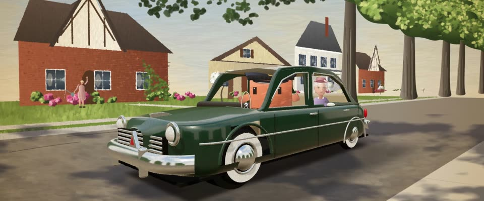

# 洛克威尔式油画插画 · Rockwell-style Oil Illustration

> 原文：lemo-opuscar `styleboard/opuscar98_styles.json` 第 62 条（OPUSCAR 98 纪念片里《为黛西小姐开车》Driving Miss Daisy（1989）那一段的风格；LemoLab，MIT，commit `f171360`），2026-10-31 收入本仓库作参考（不在风格库里，片子不能选它当风格），未改动。
> 这是约 5 秒片段的风格，没有完整的十一节说明，所以不进风格库。用法：当视觉语言的参考——某一段画面想要这种质感时，借它的提示词写进决策单，声音、镜头、坑由模型自己补。

**渲染**：2D（2D）　**手法组合**：诺曼·洛克威尔油画插画 · 《星期六晚邮报》封面 · 3D 建模的车再铺油画笔触（Norman Rockwell oil illustration · Saturday Evening Post covers · 3D-modelled car repainted in oil strokes）

## 风格提示词（中文原文）

洛克威尔式 50 年代美国杂志封面油画。人物接近写实：头约占身高 1/7，脸和手用三四块明暗面塑出、不靠描线，表情读得出。塑形平滑，笔触隐约：宽约画面 1/150，顺形体走，每笔与底色只差±5%。默认光：左上方暖色午后阳光，地上有清楚的投影和树影，阴影冷蓝灰；别的光也保持暖主光冷阴影。中等饱和：奶油天空 #E6DCC2、砖红 #9A4A38、叶绿、瓶绿 #1F3A24、柔和肤色。光面映出环境。背景有小故事：有人处路人各忙各的，主角独处就靠物件。轻画布纹、暖光油、柔和暗角。镜头：有纵深的四分之三全景缓推，越切越近，落在手或脸上。对标洛克威尔 1940–50 年代《星期六晚邮报》封面。避免：卡通脸；重纹理滤镜；无笔触的数码平涂；空背景。

## Style prompt (English original)

Norman Rockwell-style mid-century magazine-cover oil illustration. Near-realistic figures: head about 1/7 of body height, faces and hands modelled from 3–4 value planes, not outlines; readable expressions. Smooth modelling; faint strokes about 1/150 of frame width, following form, each within ±5% of the colour beneath. Default light: warm afternoon sun from the upper left, clear cast and dappled shadows in cool blue-grey; other light keeps a warm key and cool shadows. Palette: cream sky #E6DCC2, brick red #9A4A38, leaf greens, bottle green #1F3A24, soft skin. Gloss reflects surroundings. Background storytelling: busy bystanders where there are people, telling objects when the hero is alone. Light canvas texture, warm varnish, soft vignette. Camera: deep three-quarter wide, slow push, closer cuts ending on a hand or face. Reference: Rockwell's *Saturday Evening Post* covers (1940s–50s). Avoid: cartoon faces; texture filters; flat digital shading; empty backgrounds.

## 这个风格是什么（上游说明）

扎实温暖的洛克威尔写实：边缘干净、笔触可见，午后阳光穿过橡树，邻居各忙各的。这部片就是 50 年代亚特兰大一辆车里的两个人，本身就像一张《星期六晚邮报》封面。

Solid, warm Rockwell realism: clean edges, visible oil strokes, afternoon light through oaks, every neighbour busy with something. The film is two people in one car on a 1950s Atlanta street, which is a Saturday Evening Post cover already.

## 上游示范用法（只是一个例子，不要照搬故事和镜头）

Clawd 扮霍克，戴藏青色司机帽。三个硬切从车外到车里再到后视镜，一个比一个近；结果留到最后：镜子里黛西小姐的板脸在最后几拍慢慢松成微笑。场景时间平均是屏幕时间的 1.8 倍左右，车仍然开得从容。

| 机位 | 镜头 | Shot |
|---|---|---|
| still | 墨绿色 1949 年哈德逊的四分之三前侧，车沿着橡树成荫、红砖房和白门廊的街道慢慢开来；戴司机帽的 Clawd 握着方向盘，黛西小姐板着脸坐在后窗里；缓慢推进。 | Three-quarter front view of the dark-green 1949 Hudson rolling down an oak-shaded street of brick and white-porch houses; Clawd at the wheel in a chauffeur's cap, Miss Daisy stern in the back window; a slow push-in. |
| inside | 硬切到后座往前拍的定机位：前景是黛西小姐的大侧脸，后面是开车的 Clawd 的背影，街景从车窗外流过。 | Hard cut to the back seat, locked off: Miss Daisy's profile large in the foreground, Clawd driving seen from behind, the street flowing past the windows. |
| close | 硬切到后视镜特写，也就是海报构图：左边是帽檐下 Clawd 的眼睛，右边是黛西小姐，慢慢露出一点笑；镜头轻推。 | Hard cut to the rear-view mirror, the poster's framing: Clawd's eyes under the cap brim on the left, Miss Daisy on the right easing into a small smile; a slight push. |

参考：Bruce Beresford, Driving Miss Daisy (1989)；Driving Miss Daisy (1989) poster；Norman Rockwell, Saturday Evening Post covers

