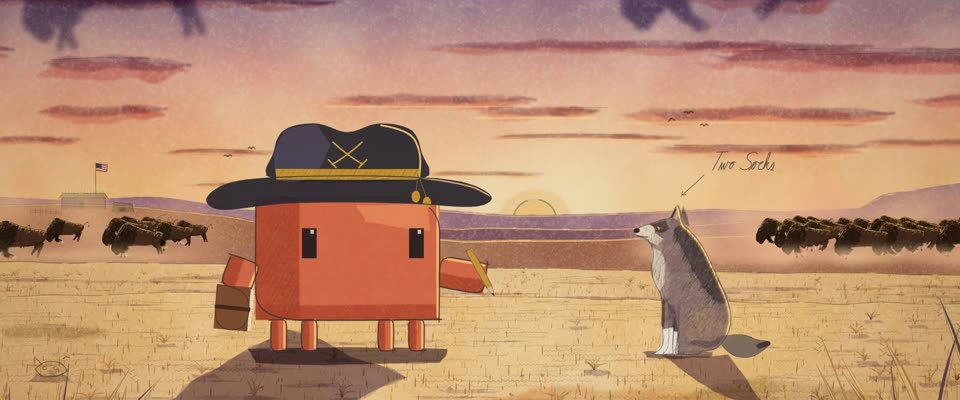

# 邓巴日记 · 铅笔 + 透明水彩 · Field Journal · Pencil & Watercolour

> 原文：lemo-opuscar `styleboard/opuscar98_styles.json` 第 63 条（OPUSCAR 98 纪念片里《与狼共舞》Dances with Wolves（1990）那一段的风格；LemoLab，MIT，commit `f171360`），2026-10-31 收入本仓库作参考（不在风格库里，片子不能选它当风格），未改动。
> 这是约 5 秒片段的风格，没有完整的十一节说明，所以不进风格库。用法：当视觉语言的参考——某一段画面想要这种质感时，借它的提示词写进决策单，声音、镜头、坑由模型自己补。

**渲染**：2D（2D）　**手法组合**：铅笔底稿 · 透明水彩 · 铁胆墨水手写 · Bodmer、Catlin 的野外水彩（Graphite under-drawing · Transparent watercolour · Iron-gall ink handwriting · Bodmer and Catlin field sketches）

## 风格提示词（中文原文）

一本活过来的 19 世纪野外日记：看得见铅笔线的满幅透明水彩。铅笔底稿 #3A363A 有轻重和断笔，暗部轻排线，透过颜色仍读得出。水彩边缘湿软，有回流花、积色深边和颗粒（不要平涂多边形），铺满约八成画面，浓郁偏暖。默认魔幻时刻：灰玫瑰色天空 #C88F76 往上转淡紫，玫瑰色条云，低太阳，赭金大地 #DEBE87，远处紫，长投影；朝太阳的边缘点几笔不透明浅金。泛黄布浆纸 #F0E4C8，淡水渍霉斑，纸色透出来。铁胆墨水 #34221C 写小字草书标注和箭头。招牌动作只在开头约两秒：先只有铅笔，镜头推进时颜色从远到近一块块铺上；之后每帧满彩。对标 Karl Bodmer、George Catlin 的野外速写。避免：灰脏或发白的淡彩；均匀数码描边；开头后仍只有铅笔。

## Style prompt (English original)

A 19th-century field journal come to life: full-colour watercolour over visible pencil. Pencil under-drawing #3A363A, pressure-varied and broken, lightly hatched in shadow, readable through the washes. Brushed washes with soft wet edges, blooms, pooled rims and granulation (not flat polygons) cover about 80% of the frame in rich warm colour. Default magic hour: dusty-rose sky #C88F76 turning lavender above, streaky rose clouds, low sun, ochre-gold land #DEBE87, violet distance, long shadows, opaque pale-gold lifts on sun-facing edges. Yellowed rag paper #F0E4C8, faint stains and foxing, showing through. Iron-gall ink #34221C for small labels and arrows. Signature move, once at the opening (about 2 s): bare pencil, then colour arrives wash by wash, far to near, during a push-in; after that, full colour. References: Bodmer and Catlin field sketches. Avoid: grey, muddy or pale washes; uniform digital outlines; later pencil-only frames.

## 这个风格是什么（上游说明）

一个军人的野外日记：轻重有变化的铅笔线、透明水彩、泛黄的布浆纸、墨水手写和页边的铅笔批注。邓巴在片中一直写画日记，所以草原是从他的速写里活过来的。

A soldier's field journal: pressure-varied pencil, transparent watercolour, yellowed rag paper, inked script and pencil notes in the margins. Dunbar writes and sketches in his diary throughout the film, so the prairie appears as his sketch coming to life.

## 上游示范用法（只是一个例子，不要照搬故事和镜头）

Clawd 扮邓巴：带金色帽绳的黑色骑兵宽檐帽，一手日记本、一手铅笔。推近页面和上色是同一个动作；切到活过来的草原落在乐句中间，抬帽致意落在最后几拍。1:1 时间。

| 机位 | 镜头 | Shot |
|---|---|---|
| page | 推近日记的右页：Clawd 的自画像和狼「双袜」一开始只是铅笔底稿，水彩一笔笔铺上来，先是天空，最后才是 Clawd。 | Push in on the journal's right page: Clawd's self-portrait and the wolf Two Socks start as bare pencil and are coloured in stroke by stroke, sky first, Clawd last. |
| prairie | 切到活成满幅彩色的日落草原：一个推镜从平原推到对望的 Clawd 和双袜，身后野牛群奔过；Clawd 抬帽致意。 | Cut to the sketch come alive in full colour at sunset: one push from the plain in to Clawd and Two Socks facing each other, the buffalo herd running behind; Clawd tips its hat. |

参考：Kevin Costner, Dances with Wolves (1990)；Dean Semler (cinematography)；Dances with Wolves (1990) poster；Karl Bodmer；George Catlin

