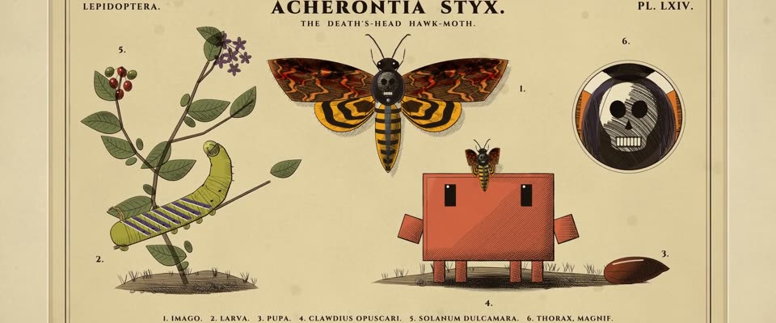

# 手工上色的博物学铜版画 · Hand-coloured Natural-history Copperplate

> 原文：lemo-opuscar `styleboard/opuscar98_styles.json` 第 64 条（OPUSCAR 98 纪念片里《沉默的羔羊》The Silence of the Lambs（1991）那一段的风格；LemoLab，MIT，commit `f171360`），2026-10-31 收入本仓库作参考（不在风格库里，片子不能选它当风格），未改动。
> 这是约 5 秒片段的风格，没有完整的十一节说明，所以不进风格库。用法：当视觉语言的参考——某一段画面想要这种质感时，借它的提示词写进决策单，声音、镜头、坑由模型自己补。

**渲染**：2D（2D）　**手法组合**：铜版雕刻排线 · 手工上色 · 维多利亚昆虫学图版 · Moses Harris《The Aurelian》（Copperplate engraving · Hand-colouring · Victorian entomology plates · Moses Harris, The Aurelian）

## 风格提示词（中文原文）

手工上色的博物学铜版画。所有物体用暖黑褐刻线画：密集平行线和交叉排线（线距约画面宽度 1/400，暗处线更粗），柔和过渡用点刻，物下有排线投影；天空留纸色或只几道稀疏横线。线内平涂水彩，中等饱和、颜色认得出：纸 #EFE3C4、赭褐 #5A3A22、铁锈红 #B4431E、黄 #E6AD24、灰紫 #7D6F8E。图版：主体作图 1 居中，约占版面高六成，四周 3–6 个编号小图（局部或相关物件），各约五分之一高；上方字距拉开的小型大写标题，下方编号图注，压印斜边版框，淡霉斑。默认均匀日光，时段变化只调着色冷暖；暗室内转冷，侧面硬光。镜头：静止图版里只有一样东西在动（虫、叶、手），再匀速慢推到关键细节。对标 Moses Harris《The Aurelian》（1766）。避免：平滑渐变；刺眼的颜色；主体缩成小晕影。

## Style prompt (English original)

A hand-coloured natural-history copperplate. Every object in engraved warm black-brown line: dense parallel and cross-hatching (spacing about 1/400 of frame width, thicker in darks), stipple for soft tones, hatched shadows beneath; sky bare or sparsely lined. Flat watercolour tints inside the line, medium saturation, clearly coloured: paper #EFE3C4, umber #5A3A22, rust #B4431E, yellow #E6AD24, grey-violet #7D6F8E. Plate: the subject as Fig. 1 in the centre, about 60% of plate height, 3–6 numbered part or object figures around it, each about 1/5 high; spaced small-caps title, numbered legend, bevelled plate mark, light foxing. Even daylight; time of day only shifts the tints' warmth; dark interiors go cold, hard side light. Camera: a still plate where one thing moves (insect, leaf, hand), then a slow push to a key detail. Reference: Moses Harris, *The Aurelian* (1766). Avoid: smooth gradients; garish colour; a tiny vignetted subject.

## 这个风格是什么（上游说明）

细密的铜版排线和点刻，上面薄薄地手工上色，图版编号和拉丁文标签印在泛黄的纸上。海报上的鬼脸天蛾本就该钉在标本图版上，同样冷峻的铜版画法一直延伸到莱克特的囚室。

Fine engraved hatching and stipple under thin hand-coloured tints, with plate numbers and Latin labels on yellowed paper. The poster's death's-head moth belongs on a specimen plate, and the same cold engraving carries on into Lecter's cell.

## 上游示范用法（只是一个例子，不要照搬故事和镜头）

Clawd 先是图版上的「图 4」，再扮别着 FBI 学员证的克拉丽丝。飞蛾在开头几拍落下；硬切到囚室，推向莱克特的镜头一气呵成、中间不切，他的笑留到最后才出来。场景时间约为屏幕时间的 1.8 倍。

| 机位 | 镜头 | Shot |
|---|---|---|
| plate | 整张昆虫学图版「Acherontia styx」：一只活的鬼脸天蛾从茄科植物上飞起，落在 Clawd 头顶；镜头轻推。 | The full entomology plate 'Acherontia styx': a live death's-head moth flies off the nightshade and settles on Clawd's head; a slight push-in. |
| cell | 硬切到地下监区：别着 FBI 学员证的 Clawd（克拉丽丝）站在玻璃前；接着一个连续的推镜向右、向里推，直到莱克特的脸占满画面，嘴角露出一丝笑。 | Hard cut to the basement: Clawd as Clarice, FBI trainee ID clipped on, stands at the glass; then one continuous push right and in until Lecter's face fills the frame and the thin smile appears. |

参考：Jonathan Demme, The Silence of the Lambs (1991)；Tak Fujimoto (cinematography)；The Silence of the Lambs (1991) poster；Moses Harris, The Aurelian

