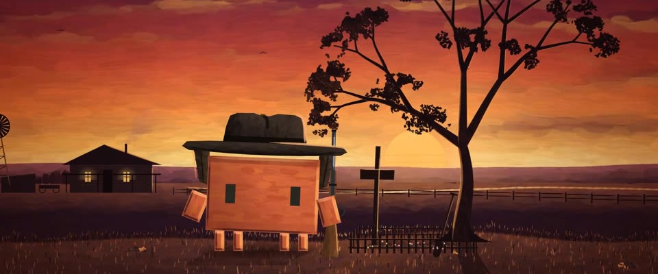

# 雷明顿西部油画 · 晚霞与雨夜 · Remington Western Oil · Sunset & Nocturne

> 原文：lemo-opuscar `styleboard/opuscar98_styles.json` 第 65 条（OPUSCAR 98 纪念片里《不可饶恕》Unforgiven（1992）那一段的风格；LemoLab，MIT，commit `413a6bd`），2026-10-27 收入本仓库作参考（不在风格库里，片子不能选它当风格），未改动。
> 这是约 5 秒片段的风格，没有完整的十一节说明，所以不进风格库。用法：当视觉语言的参考——某一段画面想要这种质感时，借它的提示词写进决策单，声音、镜头、坑由模型自己补。

**渲染**：2D（2D）　**手法组合**：雷明顿的暖色平原 · 雷明顿晚年的夜景 · 厚涂油彩 · 开场字幕的剪影（Remington's warm plains · Remington's late nocturnes · Thick oil impasto · Opening-title silhouette）

## 风格提示词（中文原文）

弗雷德里克·雷明顿式西部油画。主调是晚霞，天黑透之前都用：橙到深红的金红天空用长横笔触，太阳压在地平线上，大地和人物是暗暖剪影，向阳一侧一道细暖轮廓光。第二种调子只在天黑透后用：蓝绿夜景（天 #17333A，月光边 #9CC4BC），暖黄窗光 #FFCC6A 铺在深色地面 #1E1C16 上，加雨。先画清楚的大形，再上笔触：每笔宽约画面宽度 1/80、长为宽的三到六倍，颜料饱满、笔端松散；每笔与底色明暗只差±6%，顺着各个面走。画布纹要轻。地平线低，天空占五到六成，人物小到中等。镜头：从剪影大全景慢推到人物。对标雷明顿晚年夜景画、摄影师 Jack N. Green（《不可饶恕》，1992）。避免：平滑渐变；硬边色带；打碎形体的满屏笔触；暖场景人物发灰；大幅横摇。

## Style prompt (English original)

Frederic Remington-style Western oil painting. Primary register, for anything before full dark: sunset, a red-gold sky (orange into deep red) in long horizontal strokes, the sun on the horizon, land and figures dark warm silhouettes, thin warm rim sunward. Second register, only after dark: a blue-green nocturne (sky #17333A, moonlit edges #9CC4BC, warm window light #FFCC6A on dark ground #1E1C16, rain). Broad, readable shapes first, then loaded strokes about 1/80 of frame width wide, 3–6 times as long, soft broken ends, each within ±6% brightness of the colour beneath, following the surface. Light canvas texture. Low horizon, sky 50–60% of the frame, figures small to medium. Camera: one slow push from a silhouetted wide to the figure. References: Remington's late nocturnes; cinematographer Jack N. Green (*Unforgiven*, 1992). Avoid: smooth gradients; hard-edged flat bands; shattered shapes; grey figures in warm scenes; wide pans.

## 这个风格是什么（上游说明）

两种调子的厚涂西部油画：雷明顿金红晚霞下的平原，和他晚年被暖黄窗光点亮的蓝绿夜景。《不可饶恕》以夕阳下坟前的剪影开场和收尾，决战发生在雨夜的小镇。

Thick Western oil painting in two keys: Remington's red-gold plains at sunset and his blue-green nocturnes lit by warm windows. Unforgiven opens and closes on a silhouette at a grave against the sunset, and its showdown comes in a town on a rainy night.

## 上游示范用法（只是一个例子，不要照搬故事和镜头）

Clawd 扮威廉·芒尼：黑色宽檐帽、长雨衣立领、一支步枪。开场剪影到坟前是一个镜头，推到位时它正好抬头；唯一的一刀硬切到雨夜，Clawd 骑马进镇。1:1 时间，不放慢。

| 机位 | 镜头 | Shot |
|---|---|---|
| grave | 一个推镜从整片晚霞（木屋、风车、孤树、挡在太阳前的十字架）推到坟边的 Clawd（芒尼）；它抬起头，把步枪横到身前。 | One push from the whole sunset (farmhouse, windmill, lone tree, the cross in front of the sun) in to Clawd as Munny at the grave; it lifts its head and brings the rifle up across its body. |
| town | 硬切到雨夜的大威士忌镇：Clawd 骑一匹兔褐马走过泥街，旁边是亮着窗的 Greeley's 酒馆，镜头推向它滴水的帽檐。 | Hard cut to Big Whiskey on a rainy night: Clawd rides a dun horse down the muddy street past the lit windows of Greeley's saloon, the camera pushing toward its dripping hat brim. |

参考：Clint Eastwood, Unforgiven (1992)；Jack N. Green (cinematography)；Unforgiven (1992) poster (Bill Gold)；Frederic Remington, nocturnes

